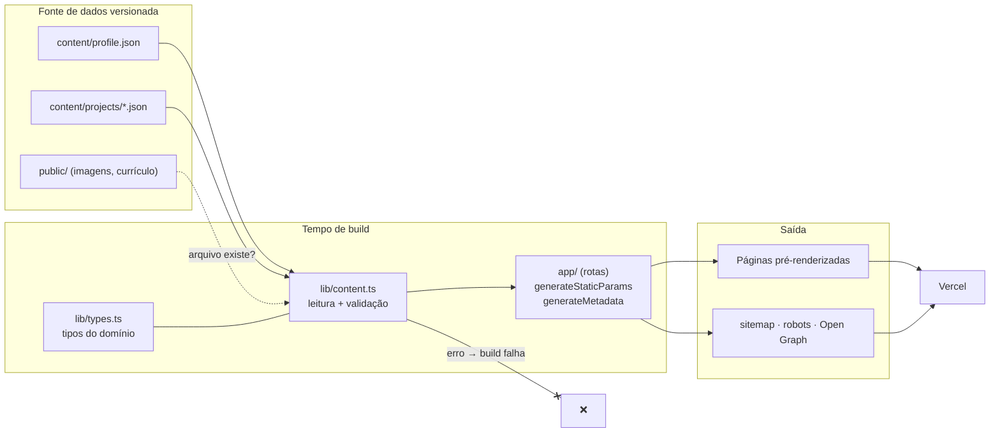
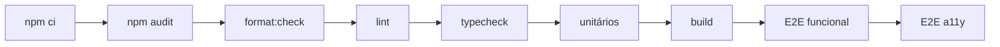

<div align="center">

# Portfólio · Jefferson Nunes

**Plataforma de portfólio pública em que cada afirmação aponta para uma evidência verificável.**

Conteúdo validado em tempo de build, testes automatizados, acessibilidade WCAG 2.1 AA e
integração contínua — do requisito ao deploy.

[](https://github.com/jeffnunespy/portfolio-web/actions/workflows/ci.yml)


[](LICENSE)

[**🌐 Ver o site publicado**](https://portfolio-web-three-zeta.vercel.app) ·
[Especificação](specs/001-experiencia-publica-inicial/spec.md) ·
[Constituição](.specify/memory/constitution.md) ·
[Como contribuir](CONTRIBUTING.md) ·
[Segurança](.github/SECURITY.md)

</div>

---

## Sumário

- [Sobre o projeto](#sobre-o-projeto)
- [Destaques](#destaques)
- [Stack](#stack)
- [Arquitetura](#arquitetura)
- [Rotas](#rotas)
- [Conteúdo como fonte de dados](#conteúdo-como-fonte-de-dados)
- [Estrutura do repositório](#estrutura-do-repositório)
- [Requisitos](#requisitos)
- [Setup](#setup)
- [Scripts](#scripts)
- [Verificações](#verificações)
- [Testes E2E](#testes-e2e)
- [Reprodução isolada](#reprodução-isolada)
- [Build e segurança HTTP](#build-e-segurança-http)
- [Deploy](#deploy)
- [Processo de desenvolvimento](#processo-de-desenvolvimento)
- [Documentação](#documentação)
- [Contribuição, conduta e segurança](#contribuição-conduta-e-segurança)
- [Licença](#licença)

---

## Sobre o projeto

Este repositório contém a **experiência pública inicial** do portfólio: um site pré-renderizado
com Next.js 16 (App Router), React 19 e TypeScript, sem backend, sem banco de dados e sem
autenticação nesta fase.

O próprio site é o primeiro estudo de caso. A plataforma foi construída para demonstrar um
método de trabalho — especificação, tarefas rastreáveis, testes, acessibilidade e CI — e para
separar com clareza **o que já está implementado** do que ainda é **escopo planejado**.

> [!NOTE]
> O princípio que orienta o projeto é **evidências acima de afirmações**: toda competência
> declarada no perfil precisa ser demonstrada por pelo menos um projeto, e o build falha quando
> isso não acontece.

## Destaques

| Área                  | O que o projeto faz                                                                                                           |
| --------------------- | ----------------------------------------------------------------------------------------------------------------------------- |
| 🧾 **Conteúdo**       | JSON versionado em `content/`, lido e validado em tempo de build por `lib/content.ts`. Conteúdo inválido quebra o build.      |
| ♿ **Acessibilidade** | Testes com `@axe-core/playwright` contra WCAG 2.1 A/AA, incluindo modo de cores forçadas.                                     |
| 🧪 **Qualidade**      | Vitest + Testing Library para unidade, Playwright (Chromium) para navegação, metadados, responsividade e desempenho de carga. |
| 🔍 **SEO**            | `generateMetadata` por rota, Open Graph gerado, `sitemap.xml` e `robots.txt` a partir da URL pública configurada.             |
| 🎨 **Design**         | Sistema visual "Minimalismo escuro" em CSS puro, sem framework, documentado em [`DESIGN.md`](DESIGN.md).                      |
| 🔁 **CI/CD**          | GitHub Actions com auditoria npm, formatação, lint, tipos, testes, build e E2E; Dependabot semanal; deploy na Vercel.         |
| 🔒 **Segurança**      | Headers HTTP e CSP em `next.config.js`, scripts de instalação controlados por `allowScripts`, actions fixadas por SHA.        |
| 🕶️ **Privacidade**    | Sem coleta de dados de navegação, sem área administrativa e sem dependência externa em runtime.                               |

## Stack

| Camada           | Tecnologia                                                               |
| ---------------- | ------------------------------------------------------------------------ |
| Runtime          | Node.js `^24.22.1` (fixado em `24.22.2`, via `.nvmrc`) e npm `>=11.16.0` |
| Framework        | Next.js 16 (App Router, build com Turbopack) + React 19                  |
| Linguagem        | TypeScript 5 (`strict`)                                                  |
| Estilos          | CSS puro em `app/globals.css`; fonte Geologica via `next/font/google`    |
| Testes unitários | Vitest 4 + Testing Library + jsdom                                       |
| Testes E2E       | Playwright (Chromium) + `@axe-core/playwright`                           |
| Qualidade        | ESLint 10 (flat config, `next/core-web-vitals` + TypeScript) + Prettier  |
| Automação        | GitHub Actions + Dependabot                                              |
| Hospedagem       | Vercel                                                                   |

## Arquitetura



`lib/content.ts` é o **único ponto de acesso ao conteúdo**. As rotas nunca leem arquivos
diretamente; recebem dados já validados e tipados.

## Rotas

| Rota               | Descrição                                                                  |
| ------------------ | -------------------------------------------------------------------------- |
| `/`                | Home: posicionamento, projetos em destaque e evidências do build           |
| `/projetos`        | Lista dos projetos implementados                                           |
| `/projetos/[slug]` | Estudo de caso, com decisões relevantes, competências e links de evidência |
| `/roadmap`         | Escopo planejado, mantido separado do que já foi entregue                  |
| `/sobre`           | Biografia, formação, trajetória e competências por área                    |
| `/curriculo`       | Currículo navegável, com download do PDF                                   |

Também são gerados `sitemap.xml`, `robots.txt`, ícone, imagens Open Graph por rota e páginas
de erro e 404.

## Conteúdo como fonte de dados

Não há CMS nem API. Todo o conteúdo vive em JSON versionado:

```text
content/
├── profile.json          # PerfilProfissional: posicionamento, competências, formação, contato
└── projects/
    └── <slug>.json       # Projeto: um estudo de caso por arquivo
```

### Validação que quebra o build (intencional)

`lib/content.ts` valida ao ler e **lança erro em vez de degradar**:

- [x] Campos obrigatórios de `Projeto` e `PerfilProfissional` presentes e não vazios.
- [x] Enums fechados para `status`, `natureza` e `categoria`.
- [x] `slug` em kebab-case e sem duplicatas.
- [x] `linkDemonstracao` e `linkRepositorio` como URLs HTTPS válidas (`linkRepositorio` aceita
      `"privado"`); `linkGithub` e `linkLinkedin` HTTPS; `contato.valor` com formato de e-mail.
- [x] `imagemApresentacao` e `linkCurriculo` como caminhos absolutos que existem em `public/`.
- [x] `decisoesRelevantes` com pelo menos 2 itens, cada um com `titulo` e `descricao`.
- [x] No máximo 6 projetos reais em destaque e ao menos um projeto publicado.
- [x] **Toda competência do perfil demonstrada em `competenciasDemonstradas` de algum projeto.**

> [!IMPORTANT]
> Adicionar uma competência ao perfil sem um projeto que a comprove faz `npm run build` falhar.
> Não contorne removendo a validação: ajuste o conteúdo. Ao alterar o schema, atualize
> `lib/types.ts`, as listas `REQUIRED_*` em `lib/content.ts`, todos os JSONs e
> `tests/unit/content.test.ts` juntos.

Para criar ou editar um projeto, siga o fluxo da skill local
[`novo-projeto-conteudo`](.claude/skills/) e a [especificação do modelo de dados](specs/001-experiencia-publica-inicial/data-model.md).

## Estrutura do repositório

```text
.
├── app/                    # Rotas do App Router, metadados, sitemap, robots, OG e estilos globais
├── components/
│   ├── layout/             # Header, Footer, evidências do build, histórico de fragmentos
│   └── project/            # Card, imagem, status, links de evidência, rodapé do registro
├── content/                # Conteúdo versionado (perfil e projetos)
├── lib/                    # content.ts (validação), types.ts, site.ts, labels.ts, og-image.tsx
├── public/                 # Imagens dos projetos e currículo em PDF
├── tests/
│   ├── unit/               # Vitest + Testing Library
│   └── e2e/                # Playwright; *.a11y.spec.ts usam axe-core
├── specs/                  # Especificação, plano, tarefas e contratos (spec-kit)
├── docs/                   # Contexto ativo, plano, checklist de publicação e auditorias
├── .github/                # CI, Dependabot, modelo de PR, segurança e código de conduta
├── CONTRIBUTING.md         # Fluxo de contribuição
├── DESIGN.md               # Sistema visual "Minimalismo escuro"
└── PRODUCT.md              # Visão de produto
```

## Requisitos

- **Node.js `^24.22.1`** (`engines.node`), piso de segurança do AUD02-E5-001. A versão fixada
  em `.nvmrc` é 24.22.2 e também é lida pelo CI; versões anteriores ao piso e Node 26 são
  recusadas por `engine-strict`.
- **npm `>=11.16.0`**; o Node 24.22.2 inclui npm 11.19.1. `.npmrc` liga `engine-strict`, então
  `npm ci` falha em Node/npm fora dos requisitos em vez de só avisar.
- **Rede no primeiro build** para `fonts.googleapis.com` e `fonts.gstatic.com`: `next/font/google`
  baixa a Geologica em tempo de build e a serve pelo próprio site. Um build sem rede e sem
  `.next/cache` falha; com o cache aquecido, o build funciona offline. Em runtime não há
  dependência externa.
- **Para E2E**: o Chromium da versão do `@playwright/test` instalada e, no Linux, as bibliotecas
  de sistema dele.

## Setup

```bash
nvm use                         # ou outra forma de usar a versão de .nvmrc
npm ci                          # instalação reproduzível pelo lockfile; não use npm install
npx playwright install chromium # navegador dos E2E
npm run dev                     # http://localhost:3000
```

> [!TIP]
> No Linux, se o Chromium não abrir por falta de bibliotecas,
> `npx playwright install-deps chromium` instala as dependências do sistema (pede privilégio de
> administrador). O CI usa `npx playwright install --with-deps chromium`, que faz as duas coisas.

## Scripts

| Comando                       | O que faz                                         |
| ----------------------------- | ------------------------------------------------- |
| `npm run dev`                 | Servidor de desenvolvimento na porta 3000         |
| `npm run build`               | Build de produção; valida todo o conteúdo         |
| `npm run start`               | Serve o build gerado                              |
| `npm run lint`                | ESLint em todo o projeto                          |
| `npm run typecheck`           | `tsc --noEmit`                                    |
| `npm run format:check`        | `prettier --check .`                              |
| `npm test -- --run`           | Vitest em execução única                          |
| `npm run test:e2e`            | Playwright completo (build + start na porta 3001) |
| `npm run test:e2e:functional` | E2E exceto os marcados `@a11y`                    |
| `npm run test:e2e:a11y`       | Somente os testes de acessibilidade (`@a11y`)     |

Para rodar um único arquivo ou teste:

```bash
npm test -- --run tests/unit/content.test.ts
npm test -- --run -t "nome do teste"
npm run test:e2e -- tests/e2e/home.spec.ts
npm run test:e2e -- -g "texto do teste"
```

> `next lint` não existe mais no Next.js 16. Para lintar arquivos específicos, use
> `npx eslint <arquivos>`.

## Verificações

O workflow [`.github/workflows/ci.yml`](.github/workflows/ci.yml) roda o job `quality` em
`ubuntu-24.04`, com o Node de `.nvmrc`, actions fixadas por SHA e permissão só de leitura:

- em todo **pull request** — é o check exigido pela proteção da `master`;
- em **push na `master`**, para revalidar o resultado combinado depois do merge;
- **manualmente** (`workflow_dispatch`), para uma branch sem PR.

Etapas:



Rode a mesma sequência localmente antes de considerar uma tarefa concluída:

```bash
export NEXT_PUBLIC_SITE_URL=https://portfolio.example # origem reservada apenas para testes
npm audit --omit=dev --audit-level=high
npm run format:check   # prettier
npm run lint           # eslint
npm run typecheck      # tsc --noEmit (não depende de tipos gerados em .next/)
npm test -- --run      # Vitest; falha se nenhum arquivo de teste for encontrado
npm run build
npm run test:e2e:functional
npm run test:e2e:a11y
```

Os relatórios do Playwright são publicados como artefatos `e2e-funcional` e `e2e-a11y`
(retenção de 14 dias), inclusive quando há falha.

<details>
<summary><strong>ESLint 10 — exceção de peer dependency</strong></summary>

<br>

`eslint-plugin-react@7.37.5`, `eslint-plugin-jsx-a11y@6.10.2` e `eslint-plugin-import@2.32.0`,
puxados por `eslint-config-next`, ainda declaram `eslint` só até a versão 9, e não há versão
publicada que inclua a 10. `npm ci` emite avisos de peer e `npm ls eslint` marca `invalid`; a
instalação e o lint funcionam. O `fixupConfigRules` de `@eslint/compat` em `eslint.config.mjs`
adapta as regras, e `tests/unit/eslint-plugins.test.ts` garante que regras dos três plugins
continuam reportando. Remover a exceção quando os plugins declararem ESLint 10.

</details>

### Scripts de instalação

`allowScripts` em `package.json` lista quais dependências podem executar scripts de instalação,
e `strict-allow-scripts=true` em `.npmrc` faz o `npm ci` falhar (`ESTRICTALLOWSCRIPTS`) quando
surge um script fora da lista. Decisões atuais:

- `unrs-resolver` (`postinstall`) está negado. O binding nativo já chega como dependência
  opcional pelo lockfile; o script só tentaria baixá-lo de novo, sem verificar integridade.
  Lint, testes e build passam sem ele.
- `fsevents` (`install`, só macOS) está liberado nas versões 2.3.2 e 2.3.3, como antes.

Se uma atualização trouxer um script novo, revise o pacote e registre a decisão com
`npm approve-scripts <pacote>` ou `npm deny-scripts <pacote>`; não use
`--dangerously-allow-all-scripts` nem remova a opção estrita.

**npm 11.16.0 ou superior é obrigatório.** As versões 11.15 e anteriores não conhecem
`allowScripts`: avisam apenas `Unknown project config "strict-allow-scripts"` e executam todos os
scripts, inclusive os negados, com instalação bem-sucedida. Por isso `engines.npm` é
`>=11.16.0` e, com `engine-strict=true`, um npm antigo recusa `npm ci`, `npm install` e
`--package-lock-only` com `EBADENGINE` antes de criar `node_modules`. Atualizar somente o npm
não torna um Node anterior a 24.22.1 suportado: use a versão de `.nvmrc` (24.22.2, com npm
11.19.1). Confira `node -v` e `npm -v` antes da instalação.

Limitações: `--engine-strict=false` na linha de comando desliga a recusa, e `npm rebuild` com npm
antigo sobre um `node_modules` existente executa os scripts negados sem checar `engines`.

## Testes E2E

```bash
npm run test:e2e               # Playwright completo
npm run test:e2e:functional    # E2E exceto os marcados @a11y
npm run test:e2e:a11y          # somente acessibilidade (axe-core)
```

| Variável                    | Efeito                                                                                    |
| --------------------------- | ----------------------------------------------------------------------------------------- |
| _(nenhuma)_                 | Faz `npm run build` e sobe `next start` na porta 3001. Porta ocupada → a execução falha.  |
| `E2E_BUILD_EXISTENTE=1`     | Serve o `.next/` já gerado sem recompilar. Use logo após `npm run build` (como o CI).     |
| `E2E_REUTILIZAR_SERVIDOR=1` | Reaproveita um servidor aberto na 3001. Só para iteração local; **não vale como aceite**. |

- Os testes nunca rodam contra um servidor de versão desconhecida: se a porta 3001 estiver
  ocupada e a reutilização não for pedida, a execução falha.
- Os metadados são validados contra a origem `https://portfolio.example`, definida em
  `NEXT_PUBLIC_SITE_URL` pelo `playwright.config.ts` quando a variável não vem do ambiente. O
  build servido precisa ter usado a mesma origem; um build com outra origem reprova os testes de
  canonical, Open Graph, sitemap e robots.
- Relatórios ficam separados por suíte: `playwright-report/{funcional,a11y,completo}/` e
  `test-results/{funcional,a11y,completo}/` (traces, contexto de erro).

## Reprodução isolada

Para validar um snapshot fora da árvore de trabalho, sem caches nem servidores locais:

```bash
git clone https://github.com/jeffnunespy/portfolio-web.git /tmp/portfolio-validacao
cd /tmp/portfolio-validacao
nvm use
npm ci
npx playwright install chromium
NEXT_PUBLIC_SITE_URL=https://portfolio.example npm run build
E2E_BUILD_EXISTENTE=1 npm run test:e2e:functional
E2E_BUILD_EXISTENTE=1 npm run test:e2e:a11y
```

Antes, rode os demais gates da seção [Verificações](#verificações). Confirme que nada
escuta na porta 3001.

## Build e segurança HTTP

```bash
NEXT_PUBLIC_SITE_URL=http://localhost:3000 npm run build # produção local via HTTP
npm run start
```

Em produção hospedada, `NEXT_PUBLIC_SITE_URL` é obrigatória e deve conter a origem HTTPS
confirmada, sem credenciais, caminho, query ou fragmento. O build falha se a configuração for
inválida ou estiver ausente; não usa localhost nem `VERCEL_URL` como domínio de produção.
Desenvolvimento/teste sem configuração usa `http://localhost:3000`. Um preview declarado por
`VERCEL_ENV=preview` pode usar `VERCEL_URL` válida em `*.vercel.app` quando a origem explícita
estiver ausente. HTTP explícito é permitido somente em loopback para testes locais; deployments
Vercel de produção/preview recusam loopback. URLs de exemplo acima não são domínio de produção.

Os headers e a CSP são configurados em `next.config.js`, sem Proxy e preservando SSG. A CSP
é aplicada em `next build/start`, inclusive previews; em `next dev` ela é omitida para o HMR.
Decisões, exceções e verificações: [Auditoria 02 — Etapa 4](docs/audits/auditoria-02-etapa4-next-http.md).

## Deploy

O site é publicado na **Vercel** a partir da branch `master`:

- **Produção:** https://portfolio-web-three-zeta.vercel.app
- **Configuração:** Framework Preset Next.js, raiz `./`, saída padrão (não usar `public` nem
  `out`), Node 24.x e instalação com `npm ci`.
- **URL pública:** `NEXT_PUBLIC_SITE_URL` define a origem de canonical, Open Graph, sitemap e
  robots, e é obrigatória em produção (ver [Build e segurança HTTP](#build-e-segurança-http)).
- **Preview:** `npx vercel deploy --environment=preview`. Confirme o ambiente no painel ou com
  `vercel inspect` antes de tratar o deploy como preview.

> [!WARNING]
> `.env.local` e `.vercel/` são ignorados pelo Git e podem conter credenciais (como
> `VERCEL_OIDC_TOKEN`). Nunca os versione nem os compartilhe.

O roteiro completo de publicação e as inspeções pendentes estão em
[`docs/CHECKLIST_PUBLICACAO.md`](docs/CHECKLIST_PUBLICACAO.md).

## Processo de desenvolvimento

O repositório é **dirigido por especificação** ([spec-kit](https://github.com/github/spec-kit)).
A ordem de precedência é:

```text
.specify/memory/constitution.md  >  specs/<feature>/{spec,plan,tasks}.md  >  sugestões do agente
```

A [constituição](.specify/memory/constitution.md) define dez princípios:

| #    | Princípio                                  |
| ---- | ------------------------------------------ |
| I    | Evidências acima de afirmações             |
| II   | Entregas verticais e incrementais          |
| III  | Simplicidade proporcional                  |
| IV   | Backend como área de profundidade          |
| V    | Qualidade verificável                      |
| VI   | Segurança e privacidade desde o início     |
| VII  | Acessibilidade e experiência consistente   |
| VIII | Documentação como parte da entrega         |
| IX   | Operação responsável                       |
| X    | Uso responsável de inteligência artificial |

Na prática:

1. Toda mudança parte de uma tarefa em
   [`specs/001-experiencia-publica-inicial/tasks.md`](specs/001-experiencia-publica-inicial/tasks.md),
   marcada como concluída só depois de validada.
2. Requisitos aprovados não mudam durante a implementação; divergências são registradas antes.
3. Testes não são removidos nem afrouxados para fazer a implementação passar.
4. Métricas, resultados e evidências de projetos nunca são inventados.
5. [`docs/ACTIVE_CONTEXT.md`](docs/ACTIVE_CONTEXT.md) acompanha o estado da feature.

## Documentação

| Documento                                                                                                | Conteúdo                                               |
| -------------------------------------------------------------------------------------------------------- | ------------------------------------------------------ |
| [`CONTRIBUTING.md`](CONTRIBUTING.md)                                                                     | Fluxo de pull request e regras de proteção da `master` |
| [`.github/SECURITY.md`](.github/SECURITY.md)                                                             | Como relatar vulnerabilidades                          |
| [`docs/audits/PROCESSO.md`](docs/audits/PROCESSO.md)                                                     | Níveis de risco, gates e autorização de merge          |
| [`docs/audits/STATUS.md`](docs/audits/STATUS.md)                                                         | Estado das auditorias e pendências abertas             |
| [`docs/audits/auditoria-02-etapa4-next-http.md`](docs/audits/auditoria-02-etapa4-next-http.md)           | Headers HTTP e CSP: decisões, exceções e verificações  |
| [`docs/audits/auditoria-02-followup-node-runtime.md`](docs/audits/auditoria-02-followup-node-runtime.md) | Correção do runtime Node.js e validação local          |
| [`docs/PROJECT.md`](docs/PROJECT.md)                                                                     | Visão geral do projeto                                 |
| [`docs/DEVELOPMENT_PLAN.md`](docs/DEVELOPMENT_PLAN.md)                                                   | Plano de desenvolvimento                               |
| [`docs/ACTIVE_CONTEXT.md`](docs/ACTIVE_CONTEXT.md)                                                       | Contexto ativo da implementação                        |
| [`docs/CHECKLIST_PUBLICACAO.md`](docs/CHECKLIST_PUBLICACAO.md)                                           | Roteiro e evidências de publicação                     |
| [`docs/PLANO_AVALIACAO_SEGURANCA.md`](docs/PLANO_AVALIACAO_SEGURANCA.md)                                 | Adoção futura de ZAP, WSTG e Nuclei                    |
| [`docs/audits/`](docs/audits/)                                                                           | Auditorias de reprodutibilidade, design e dependências |
| [`DESIGN.md`](DESIGN.md)                                                                                 | Sistema visual "Minimalismo escuro"                    |
| [`PRODUCT.md`](PRODUCT.md)                                                                               | Visão de produto                                       |
| [`specs/001-experiencia-publica-inicial/`](specs/001-experiencia-publica-inicial/)                       | Especificação, plano, tarefas, contratos e checklists  |

## Contribuição, conduta e segurança

- 🤝 [**Como contribuir**](CONTRIBUTING.md) — fluxo de pull request, proteção da `master` e padrões do
  projeto.
- 📜 [**Código de conduta**](.github/CODE_OF_CONDUCT.md) — expectativas de convivência no projeto.
- 🔒 [**Política de segurança**](.github/SECURITY.md) — como relatar vulnerabilidades com
  responsabilidade.

## Licença

O **código-fonte** está sob a [licença MIT](LICENSE). O **conteúdo pessoal** — `content/`,
`public/curriculo.pdf` e `public/images/` — não está coberto por ela: permanece com todos os
direitos reservados e não pode ser reutilizado sem autorização.

---

<div align="center">

Feito por **Jefferson Nunes** ·
[GitHub](https://github.com/jeffnunespy) ·
[LinkedIn](https://www.linkedin.com/in/jefferson-nunes-7bb309122/)

</div>
