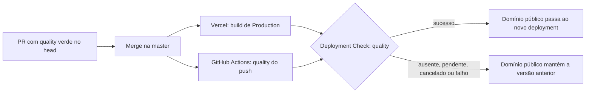

# Guia de lições aprendidas — portfolio-web

**Retrospectiva AUD01–AUD11 · corte: 15/11/2026 (America/Recife) · referência: `master` em `af40e66`**

Repositório: [jeffnunespy/portfolio-web](https://github.com/jeffnunespy/portfolio-web). Este guia transforma os erros, as correções e as decisões de onze auditorias em um manual para começar o próximo projeto com os controles certos desde o primeiro dia. Ele cataloga **47 problemas** técnicos e de processo, separa o que foi comprovado do que é inferência ou recomendação e termina em checklists prontos para copiar.

A AUD11 foi encerrada no escopo de AUD11-001 depois do [PR #63][P63], integrado no commit [`af40e66e5959eb2441385658af3e9c66f5208b09`][K-af40e66] em 15/11/2026. Este documento não executa nova auditoria, não implementa as recomendações e não certifica ausência de defeitos.

> [!NOTE]
> Esta versão substitui a de 08/11/2026 (corte em `cc96648`, 38 problemas, AUD11 ainda aberta). Os identificadores LA-001 a LA-038 e a numeração das seções foram preservados para não quebrar referências existentes; LA-039 a LA-047 são novos e vêm da investigação refeita sobre o histórico do Git, os PRs e as execuções do GitHub Actions.

## Resumo para quem tem cinco minutos

Seis fatos explicam a maior parte do retrabalho e do risco. Todos têm evidência nas seções indicadas.

1. **O CI existia, mas não executava.** Do dia em que o workflow foi criado (15/08) até 04/09/2026 nenhum job rodou: 67 execuções terminaram sem iniciar um passo. Nesse período entraram na `master` a implementação inicial e oito PRs do Dependabot, sete deles de versão major ([LA-039](#la-039)).
2. **A proteção efetiva da `master` não está comprovada no período inicial.** O ruleset atual foi criado 83 dias depois do primeiro commit, em 28/10; em 03/11 havia impedimento de plano registrado, e a aplicação aparece confirmada após o repositório se tornar público, em 06/11. Isso não prova ausência absoluta de outros controles históricos ([LA-040](#la-040)).
3. **A Vercel concluía antes do CI terminar.** Em 18 de 18 integrações entre 02/11 e 07/11 o status `Vercel: success` saiu de 2 a 5 minutos antes do `quality` da `master`; o instante da promoção ao domínio não foi amostrado nessas integrações. No #63, o build terminou antes do CI, mas a promoção esperou sua aprovação ([LA-042](#la-042), [§8.2](#aud11)).
4. **Histórico do navegador, página 404 e foco consumiram a maior parte do esforço de correção:** uma solução rejeitada, quatro PRs, duas issues e riscos residuais ainda abertos ([LA-021](#la-021) a [LA-024](#la-024)).
5. **O site afirmou o que não podia sustentar.** Dez referências anunciavam código público de um repositório privado, e o PDF do currículo, exigido pela especificação, ficou 63 dias fora do contrato ([LA-020](#la-020), [LA-026](#la-026)).
6. **O que funcionou merece ser repetido:** conteúdo validado que quebra o build, auditoria de dependências bloqueante, controles negativos, revisão independente e verificação depois do merge. Desde 04/09 a `master` acumula 27 integrações consecutivas com CI verde ([§4.1](#decisoes-boas)).

| Se você vai…                           | Leia                                                                       |
| -------------------------------------- | -------------------------------------------------------------------------- |
| Começar um projeto novo                | [§4.4](#dia-zero), depois os checklists [7.1](#ck-71) e [7.2](#ck-72)      |
| Abrir ou integrar um PR                | Checklists [7.3](#ck-73) e [7.4](#ck-74)                                   |
| Publicar pela primeira vez             | [LA-041](#la-041), [LA-042](#la-042) e o checklist [7.5](#ck-75)           |
| Atualizar dependências                 | [LA-044](#la-044) e o checklist [7.8](#ck-78)                              |
| Decidir o que é indispensável          | [§6](#prioridades)                                                         |
| Entender um problema específico        | Índice do [§3](#inventario)                                                |
| Saber o que continua aberto no projeto | [§8.1](#pendencias)                                                        |
| Conferir uma afirmação deste guia      | [§10](#fontes), com fontes, lacunas e os comandos usados para verificá-las |

<a id="sumario"></a>

## Sumário

1. [Escopo, método e confiabilidade](#metodo)
2. [Estado das auditorias e cronologia](#estado)
3. [Inventário dos 47 problemas](#inventario)
4. [Decisões, retrabalho e o que faltou no primeiro dia](#decisoes)
5. [Guia de boas práticas em oito etapas](#etapas)
6. [Prioridades: obrigatório, recomendado e opcional](#prioridades)
7. [Checklists reutilizáveis](#checklists)
8. [Acompanhamentos e resultado da AUD11](#acompanhamentos)
9. [Dez aprendizados e erros de maior impacto](#aprendizados)
10. [Fontes, lacunas e validação desta entrega](#fontes)

<a id="metodo"></a>

## 1. Escopo, método e confiabilidade

### 1.1 O que foi investigado

A compilação de 15/11/2026 tomou como referência a `master` em `af40e66`, sem depender do checkout local, que está em outra branch e contém trabalho não commitado. Seu levantamento abrangeu o histórico Git completo (112 commits), os 62 PRs do repositório (corpos e comentários de 34 deles), as duas issues, as 181 execuções do workflow de CI, com os passos das 90 que falharam e as anotações de 9 delas, a configuração remota de proteção da `master`, os arquivos de configuração e de código pertinentes, os relatórios de auditoria versionados e os documentos de estado. A lista está no [§10.1](#fontes-lista).

A revisão técnica independente, também em 15/11, leu o guia integralmente e confrontou as 47 fichas com fontes pertinentes, sem repetir as auditorias. Reconfirmou os totais de PRs e de CI, os jobs das 90 falhas, nove anotações do bloqueio, as 19 linhas da comparação CI/Vercel, a proteção atual e os PRs citados nas correções. Conferiu os caminhos e commits das referências pelo Git e a estrutura Markdown. Resultados de aplicação continuam históricos; revisar uma evidência não equivale a reexecutar seu teste.

Os pareceres originais das AUD07 e AUD08 e o diagnóstico inicial da AUD11 vivem em conversas que não estão no repositório. O que depende exclusivamente deles está marcado como **Herdado**. A matriz causal da AUD10 tem resumo verificável no corpo do #60; os registros brutos da comparação continuam indisponíveis.

### 1.2 Como ler as afirmações

| Marca            | Significado                                                                                                                                                         |
| ---------------- | ------------------------------------------------------------------------------------------------------------------------------------------------------------------- |
| **Fato**         | Conferido diretamente em 15/11/2026: conteúdo de arquivo em `af40e66`, texto de PR ou issue, resposta da API do GitHub ou resposta HTTP do site público.            |
| **Histórico**    | Resultado descrito em PR, relatório ou documento versionado da época. O registro foi lido; a execução que ele descreve não foi repetida.                            |
| **Herdado**      | Informação trazida da versão de 08/11/2026 deste guia, cuja fonte eram conversas e anexos não versionados. Não pôde ser reconferida.                                |
| **Inferência**   | Explicação plausível que as fontes não demonstram. Não prova intenção nem causa.                                                                                    |
| **Recomendação** | Orientação para o futuro. Não descreve algo implementado. Todo campo "Prevenção" do inventário e todo o conteúdo dos capítulos 5, 6 e 7 pertencem a esta categoria. |
| **Lacuna**       | Informação ausente, acesso insuficiente ou cenário não exercitado. Não prova aprovação nem falha.                                                                   |

### 1.3 Vocabulário de estado

- **Corrigido:** a mudança está integrada em `af40e66` e existe evidência histórica pertinente. Não significa que os testes foram repetidos agora.
- **Mitigado:** o risco foi reduzido de forma demonstrada, com limite remanescente declarado.
- **Mantido por decisão:** o comportamento foi examinado e deliberadamente preservado.
- **Aceito:** existe decisão delimitada do proprietário. Aceite não transforma defeito em correção.
- **Em acompanhamento:** tem responsável e gatilho de retomada.
- **Aberto:** sem correção integrada nem aceite.

Os campos de causa distinguem mecanismos técnicos, explicações registradas e inferências. Quando o commit de origem ou a motivação não foi estabelecido, isso é dito; nenhum erro é atribuído a descuido, a uma pessoa ou a uma ferramenta de IA sem evidência.

### 1.4 Limites de execução

Nenhuma dependência foi instalada e nenhum teste de aplicação, build, deploy ou rollback foi executado na compilação ou na revisão. Os números de testes citados pertencem à versão e à rodada indicadas; não devem ser somados nem lidos como resultado desta sessão. As consultas ao GitHub foram somente leitura. A compilação obteve `af40e66` com `git fetch` do SHA e fez uma requisição à home pública; a revisão usou o objeto Git já disponível e não repetiu essa requisição. Foram consultados os avisos oficiais citados em LA-013 e LA-018, sem executar uma nova auditoria de dependências. A revisão alterou somente este documento no repositório; cópia inicial, verificações auxiliares e diff ficaram em `/tmp`.

<a id="estado"></a>

## 2. Estado das auditorias e cronologia

### 2.1 Situação por frente

| Auditoria                               | Estado em 15/11/2026                                                                              | Evidência principal e alcance                                                                                                                                                                                    |
| --------------------------------------- | ------------------------------------------------------------------------------------------------- | ---------------------------------------------------------------------------------------------------------------------------------------------------------------------------------------------------------------- |
| AUD01 — Integridade e reprodutibilidade | Concluída com ressalvas                                                                           | [Relatório][A01], commit [`8b3377a`][K-8b3377a], [#29][P29]. Peers do ESLint e build frio dependente de rede permanecem.                                                                                         |
| AUD02 — Segurança                       | Concluída com ressalvas                                                                           | [#30][P30], [#31][P31], [#34][P34], [#35][P35]; relatórios da [etapa 3][A02D], da [etapa 4][A02H] e do [runtime Node][A02N].                                                                                     |
| AUD03 — Integridade funcional           | Formalmente concluída com ressalvas                                                               | [#54][P54] e [STATUS][STATUS]; correções em #36, #40, #41, #44, #46, #47, #51, #52 e #53. F5, T055, R05, #49 e a ocorrência A1 seguem separados.                                                                 |
| AUD04 — Desempenho                      | Concluída no escopo examinado                                                                     | [#50][P50]: três ajustes de SEO e compartilhamento; nenhum gargalo que justificasse refatorar a hidratação; sem dados de campo.                                                                                  |
| AUD05 — Acessibilidade                  | Escopo técnico integrado                                                                          | [#55][P55], T118–T120. Não encerra T055 nem certifica conformidade integral com a WCAG.                                                                                                                          |
| AUD06 — SEO                             | Concluída no escopo aprovado                                                                      | [#58][P58], T121. Não prova indexação pelo Google nem cartão renderizado em rede social.                                                                                                                         |
| AUD07 — Responsividade                  | Diagnóstico aprovado com ressalvas, sem alterações                                                | **Herdado:** parecer em conversa não versionada; amostra complementar de 21 combinações sem defeito novo relevante. Não há PR próprio.                                                                           |
| AUD08 — Arquitetura                     | Diagnóstico aprovado com ressalvas, sem refatoração                                               | **Herdado:** parecer em conversa não versionada; 35 arquivos de produção e 51 dependências locais analisados, sem ciclos. Não há PR próprio.                                                                     |
| AUD09 — Testes                          | Reforços integrados                                                                               | [#59][P59], T122 e T123: duas lacunas P2 de cobertura, sem defeito de produto demonstrado.                                                                                                                       |
| AUD10 — Cadeia de suprimentos           | Encerrada tecnicamente no escopo aprovado, com ressalvas                                          | [#60][P60]: tipos do Node e mock corrigidos; avisos de segurança inconclusivos preservados.                                                                                                                      |
| **AUD11 — CI/CD e publicação**          | **Encerrada no escopo de AUD11-001**; a proposta A1/O1 continua aberta no [#62][P62], em rascunho | [#63][P63], merge `af40e66`: bloqueio da promoção pelo `quality` documentado e demonstrado numa integração real. Cenários de check ausente, falho ou cancelado não foram observados. Detalhes no [§8.2](#aud11). |

O roteiro original das auditorias não está no repositório. A versão anterior deste guia cita AUD12, AUD13 e AUD14 como pendentes; o escopo delas não está registrado em nenhum arquivo versionado (**Lacuna**).

O [STATUS][STATUS] da `master` reconcilia principalmente a AUD03 e ainda traz a frase "AUD05 não iniciada". Os PRs #55, #58, #59, #60 e #63 superam essa frase. O arquivo não foi alterado por esta tarefa ([LA-011](#la-011)).

### 2.2 Linha do tempo

Datas em America/Recife, conforme o Git. Horários com "Z" estão em UTC.

| Período       | O que aconteceu                                                                                                                                                                                                                                                               |
| ------------- | ----------------------------------------------------------------------------------------------------------------------------------------------------------------------------------------------------------------------------------------------------------------------------- |
| 06/08         | Primeiro commit. Constituição e especificação escritas antes do código.                                                                                                                                                                                                       |
| 15/08         | Workflow de CI criado (`b79a353`) e implementação inicial integrada (#2, 66 arquivos). Seis PRs do Dependabot integrados em cinco minutos; dois no dia seguinte. **Nenhum job de CI executou** ([LA-039](#la-039)).                                                           |
| 16/08 a 30/08 | #15 fica 14 dias aberto com 55 arquivos: correções de validação, conteúdo novo e SEO no mesmo PR ([LA-047](#la-047)).                                                                                                                                                         |
| 04/09         | Primeira execução real do CI. #21 reformula o visual como "ficha catalográfica", separa projetos reais de planejados, remove o PDF do currículo e declara público o repositório.                                                                                              |
| 09/09         | #22 otimiza o carregamento. O gate de auditoria de produção barra três execuções até o commit `1f9ac31` corrigir vulnerabilidades do Next.js.                                                                                                                                 |
| 23/10 a 27/10 | Direção visual "Levantamento e sondagem" aprovada e migrada; no mesmo dia, "Minimalismo escuro" é aprovado como visual oficial e aplicado em seguida ([LA-046](#la-046)). Duas revisões de design encontram refluxo quebrado a 200% e gate de acessibilidade incompleto.      |
| 28/10         | AUD01 e AUD02: cinco PRs num dia (#29, #30, #31, #34, #35) corrigem reprodutibilidade, Actions, dependências, cabeçalhos HTTP e runtime. Ruleset `proteger-master` criado.                                                                                                    |
| 29/10         | Primeira publicação na Vercel. O primeiro deployment pedido como Preview termina em Production ([LA-041](#la-041)).                                                                                                                                                           |
| 31/10 a 06/11 | AUD03: links para repositório privado, histórico por fragmento (F1 v1 rejeitada, v2 integrada), 404 sem JavaScript, foco, contratos de arquivos e do PDF. #42 e #48 simplificam CI e governança. Em 06/11 o repositório torna-se público e a AUD03 é encerrada com ressalvas. |
| 07/11         | AUD05, AUD06, AUD09 e AUD10 integradas (#55, #58, #59, #60).                                                                                                                                                                                                                  |
| 09/11 a 15/11 | AUD11: #62 (branch atualizada antes do merge) permanece em rascunho; #63 documenta o Deployment Check e sua integração, em 15/11, demonstra a espera pelo `quality` antes da promoção.                                                                                        |

### 2.3 O projeto em números

Todos os valores são **Fato**, obtidos do Git e da API do GitHub em 15/11/2026, salvo indicação.

| Medida                                 | Valor                                                                                                                               |
| -------------------------------------- | ----------------------------------------------------------------------------------------------------------------------------------- |
| Duração                                | 101 dias, de 06/08 a 15/11/2026                                                                                                     |
| Commits alcançáveis da `master`        | 112                                                                                                                                 |
| PRs                                    | 62: 41 integrados, 16 fechados sem merge, 5 abertos                                                                                 |
| PRs do Dependabot                      | 28: 8 integrados (todos em 15–16/08), 16 fechados, 4 abertos                                                                        |
| Issues                                 | 2: #45 fechada, #49 aberta                                                                                                          |
| Execuções do workflow CI               | 181: 91 com sucesso e 90 com falha                                                                                                  |
| Falhas de CI por tipo                  | 67 sem nenhum passo executado; 15 em tipos; 3 na auditoria de produção; 2 em unitários; 2 em E2E de acessibilidade; 1 em formatação |
| CI da `master`                         | 14 pushes sem job executado (15/08 a 30/08); depois, 27 pushes consecutivos com `quality` verde                                     |
| Tarefas da feature (`tasks.md`)        | 121, das quais 118 marcadas como concluídas                                                                                         |
| Código de aplicação                    | 36 arquivos em `app/`, `components/` e `lib/`; 3 com `"use client"`                                                                 |
| Suíte no CI (**Histórico**, #60 e #63) | 158 testes unitários em 12 arquivos, 210 E2E funcionais e 27 E2E de acessibilidade                                                  |
| Versões resolvidas no lockfile         | Next.js 16.4.2, React 19.2.8, TypeScript 5.9.3, Vitest 4.1.12, Playwright 1.62.1, `@types/node` 24.19.2                             |

<a id="inventario"></a>

## 3. Inventário dos 47 problemas

Os identificadores LA pertencem a este guia e não renumeram os achados originais das auditorias. Defeitos do mesmo PR foram agrupados quando compartilham a prevenção; controles com mecanismos diferentes ficaram separados. **47 não é a soma oficial dos achados das auditorias.**

Cada ficha segue a mesma ordem: problema, causa, identificação, correção, evidência e prevenção. O campo "Prevenção" é sempre recomendação. Quando a data de origem não foi rastreada, a ficha diz isso.

### 3.1 Índice

| ID                | Problema                                                                                  | Tema                     | Frente               | Estado                                                    |
| ----------------- | ----------------------------------------------------------------------------------------- | ------------------------ | -------------------- | --------------------------------------------------------- |
| [LA-001](#la-001) | Versão em uso fora do Git e checkout confundido com a referência                          | Processo e documentação  | AUD01                | Corrigido; hábito recorrente no checkout local            |
| [LA-002](#la-002) | Faixa do Node aceitava patches incompatíveis e o shell não seguia o requisito             | Ambiente e dependências  | AUD01, AUD10         | Corrigido                                                 |
| [LA-003](#la-003) | Plugins do ESLint sem peer declarado para a major em uso                                  | Ambiente e dependências  | AUD01                | Mantido por decisão, com teste                            |
| [LA-004](#la-004) | Projetos planejados consumiam o teto de destaques reais                                   | Conteúdo e contratos     | AUD01, AUD09         | Corrigido                                                 |
| [LA-005](#la-005) | Build frio dependia de fonte baixada da rede                                              | Ambiente e dependências  | AUD01, AUD04         | Mantido por decisão                                       |
| [LA-006](#la-006) | CI compilava a aplicação três vezes                                                       | CI/CD e governança       | AUD01                | Corrigido                                                 |
| [LA-007](#la-007) | E2E podia testar um servidor desconhecido na porta esperada                               | Testes e evidências      | AUD01                | Corrigido                                                 |
| [LA-008](#la-008) | Seleção vazia de testes retornava sucesso                                                 | Testes e evidências      | AUD01                | Corrigido                                                 |
| [LA-009](#la-009) | Grupos de E2E sobrescreviam relatórios e artefatos                                        | Testes e evidências      | AUD01                | Corrigido                                                 |
| [LA-010](#la-010) | Ambiente e identidade da execução mal registrados                                         | CI/CD e governança       | AUD01, #42           | Corrigido                                                 |
| [LA-011](#la-011) | Documentos e índices de estado divergentes do código e da fase                            | Processo e documentação  | AUD01, AUD03         | Parcial: índices ainda divergem                           |
| [LA-012](#la-012) | Actions por tag móvel e token mais amplo que o necessário                                 | Segurança e cadeia       | AUD02                | Corrigido no workflow; política do repositório aberta     |
| [LA-013](#la-013) | Faixas do manifesto admitiam versões vulneráveis                                          | Segurança e cadeia       | AUD02                | Corrigido                                                 |
| [LA-014](#la-014) | Política de scripts de instalação ignorada por npm antigo                                 | Segurança e cadeia       | AUD02                | Corrigido                                                 |
| [LA-015](#la-015) | React e React DOM atualizados separadamente                                               | Ambiente e dependências  | AUD02                | Mitigado                                                  |
| [LA-016](#la-016) | Cabeçalhos de segurança ausentes e superfície HTTP maior que a necessária                 | Segurança e cadeia       | AUD02                | Mitigado; CSP não é estrita                               |
| [LA-017](#la-017) | Origem pública sem validação e com fallback silencioso                                    | Segurança e cadeia       | AUD02                | Corrigido                                                 |
| [LA-018](#la-018) | Runtime declarado incluía patches com correções de segurança pendentes                    | Segurança e cadeia       | AUD02                | Corrigido no requisito; runtime hospedado não demonstrado |
| [LA-019](#la-019) | Fallback de imagem dependia de evento anterior à hidratação                               | Renderização e navegação | AUD03                | Corrigido; F5 em acompanhamento                           |
| [LA-020](#la-020) | Links anunciavam código público de repositório privado                                    | Conteúdo e contratos     | AUD03                | Corrigido                                                 |
| [LA-021](#la-021) | Primeira correção do histórico podia gravar a árvore de outra rota                        | Renderização e navegação | AUD03                | v1 rejeitada; v2 integrada com limites                    |
| [LA-022](#la-022) | Retorno à 404 mantinha conteúdo anterior; flake posterior sem causa                       | Renderização e navegação | AUD03                | Corrigido; ocorrência A1 aceita sem causa                 |
| [LA-023](#la-023) | 404 de projeto inexistente vinha vazia sem JavaScript                                     | Renderização e navegação | AUD03                | Corrigido                                                 |
| [LA-024](#la-024) | Skip link da 404 perdia o foco sob navegação suspensa                                     | Renderização e navegação | AUD03                | Corrigido; riscos residuais na #49                        |
| [LA-025](#la-025) | Existência de caminho confundida com arquivo regular                                      | Conteúdo e contratos     | AUD03                | Corrigido                                                 |
| [LA-026](#la-026) | PDF obrigatório tratado como opcional no tipo, no validador e no teste                    | Conteúdo e contratos     | AUD01, AUD03         | Corrigido                                                 |
| [LA-027](#la-027) | Demonstração pública ocultava a ausência de código                                        | Conteúdo e contratos     | AUD03                | Corrigido                                                 |
| [LA-028](#la-028) | Compartilhamento herdava dados da home; Roadmap sem imagem própria                        | SEO e metadados          | AUD04                | Corrigido                                                 |
| [LA-029](#la-029) | Objeto Open Graph da página eliminava o tipo herdado                                      | SEO e metadados          | AUD06                | Corrigido                                                 |
| [LA-030](#la-030) | Lacunas pontuais de cobertura de acessibilidade e de medida de leitura                    | Renderização e navegação | AUD05                | Corrigido no escopo; inspeção humana pendente             |
| [LA-031](#la-031) | Testes aprovavam os dados atuais sem discriminar outras combinações                       | Testes e evidências      | AUD09                | Corrigido                                                 |
| [LA-032](#la-032) | CI duplicava eventos e guardava o trace da repetição, não o da falha                      | CI/CD e governança       | #42                  | Corrigido                                                 |
| [LA-033](#la-033) | Governança acumulava histórico e exigia a mesma verificação para tudo                     | Processo e documentação  | #42, #48             | Corrigido                                                 |
| [LA-034](#la-034) | Parecer de revisão e controles negativos sem proveniência acessível                       | Testes e evidências      | AUD09                | Corrigido                                                 |
| [LA-035](#la-035) | Tipos do Node de major superior à do runtime                                              | Ambiente e dependências  | AUD10                | Corrigido                                                 |
| [LA-036](#la-036) | Conversão de tipo em mock provocava erro e confundia o diagnóstico                        | Testes e evidências      | AUD10                | Corrigido                                                 |
| [LA-037](#la-037) | Patch aprovado e evidências guardados em diretório temporário                             | Testes e evidências      | AUD03                | Recuperado; hábito ainda presente                         |
| [LA-038](#la-038) | Falhas do instrumento de medição confundidas com defeito do produto                       | Testes e evidências      | AUD04, AUD07, AUD09  | Tratado caso a caso                                       |
| [LA-039](#la-039) | CI sem executar nas três primeiras semanas e integrações sem validação pelo CI            | CI/CD e governança       | Esta retrospectiva   | Cessou em 04/09; causa administrativa não registrada      |
| [LA-040](#la-040) | Período sem proteção efetiva comprovada da `master`                                       | CI/CD e governança       | #42, AUD11           | Proteção confirmada após 06/11; histórico incompleto      |
| [LA-041](#la-041) | Primeira publicação: Preview que terminou em Production e projeto com padrões divergentes | Deploy e hospedagem      | Publicação de 29/10  | Corrigido na operação; causa indeterminada                |
| [LA-042](#la-042) | Publicação sem bloqueio comprovado pelo CI da `master`                                    | Deploy e hospedagem      | AUD11                | Corrigido e demonstrado em um cenário                     |
| [LA-043](#la-043) | PR desatualizado pode ser integrado sem validar a combinação com a `master`               | CI/CD e governança       | AUD11                | Melhoria de governança não adotada; #62 em rascunho       |
| [LA-044](#la-044) | Fila de atualizações automáticas sem vazão                                                | Ambiente e dependências  | AUD02, retrospectiva | Aberto                                                    |
| [LA-045](#la-045) | Gate anunciado como WCAG 2.1 sem as regras dessa versão; refluxo quebrado a 200%          | Renderização e navegação | Revisões de design   | Corrigido                                                 |
| [LA-046](#la-046) | Três direções visuais em sete semanas                                                     | Processo e documentação  | Esta retrospectiva   | Encerrado: direção estável desde 23/10                    |
| [LA-047](#la-047) | PRs grandes, mistos e sem descrição nas primeiras entregas                                | Processo e documentação  | Esta retrospectiva   | Mitigado por template e processo                          |

### 3.2 Leitura por tema

| Tema                                     | Problemas                                                      |
| ---------------------------------------- | -------------------------------------------------------------- |
| Ambiente e dependências                  | LA-002, LA-003, LA-005, LA-015, LA-035, LA-044                 |
| Segurança e cadeia de suprimentos        | LA-012, LA-013, LA-014, LA-016, LA-017, LA-018                 |
| CI/CD e governança                       | LA-006, LA-010, LA-032, LA-039, LA-040, LA-043                 |
| Deploy e hospedagem                      | LA-041, LA-042                                                 |
| Conteúdo e contratos                     | LA-004, LA-020, LA-025, LA-026, LA-027                         |
| Renderização, navegação e acessibilidade | LA-019, LA-021, LA-022, LA-023, LA-024, LA-030, LA-045         |
| SEO e metadados                          | LA-028, LA-029                                                 |
| Testes e evidências                      | LA-007, LA-008, LA-009, LA-031, LA-034, LA-036, LA-037, LA-038 |
| Processo e documentação                  | LA-001, LA-011, LA-033, LA-046, LA-047                         |

<a id="la-001"></a>

### LA-001 — Versão em uso fora do Git e checkout confundido com a referência

**Tema:** Processo e documentação · **Frente:** AUD01-001 · **Estado:** corrigido na referência; hábito recorrente no checkout local

- **Problema:** a AUD01 encontrou código em uso (`components/home/BuildEvidence.tsx`) e mais 40 arquivos fora do versionamento, além de alterações rastreadas sem commit. O que era executado e testado não correspondia a nenhum commit.
- **Causa:** o trabalho avançou numa árvore local sem commits intermediários; o HEAD (`9a90166`) deixou de descrever os arquivos reais.
- **Identificação:** inventário do Git (status, diff e não rastreados) e comparação de hashes SHA-256 com uma cópia reconstruída.
- **Correção:** a AUD01 reproduziu HEAD + diff + não rastreados num diretório isolado, com hashes idênticos, e o conjunto foi integrado pelo [#29][P29].
- **Evidência:** **Histórico:** [relatório da AUD01][A01]. **Fato:** em 15/11/2026 o checkout principal está na branch `docs/segundo-cerebro`, com 8 arquivos rastreados modificados e 27 entradas não rastreadas; a branch local `master` está 72 commits atrás da referência remota que o checkout conhece (`cc96648`).
- **Prevenção:** fazer commits pequenos em branch própria. Antes de avaliar ou testar, registrar branch, HEAD e `git status`. Ler a referência com `git show <sha>:<arquivo>` em vez de confiar no checkout.

<a id="la-002"></a>

### LA-002 — Faixa do Node aceitava patches incompatíveis e o shell não seguia o requisito

**Tema:** Ambiente e dependências · **Frente:** AUD01-002, AUD10 · **Estado:** corrigido

- **Problema:** `engines.node` em `24.x` admitia versões abaixo do piso exigido pelo jsdom 30. Em novembro, sessões locais ainda rodavam Node 24.19.0, abaixo do piso `^24.22.1` já exigido na `master`.
- **Causa:** declarar só a major não fixa o patch, e `.nvmrc` documenta a versão sem trocar o executável do shell.
- **Identificação:** comparação de versões e instalação negativa: `npm ci` em Node 22.23.1 falha com `EBADENGINE`.
- **Correção:** [#29][P29] introduziu piso em `engines`, `engine-strict` e leitura de `.nvmrc` pelo CI; [#35][P35] elevou o piso por segurança ([LA-018](#la-018)).
- **Evidência:** **Fato:** [`package.json`][C-pkg] exige `^24.22.1`, [`.nvmrc`][C-nvmrc] fixa 24.22.2 e [`.npmrc`][C-npmrc] ativa `engine-strict`; nesta sessão o shell executa Node 24.22.2 e npm 11.19.1. **Histórico:** [relatório da AUD01][A01]; dois relatórios locais de novembro registram o shell em 24.19.0.
- **Prevenção:** declarar piso de versão, não só a major, com `engine-strict` desde o primeiro commit. Conferir `node -v` e `npm -v` no início de cada sessão e registrar as versões no PR.

<a id="la-003"></a>

### LA-003 — Plugins do ESLint sem peer declarado para a major em uso

**Tema:** Ambiente e dependências · **Frente:** AUD01-003 · **Estado:** mantido por decisão, com teste

- **Problema:** plugins transitivos de `eslint-config-next` declaravam suporte só até o ESLint 9, e o projeto usa o ESLint 10. A instalação emite avisos de peer.
- **Causa:** a major da ferramenta foi adotada antes de os plugins declararem compatibilidade.
- **Identificação:** avisos do `npm ci`, examinados na AUD01.
- **Correção:** exceção documentada e teste que prova que as regras dos três plugins continuam reportando.
- **Evidência:** **Fato:** [`tests/unit/eslint-plugins.test.ts`][T-eslint] existe em `af40e66`. **Histórico:** [relatório da AUD01][A01].
- **Prevenção:** ao subir a major de uma ferramenta, conferir os peers dos plugins. Se a exceção for aceita, prová-la com teste e registrar o gatilho de remoção. Não desligar regras nem rebaixar versões só para silenciar avisos.

<a id="la-004"></a>

### LA-004 — Projetos planejados consumiam o teto de destaques reais

**Tema:** Conteúdo e contratos · **Frente:** AUD01-004, AUD09 · **Estado:** corrigido

- **Problema:** o limite de seis destaques contava `destaque` sem exigir `real`. Itens planejados podiam impedir a publicação de seis projetos implementados.
- **Causa:** a regra era aplicada a um universo diferente do exibido na vitrine.
- **Identificação:** comparação entre o requisito e o seletor, na AUD01.
- **Correção:** a contagem passou a usar `real && destaque` no commit [`8b3377a`][K-8b3377a] ([#29][P29]); o [#59][P59] acrescentou a matriz dos quatro estados.
- **Evidência:** **Fato:** [`lib/content.ts`][C-content], linha 340, filtra `projeto.real && projeto.destaque`. **Histórico:** seis cenários; a mutação que reverte a correção derruba dois deles ([relatório][A01]).
- **Prevenção:** declarar o universo de cada regra antes de programar a contagem. Testar as quatro combinações de real e destaque e os dois lados do limite (seis passa, sete falha).

<a id="la-005"></a>

### LA-005 — Build frio dependia de fonte baixada da rede

**Tema:** Ambiente e dependências · **Frente:** AUD01-005, AUD04 · **Estado:** mantido por decisão

- **Problema:** `next/font/google` baixa a fonte Geologica durante o build. Sem rede e sem cache, o build falha.
- **Causa:** o cache aquecido escondia a dependência.
- **Identificação:** build frio sem rede comparado com build com cache (AUD01). O mesmo efeito reapareceu no sandbox da primeira publicação e na preparação do #50.
- **Correção:** nenhuma. A escolha foi mantida e a condição, documentada no README.
- **Evidência:** **Fato:** [`app/layout.tsx`][C-layout] importa `Geologica` de `next/font/google`. **Histórico:** [relatório da AUD01][A01], [contexto ativo][CONTEXTO] de 29/10 e [#50][P50].
- **Prevenção:** decidir no planejamento se o build precisa funcionar sem rede ou ser reproduzível byte a byte. Se precisar, usar fonte local desde o início.

<a id="la-006"></a>

### LA-006 — CI compilava a aplicação três vezes

**Tema:** CI/CD e governança · **Frente:** AUD01-006 · **Estado:** corrigido

- **Problema:** o passo de build e cada grupo de E2E recompilavam a aplicação.
- **Causa:** o comando do servidor de testes do Playwright incluía `npm run build`, embora o pipeline já tivesse construído.
- **Identificação:** contagem de compilações nos logs, na AUD01.
- **Correção:** com `E2E_BUILD_EXISTENTE=1` o Playwright serve o artefato já construído e falha se `.next/BUILD_ID` não existir.
- **Evidência:** **Fato:** [`playwright.config.ts`][C-playwright] e [`ci.yml`][C-ci] em `af40e66`. **Histórico:** um build por pipeline, com `BUILD_ID` igual antes e depois dos E2E.
- **Prevenção:** uma etapa constrói; as outras servem o artefato. Registrar o `BUILD_ID` testado.

<a id="la-007"></a>

### LA-007 — E2E podia testar um servidor desconhecido na porta esperada

**Tema:** Testes e evidências · **Frente:** AUD01-007 · **Estado:** corrigido

- **Problema:** `reuseExistingServer` reaproveitava qualquer serviço já aberto na porta 3001.
- **Causa:** porta respondendo não prova qual código está sendo servido.
- **Identificação:** a AUD01 subiu um servidor falso na porta como controle.
- **Correção:** o reuso passou a depender de `E2E_REUTILIZAR_SERVIDOR=1` e é proibido no CI. A configuração avisa que esse modo não vale como aceite.
- **Evidência:** **Fato:** [`playwright.config.ts`][C-playwright]. **Histórico:** com o servidor falso, o modo padrão e o CI recusam; só o opt-in reaproveita.
- **Prevenção:** no modo de aceite, porta ocupada derruba a execução. Conveniência de iteração local nunca vira evidência de versão.

<a id="la-008"></a>

### LA-008 — Seleção vazia de testes retornava sucesso

**Tema:** Testes e evidências · **Frente:** AUD01-008 · **Estado:** corrigido

- **Problema:** `passWithNoTests: true` fazia o Vitest sair com código zero quando o filtro não selecionava nenhum arquivo.
- **Causa:** opção tolerante herdada da configuração inicial.
- **Identificação:** comparação do código de saída com um filtro vazio.
- **Correção:** opção removida no commit [`8b3377a`][K-8b3377a].
- **Evidência:** **Fato:** [`vitest.config.ts`][C-vitest] não contém a opção. **Histórico:** a saída do filtro vazio passou de 0 para 1.
- **Prevenção:** um gate precisa provar que executou algo. Remover do scaffold as opções que transformam "nada rodou" em aprovação e conferir a contagem de testes nos comandos dirigidos.

<a id="la-009"></a>

### LA-009 — Grupos de E2E sobrescreviam relatórios e artefatos

**Tema:** Testes e evidências · **Frente:** AUD01-011 · **Estado:** corrigido

- **Problema:** as suítes funcional e de acessibilidade gravavam no mesmo diretório; a segunda apagava a evidência da primeira.
- **Causa:** destino único de relatório e de artefatos.
- **Identificação:** inspeção dos diretórios depois das duas rodadas.
- **Correção:** diretórios e relatórios por grupo (`E2E_GRUPO`), upload por suíte, retenção de 14 dias e envio mesmo quando um passo falha.
- **Evidência:** **Fato:** [`playwright.config.ts`][C-playwright] e os dois passos de upload em [`ci.yml`][C-ci].
- **Prevenção:** planejar nome, destino e retenção da evidência junto com o teste. Copiar para local durável só a evidência que sustenta uma decisão duradoura, antes de o artefato expirar.

<a id="la-010"></a>

### LA-010 — Ambiente e identidade da execução mal registrados

**Tema:** CI/CD e governança · **Frente:** AUD01-012, #42 · **Estado:** corrigido

- **Problema:** o CI usava `ubuntu-latest` e Node `24` genérico, sem registrar versões. Em `pull_request`, o `GITHUB_SHA` é o merge temporário com a base, não o head que a revisão e a autorização citam.
- **Causa:** a execução era descrita por referências com significados diferentes.
- **Identificação:** AUD01 e [#42][P42].
- **Correção:** imagem fixa `ubuntu-24.04`, Node lido de `.nvmrc`, passo que imprime runner, Node, npm e Playwright e passo "Identificar artefato" que grava evento, ref, commit, head, base e `BUILD_ID` no resumo.
- **Evidência:** **Fato:** [`ci.yml`][C-ci].
- **Prevenção:** definir no primeiro pipeline uma ficha de identidade com entrada, ambiente e artefato. Distinguir head do PR, merge sintético, merge final e deployment.

<a id="la-011"></a>

### LA-011 — Documentos e índices de estado divergentes do código e da fase

**Tema:** Processo e documentação · **Frente:** AUD01-009, AUD01-010, AUD03 · **Estado:** parcial

- **Problema:** o README mandava `npm install` e omitia o preparo; documentos de dados divergiam do código. Em agosto, as instruções afirmavam que `linkCurriculo` era validado como arquivo, o que o código não fazia. Em 15/11 as divergências continuam nos índices: o STATUS diz "AUD05 não iniciada" e não registra AUD05 a AUD11; `tasks.md` mantém T122 e T123 abertas com o #59 integrado; o plano de desenvolvimento diz que a Vercel não foi configurada.
- **Causa:** fechamentos registrados nos PRs não foram propagados aos índices. O PROCESSO já exige atualizar o estado relevante; a lacuna é de reconciliação dos registros, não de ausência dessa regra.
- **Identificação:** comparação entre documentos, código e PRs na AUD01, na AUD03 e nesta retrospectiva.
- **Correção:** [#29][P29] alinhou as instruções; [#42][P42] e [#48][P48] definiram o PR como registro principal e o STATUS como índice; [#54][P54] reconciliou a AUD03.
- **Evidência:** **Fato:** [STATUS][STATUS], [`tasks.md`][TASKS] e `docs/DEVELOPMENT_PLAN.md` em `af40e66`; mensagem do commit [`efe00e9`][K-efe00e9]. A lista completa das divergências está no [§10.3](#divergencias).
- **Prevenção:** um dono por tipo de informação (requisito, estado, histórico). Atualizar o índice no mesmo PR que encerra a frente e datar as seções históricas.

<a id="la-012"></a>

### LA-012 — Actions por tag móvel e token mais amplo que o necessário

**Tema:** Segurança e cadeia de suprimentos · **Frente:** AUD02 · **Estado:** corrigido no workflow; política do repositório aberta

- **Problema:** as Actions eram referenciadas por tag (`@v7`), o token não tinha permissão explícita e o checkout deixava a credencial gravada no repositório clonado.
- **Causa:** os padrões do serviço excediam o que um pipeline que só lê código precisa.
- **Identificação:** revisão do workflow na AUD02.
- **Correção:** [#30][P30] fixou as três Actions por SHA, declarou `permissions: contents: read` e `persist-credentials: false`; o Dependabot acompanha o ecossistema de Actions.
- **Evidência:** **Fato:** [`ci.yml`][C-ci] e commit [`c49b2a2`][K-c49b2a2]. **Fato:** a configuração do repositório ainda aceita qualquer Action (`allowed_actions: all`, `sha_pinning_required: false`); a restrição recomendada na [etapa 3][A02D] não foi aplicada.
- **Prevenção:** tratar Actions como dependências executáveis. Fixar por SHA, dar permissão mínima e não persistir credencial desde o primeiro workflow.

<a id="la-013"></a>

### LA-013 — Faixas do manifesto admitiam versões vulneráveis

**Tema:** Segurança e cadeia de suprimentos · **Frente:** AUD02-009 · **Estado:** corrigido

- **Problema:** `next ^16.3.4` admitia versões com avisos graves, entre eles três de execução remota de código; o relatório destaca que o site usa `next/og`. `vitest ^4.1.10` admitia uma versão com falha de travessia de caminho. O lockfile já resolvia versões corrigidas. Trata-se da faixa permitida, sem exploração demonstrada: usar `next/og` por si só não satisfaz a condição de entrada controlada pelo atacante do [aviso específico](https://github.com/advisories/GHSA-vcvr-r3jv-pc5j).
- **Causa:** confundir a versão instalada com o intervalo que o manifesto permite.
- **Identificação:** a etapa 3 da AUD02 comparou manifesto e lockfile.
- **Correção:** [#31][P31] elevou os pisos para `^16.4.2` (Next e `eslint-config-next`) e `^4.1.12` (Vitest), sem mudar o que estava instalado.
- **Evidência:** **Fato:** [`package.json`][C-pkg]. **Fato:** em 09/09 o passo `npm audit --omit=dev --audit-level=high` reprovou três execuções da branch do #22 até o commit [`1f9ac31`][K-1f9ac31] corrigir as vulnerabilidades do Next.js. **Histórico:** [etapa 3][A02D].
- **Prevenção:** revisar manifesto, lockfile e aplicabilidade do aviso em conjunto e subir o piso quando o lockfile for corrigido. Manter a auditoria de produção como passo bloqueante desde o primeiro pipeline. Um resultado "zero vulnerabilidades" vale para a data da consulta.

<a id="la-014"></a>

### LA-014 — Política de scripts de instalação ignorada por npm antigo

**Tema:** Segurança e cadeia de suprimentos · **Frente:** AUD02, etapa 3 · **Estado:** corrigido

- **Problema:** o `postinstall` de `unrs-resolver` rodava sem decisão explícita. Versões do npm anteriores à 11.16 não conhecem `allowScripts`: ignoravam a política em silêncio e executavam todos os scripts.
- **Causa:** a política declarada dependia de uma versão da ferramenta capaz de aplicá-la.
- **Identificação:** fixture com três pacotes locais (autorizado, negado e sem decisão) instalada em seis versões do npm.
- **Correção:** [#31][P31] negou `unrs-resolver`, liberou versões específicas de `fsevents`, ativou `strict-allow-scripts` e passou a exigir `npm >=11.16.0` com `engine-strict`.
- **Evidência:** **Fato:** [`package.json`][C-pkg] e [`.npmrc`][C-npmrc]. **Histórico:** matriz da [etapa 3][A02D]: npm antigo é recusado antes de instalar; versões compatíveis bloqueiam o script sem decisão.
- **Limite:** `--engine-strict=false` e `npm rebuild` sobre uma instalação existente contornam a política. Ambos exigem ação deliberada.
- **Prevenção:** fixar a versão mínima do gerenciador pela capacidade de impor a política, não só de instalar. Testar a política com um script inofensivo.

<a id="la-015"></a>

### LA-015 — React e React DOM atualizados separadamente

**Tema:** Ambiente e dependências · **Frente:** AUD02, etapa 3 · **Estado:** mitigado

- **Problema:** o Dependabot propôs `react` sem `react-dom` (#25) e os testes quebraram. Sem agrupamento nem atraso de adoção, cinco PRs antigos ocupavam todo o limite de PRs abertos.
- **Causa:** pacotes que exigem versões coordenadas eram atualizados um a um.
- **Identificação:** falha do CI no #25 e análise da etapa 3.
- **Correção:** [#31][P31] criou os grupos `react`, `next` e `desenvolvimento` (só minor e patch) e o cooldown de sete dias.
- **Evidência:** **Fato:** [`dependabot.yml`][C-dependabot]; a [execução 34714032347][R-25] do #25 falhou em `npm test`. **Histórico:** [etapa 3][A02D].
- **Limite:** agrupar reduz propostas incoerentes; não integra nem aprova nenhuma delas ([LA-044](#la-044)).
- **Prevenção:** classificar as famílias acopladas antes de ligar a automação e manter cada major em PR próprio.

<a id="la-016"></a>

### LA-016 — Cabeçalhos de segurança ausentes e superfície HTTP maior que a necessária

**Tema:** Segurança e cadeia de suprimentos · **Frente:** AUD02, etapa 4 · **Estado:** mitigado; a CSP não é estrita

- **Problema:** as respostas não tinham CSP, `nosniff`, proteção contra enquadramento, política de referrer nem de permissões; o servidor anunciava `X-Powered-By`; o otimizador de imagens processava requisições embora o site não use `next/image`.
- **Causa:** padrões do framework mantidos sem inventário de endpoints e recursos.
- **Identificação:** inventário da superfície HTTP e comparação de respostas na etapa 4.
- **Correção:** [#34][P34] aplicou os cabeçalhos em `next.config.js`, removeu `X-Powered-By` e desativou o otimizador.
- **Evidência:** **Fato:** [`next.config.js`][C-next]. **Fato:** em 15/11 a home em produção respondeu com a CSP configurada, `X-Content-Type-Options: nosniff`, `X-Frame-Options: DENY`, `Referrer-Policy`, `Permissions-Policy` e `Strict-Transport-Security` (este fornecido pela hospedagem), sem `X-Powered-By`. **Histórico:** [etapa 4][A02H].
- **Limite:** `script-src` mantém `'unsafe-inline'`, porque o Next.js injeta scripts inline em páginas pré-renderizadas; nonces exigiriam renderização dinâmica. Uma URL com codificação malformada (`/projetos/%E0%A4%A`) responde 500 no Next.js 16.4.2, limitação do framework registrada na etapa 4.
- **Prevenção:** inventariar a superfície antes de aplicar cabeçalhos, validar cada diretiva com um bloqueio real e conferir a resposta do ambiente publicado, não só a do servidor local.

<a id="la-017"></a>

### LA-017 — Origem pública sem validação e com fallback silencioso

**Tema:** Segurança e cadeia de suprimentos · **Frente:** AUD02, etapa 4 · **Estado:** corrigido

- **Problema:** a origem usada em canonical, Open Graph, sitemap e robots era aceita sem validação. `VERCEL_URL` podia ser usada fora de Preview e `localhost` podia chegar a um build de produção.
- **Causa:** configuração tratada como texto livre.
- **Identificação:** a AUD02 relacionou o valor aos metadados que ele alimenta.
- **Correção:** [`lib/site.ts`][C-site] ([#34][P34]) exige origem HTTP(S) sem credenciais, caminho, query ou fragmento, HTTPS fora de loopback e variável explícita em produção; `VERCEL_URL` só vale em Preview declarado.
- **Evidência:** **Fato:** o arquivo lança erro quando o build de produção não define a origem e quando o Preview não tem origem válida; [`tests/unit/site.test.ts`][T-site] existe.
- **Limite:** código correto não prova o valor configurado na hospedagem.
- **Prevenção:** validar configuração na fronteira, definir a política por ambiente e conferir o HTML publicado contra o domínio autorizado.

<a id="la-018"></a>

### LA-018 — Runtime declarado incluía patches com correções de segurança pendentes

**Tema:** Segurança e cadeia de suprimentos · **Frente:** AUD02, follow-up · **Estado:** corrigido no requisito; runtime hospedado não demonstrado

- **Problema:** o piso `^24.15.0` e o `.nvmrc` em 24.19.0 abrangiam versões afetadas por oito CVEs do Node.js, quatro de severidade alta. O primeiro patch corrigido é o [24.22.1](https://nodejs.org/en/blog/release/v24.22.1); 24.22.2 foi a versão posterior fixada e testada. Não foi demonstrada exploração pelo portfólio.
- **Causa:** o piso atendia à compatibilidade, não às correções de segurança publicadas depois.
- **Identificação:** o follow-up da AUD02 confrontou versões e releases.
- **Correção:** [#35][P35] elevou `engines.node` para `^24.22.1` e o `.nvmrc` para 24.22.2, mantendo a major.
- **Evidência:** **Fato:** [`package.json`][C-pkg] e [`.nvmrc`][C-nvmrc]. **Histórico:** [relatório do runtime][A02N], com checksum da distribuição e controles positivos e negativos.
- **Limite:** **Lacuna:** o patch do runtime usado pela Vercel não foi demonstrado. **Herdado:** havia anúncio de novas correções do Node.js para 11/11/2026; não foi conferido.
- **Prevenção:** separar piso funcional de piso de segurança, acompanhar os avisos do runtime e conferir a versão executada em cada ambiente.

<a id="la-019"></a>

### LA-019 — Fallback de imagem dependia de evento anterior à hidratação

**Tema:** Renderização, navegação e acessibilidade · **Frente:** AUD03-001 (F4) · **Estado:** corrigido; F5 em acompanhamento

- **Problema:** a prévia de imagem dos projetos tratava falha de carregamento com um manipulador de erro do React. Se o erro ocorresse antes da hidratação, o tratamento se perdia; sem JavaScript, não existia.
- **Causa:** uma informação necessária no HTML inicial dependia de um evento assíncrono do cliente.
- **Identificação:** revisão com cenários de carga lenta, erro precoce e JavaScript desligado.
- **Correção:** [#36][P36] entrega uma superfície neutra com fundo CSS, orientação permanente e link para a descrição textual no próprio HTML. Carregamento e indisponibilidade ficam neutros, sem mensagem de erro falsa.
- **Evidência:** **Fato:** [`ProjectImage.tsx`][C-image] e [`ProjectImage.test.tsx`][T-image] em `af40e66`; texto do #36, que ficou 116 horas aberto. **Histórico:** validações registradas no PR.
- **Limite:** F5 continua em acompanhamento: fundo CSS sem carregamento tardio nativo, alto contraste real não executado, impressão e rasterização aceitas no alcance atual. A solução serve a imagem decorativa ou repetida em texto, não a imagem informativa.
- **Prevenção:** desenhar primeiro a experiência anterior à hidratação e testar carga lenta, erro precoce e ausência de JavaScript.

<a id="la-020"></a>

### LA-020 — Links anunciavam código público de repositório privado

**Tema:** Conteúdo e contratos · **Frente:** AUD03 (T112) · **Estado:** corrigido

- **Problema:** a ficha da plataforma apresentava o código como público, com links diretos. Para o visitante sem acesso, eles devolviam 404: dez ocorrências em oito URLs.
- **Causa:** **Fato:** o #21, de 04/09, trocou `linkRepositorio` de `"privado"` para a URL, declarando o repositório "agora público"; em 02/11 ele estava privado. A validação confere a sintaxe da URL, e o autor, autenticado, via os links funcionando. **Lacuna:** o histórico de visibilidade do repositório entre setembro e novembro não foi estabelecido.
- **Identificação:** AUD03, consultando os links como visitante.
- **Correção:** [#40][P40] classificou o código como privado e ofereceu pedido de acesso. Em 06/11, com o repositório tornado público por decisão do proprietário, o [#53][P53] restaurou os links.
- **Evidência:** **Fato:** textos de [#21][P21], #40 e #53; a API confirma o repositório público em 15/11.
- **Prevenção:** conferir todo link de evidência como visitante sem sessão. Tratar demonstração, perfil e repositório como evidências diferentes e rever o conteúdo sempre que a visibilidade mudar.

<a id="la-021"></a>

### LA-021 — Primeira correção do histórico podia gravar a árvore de outra rota

**Tema:** Renderização, navegação e acessibilidade · **Frente:** AUD03 (F1) · **Estado:** v1 rejeitada; v2 integrada com limites

- **Problema:** depois de navegar por âncora, trocar de rota e usar Voltar ou Avançar, URL e conteúdo divergiam: entradas nativas do histórico com estado nulo não eram restauradas pelo roteador do Next.js 16.4.2. A primeira correção (F1 v1) usava `history.replaceState()` e, concorrendo com uma troca de rota, podia gravar nessa entrada a árvore de outra página. Era um defeito P1.
- **Causa:** estado interno do roteador fabricado por aproximação durante uma transição pendente.
- **Identificação:** a revisão independente reproduziu o P1 com controles negativos antes do merge.
- **Correção:** [#41][P41] (F1 v2) passou a tratar `popstate` com estado nulo pedindo `router.replace` da URL atual, deixando o roteador resolver a rota. Em `af40e66`, a lógica também inclui a recuperação da 404 conhecida com estado não nulo (#44) e a preservação de sua restauração confirmada (#47), descritas em [LA-022](#la-022) e [LA-024](#la-024).
- **Evidência:** **Fato:** texto do #41; [`FragmentHistory.tsx`][C-history] em `af40e66`.
- **Limite:** R05: foco, rolagem e `:target` no retorno por âncora não são garantidos em Firefox e WebKit.
- **Prevenção:** não escrever estado opaco do framework; pedir ao roteador que resolva. Testar ciclos completos, inclusive o segundo Voltar e Avançar, com latência e cancelamento.

<a id="la-022"></a>

### LA-022 — Retorno à 404 mantinha conteúdo anterior; flake posterior sem causa

**Tema:** Renderização, navegação e acessibilidade · **Frente:** AUD03 (A1) · **Estado:** corrigido; ocorrência A1 aceita sem causa

- **Problema:** ao voltar pelo histórico para uma 404 com âncora, o conteúdo da página anterior podia permanecer. Depois da correção, o teste A1 falhou uma vez no CI do #53: esperava dois documentos e observou três requisições. Passou na repetição.
- **Causa:** interação entre a recuperação da 404 e o fallback do roteador. A causa da ocorrência do #53 é indeterminada.
- **Identificação:** testes de histórico no #44; CI do #53.
- **Correção:** [#44][P44] acrescentou a recuperação específica da 404. O teste foi sincronizado sem esperas fixas nem novos retries.
- **Evidência:** **Fato:** textos do #44 e do [#53][P53], que registra: "O check verde não apaga a falha inicial".
- **Limite:** o proprietário aceitou a ocorrência para aquela integração. Um PASS posterior não fecha a causa.
- **Prevenção:** separar defeito funcional, sincronização do teste e incidente posterior. Preservar a primeira falha com trace e contagem e reabrir só com evidência nova que discrimine a causa.

<a id="la-023"></a>

### LA-023 — 404 de projeto inexistente vinha vazia sem JavaScript

**Tema:** Renderização, navegação e acessibilidade · **Frente:** AUD03 (PROD-001) · **Estado:** corrigido

- **Problema:** em produção, um endereço de projeto inexistente respondia 404 com `noindex`, mas sem conteúdo útil antes do JavaScript.
- **Causa:** o caminho dinâmico do `notFound()` no Next.js 16.4.2 entregava uma casca que dependia da recuperação no cliente. Conferir só o status não revelava a página vazia.
- **Identificação:** publicação controlada, com inspeção do HTML inicial.
- **Correção:** [#46][P46] aplicou `dynamicParams = false`, que restringe a rota aos projetos conhecidos e encaminha o resto à 404 global pré-renderizada, agora com link de retorno à listagem.
- **Evidência:** **Fato:** [`app/projetos/[slug]/page.tsx`][C-slug], linha 20; [`project-not-found.spec.ts`][T-notfound]; texto do #46.
- **Limite:** a etapa 4 da AUD02 tinha rejeitado a opção porque ela mudava a apresentação e os metadados específicos de projeto então cobertos pelos testes e tarefas. O #46 adotou a 404 global com aceite explícito do proprietário e link à listagem. A especificação exige mensagem amigável e esse retorno, sem impor o título específico; não há base para afirmar que o requisito funcional foi alterado.
- **Prevenção:** testar status, corpo inicial e recuperação juntos, com JavaScript desligado, e repetir a cada mudança de versão do framework.

<a id="la-024"></a>

### LA-024 — Skip link da 404 perdia o foco sob navegação suspensa

**Tema:** Renderização, navegação e acessibilidade · **Frente:** AUD03 (#45, T113) · **Estado:** corrigido; riscos residuais na #49

- **Problema:** na 404 já hidratada, depois de acionar o skip link e pressionar Tab, uma resolução assíncrona da navegação devolvia o foco ao conteúdo principal.
- **Causa:** a 404 já confirmada era resolvida de novo e disparava a recuperação.
- **Identificação:** reproduzido na base e na candidata do #44, registrado na issue [#45][I45] e investigado com cenários sob latência.
- **Correção:** [#47][P47] preserva o estado confirmado da própria 404 e sincroniza os testes sem afrouxar asserções. A #45 foi fechada depois do CI e do smoke pós-merge.
- **Evidência:** **Fato:** texto do #47; #45 fechada e [#49][I49] aberta. **Histórico:** smoke de 8 cenários no artefato publicado; pacote de 223 arquivos de evidência identificado por SHA-256.
- **Limite:** a #49 mantém quatro riscos aceitos individualmente: A (`:target` em Chromium hospedado), C (Avançar durante a hidratação), B/skip (incidente indeterminado, potencial P1) e L (leitor de tela real).
- **Prevenção:** corrigir o cenário específico e manter separado o que foi apenas aceito. Testar foco visível, próximo destino do Tab e cancelamento de navegação.

<a id="la-025"></a>

### LA-025 — Existência de caminho confundida com arquivo regular

**Tema:** Conteúdo e contratos · **Frente:** AUD03-003 (T114) · **Estado:** corrigido

- **Problema:** o validador aceitava um diretório no lugar da imagem do projeto ou do PDF do currículo.
- **Causa:** ele verificava só a existência do caminho; existir e ser arquivo regular são propriedades diferentes.
- **Identificação:** casos de sistema de arquivos na AUD03.
- **Correção:** [#51][P51] passou a exigir arquivo regular, com diagnóstico que cita o campo e o JSON.
- **Evidência:** **Fato:** [`lib/content.ts`][C-content], linhas 156 a 162 (`statSync` e `isFile`). **Histórico:** testes de diretório, inexistência, escape de caminho, arquivo regular e erro de leitura.
- **Limite:** a consulta segue links simbólicos; o ajuste não prova confinamento físico contra todo symlink.
- **Prevenção:** escrever o contrato do recurso: caminho permitido, existência, tipo e formato mínimo.

<a id="la-026"></a>

### LA-026 — PDF obrigatório tratado como opcional no tipo, no validador e no teste

**Tema:** Conteúdo e contratos · **Frente:** AUD01-010, AUD03-004 (T115) · **Estado:** corrigido

- **Problema:** a especificação exige currículo em HTML e em PDF. O tipo e o validador aceitavam a ausência do PDF, e o teste E2E retornava cedo quando ele não existia.
- **Causa:** **Fato:** o #21 removeu o PDF de propósito, com a justificativa de que um arquivo desatualizado contradiria o conteúdo validado, sem alterar o requisito. A AUD01 registrou a divergência em 28/10 e a deixou para decisão do proprietário.
- **Identificação:** comparação entre especificação, tipo, validador e teste.
- **Correção:** depois da decisão do proprietário, o [#52][P52] tornou o campo obrigatório e passou a exigir arquivo regular, extensão, cabeçalho `%PDF-` e término `%%EOF`. Os testes deixaram de aceitar a ausência.
- **Evidência:** **Fato:** [`lib/content.ts`][C-content], linha 186; textos de [#21][P21] e #52; [relatório da AUD01][A01]. O requisito ficou 63 dias sem representação no código.
- **Limite:** cabeçalho e término não validam a estrutura nem o conteúdo do PDF.
- **Prevenção:** registrar mudança de requisito na especificação, não só no código. Decidir a obrigatoriedade uma vez e propagar a tipo, validador, fixtures e testes. Um teste que retorna cedo não testa.

<a id="la-027"></a>

### LA-027 — Demonstração pública ocultava a ausência de código

**Tema:** Conteúdo e contratos · **Frente:** AUD03-002 e AUD03-005 (T116, T117) · **Estado:** corrigido

- **Problema:** quando o projeto tinha demonstração pública, o aviso de código indisponível desaparecia. O cartão de projeto privado não dizia "disponível mediante solicitação".
- **Causa:** disponibilidade da demonstração e do repositório acopladas na mesma condição de apresentação.
- **Identificação:** matriz de combinações montada na AUD03.
- **Correção:** no [#53][P53], `EvidenceLink` deriva o aviso do estado do repositório, independentemente da demonstração, e `ProjectCard` completa a indicação.
- **Evidência:** **Fato:** texto do #53. **Histórico:** 26 testes de componentes, 49 E2E dirigidos e quatro análises axe.
- **Prevenção:** modelar repositório (público, privado, ausente) e demonstração (presente, ausente) como dimensões independentes e testar todas as combinações.

<a id="la-028"></a>

### LA-028 — Compartilhamento herdava dados da home; Roadmap sem imagem própria

**Tema:** SEO e metadados · **Frente:** AUD04 · **Estado:** corrigido

- **Problema:** seis rotas internas publicavam o título e a descrição de Twitter da home; o título da home não trazia o nome do autor; o Roadmap não tinha imagem Open Graph.
- **Causa:** valores específicos definidos num layout compartilhado.
- **Identificação:** inspeção do HTML publicado, rota por rota.
- **Correção:** no [#50][P50], Twitter passa a usar o Open Graph resolvido de cada rota, a home inclui o nome do perfil e o Roadmap reutiliza o gerador de imagem existente.
- **Evidência:** **Fato:** texto do #50. **Histórico:** 28 testes dirigidos sem repetição.
- **Limite:** tag correta não prova cartão renderizado por uma rede social real. Não foi medido ganho de desempenho causado por essas correções.
- **Prevenção:** definir metadados por rota e conferir o HTML final, não só os objetos de configuração.

<a id="la-029"></a>

### LA-029 — Objeto Open Graph da página eliminava o tipo herdado

**Tema:** SEO e metadados · **Frente:** AUD06-001 (T121) · **Estado:** corrigido

- **Problema:** Projetos, Roadmap, Sobre e Currículo redefiniam `openGraph` sem `type`; o valor `website` definido no layout desaparecia do HTML.
- **Causa:** esperava-se herança profunda do objeto de metadados; o framework substitui o objeto inteiro. O teste existente não exigia a tag.
- **Identificação:** inspeção do HTML inicial na AUD06.
- **Correção:** [#58][P58] declara `website` nas quatro páginas e o teste passa a exigir uma única tag por rota, preservando `article` nas fichas.
- **Evidência:** **Fato:** texto do #58; [`metadata.spec.ts`][T-meta]. **Histórico:** 18 testes com JavaScript desligado; o controle negativo falhou nas quatro rotas sem a tag.
- **Prevenção:** conferir como o framework compõe objetos de configuração na versão em uso e testar a tag que chega ao HTML.

<a id="la-030"></a>

### LA-030 — Lacunas pontuais de cobertura de acessibilidade e de medida de leitura

**Tema:** Renderização, navegação e acessibilidade · **Frente:** AUD05 (T118–T120) · **Estado:** corrigido no escopo; inspeção humana pendente

- **Problema:** um teste supunha suporte a `forced-color-adjust` em todos os motores; o Roadmap e a nota de prévia tinham linhas longas demais para leitura. As análises axe ainda não incluíam WCAG 2.2: acrescentá-la foi ampliação de cobertura, não correção de descumprimento do requisito WCAG 2.1 AA.
- **Causa:** cobertura automatizada e suporte do motor generalizados sem verificação.
- **Identificação:** inspeção dirigida, que separou falta de suporte do motor de falha real de foco ou apresentação.
- **Correção:** [#55][P55] acrescentou as tags 2.2 preservando 2.0 e 2.1, registrou a limitação do WebKit sem pular os demais controles e limitou a medida da prosa.
- **Evidência:** **Fato:** texto do #55; [`forced-colors.a11y.spec.ts`][T-forced]. **Histórico:** 108 E2E locais nos três motores e 15 em Preview e Production.
- **Limite:** o requisito continua sendo WCAG 2.1 AA. As inspeções humanas gerais de T055 não foram concluídas integralmente; o #36 registra verificações humanas específicas de zoom e prévia de impressão e confirmação parcial de teclado. Isso não encerra leitor de tela real, aparelho físico e os demais critérios pendentes; a revisão do aceite vence em 04/12/2026.
- **Prevenção:** adaptar a asserção à capacidade real do motor sem relaxar o requisito e nunca encerrar inspeção humana com base em automação.

<a id="la-031"></a>

### LA-031 — Testes aprovavam os dados atuais sem discriminar outras combinações

**Tema:** Testes e evidências · **Frente:** AUD09-001 e AUD09-002 (T122, T123) · **Estado:** corrigido

- **Problema:** a home era testada só com o acervo atual. Open Graph e Twitter eram comparados entre si, de modo que os dois podiam estar errados e concordar. O bloqueio de indexação não era verificado em todas as páginas indexáveis.
- **Causa:** consistência interna confundida com valor esperado; fixtures sem variação.
- **Identificação:** diagnóstico da AUD09, que apontou duas lacunas P2 sem defeito de produto demonstrado.
- **Correção:** [#59][P59] acrescentou fixtures com implementados e planejados destacados e uma matriz de metadados esperados e de `noindex`.
- **Evidência:** **Fato:** [`tests/unit/Home.test.tsx`][T-home]; comentário do #59 com os [controles CN-01 a CN-04][CN59], cada um com saída 1 sob mutação e 0 depois de restaurado.
- **Prevenção:** partir do requisito e do risco, não da contagem de testes. Comparar com valores esperados externos e variar os dados: lista vazia, ordem, exclusão.

<a id="la-032"></a>

### LA-032 — CI duplicava eventos e guardava o trace da repetição, não o da falha

**Tema:** CI/CD e governança · **Frente:** #42 · **Estado:** corrigido

- **Problema:** `on: [push, pull_request]` executava o job duas vezes por commit de PR. Execuções obsoletas não eram canceladas. O trace guardado era o da repetição, que num teste instável costuma passar, e um retry aprovado deixava o check verde sem aviso.
- **Causa:** eventos sobrepostos e uma política de trace que não respondia à pergunta de diagnóstico.
- **Identificação:** o [#42][P42] contou 38 execuções duplicadas nas últimas 100, cerca de 55 minutos de runner.
- **Correção:** gatilhos `pull_request`, `push` só na `master` e execução manual; concorrência que cancela o commit anterior do mesmo PR e nunca cancela a `master`; trace da primeira falha; anotação de testes instáveis no resumo da execução.
- **Evidência:** **Fato:** texto do #42; [`ci.yml`][C-ci]; [`playwright.config.ts`][C-playwright].
- **Limite:** o CI ainda permite dois retries, usa um worker e cobre só Chromium. Branch sem PR depende de execução manual.
- **Prevenção:** um evento por commit, guardar a primeira falha e tornar visível o teste que só passa na repetição.

<a id="la-033"></a>

### LA-033 — Governança acumulava histórico e exigia a mesma verificação para tudo

**Tema:** Processo e documentação · **Frente:** #42, #48 · **Estado:** corrigido

- **Problema:** o processo pedia o mesmo conjunto de verificações para qualquer alteração, e as regras permanentes misturavam logs, pareceres e instruções operacionais. Não havia classificação de risco nem índice único de estado.
- **Causa:** os documentos cresciam a cada rodada, e provar tudo de novo custava mais do que a informação nova valia.
- **Identificação:** [#42][P42] e [#48][P48].
- **Correção:** o [PROCESSO][PROCESSO] passou a definir três níveis de risco com gates proporcionais, o PR como registro principal, o STATUS como índice e o reaproveitamento de evidência só com equivalência demonstrada.
- **Evidência:** **Fato:** PROCESSO em `af40e66`; textos de #42 e #48. **Histórico:** o #48 foi revisado de forma adversarial como risco 3, com CI completo.
- **Prevenção:** uma fonte por decisão, verificação proporcional ao risco e gatilhos claros de reabertura. Simplificar o processo nunca dispensa o CI nem a proteção da branch.

<a id="la-034"></a>

### LA-034 — Parecer de revisão e controles negativos sem proveniência acessível

**Tema:** Testes e evidências · **Frente:** AUD09, #59 · **Estado:** corrigido

- **Problema:** um "GO" relatado sem vínculo com revisor e head, e logs de controles negativos sem saída nem restauração verificáveis, não satisfaziam o gate de revisão.
- **Causa:** afirmação de revisão usada onde era preciso registro acessível. O bloqueio foi documental e não indicava defeito no patch.
- **Identificação:** revisão do #59, que emitiu NO-GO documental.
- **Correção:** o PR recebeu os comandos, as mutações e os códigos de saída, além do [parecer atribuído][GO59], com origem, escopo, SHA e revisor declarado.
- **Evidência:** **Fato:** cinco comentários do proprietário no [#59][P59], cerca de 27 mil caracteres; há também um comentário do bot da Vercel. **Fato:** nos 34 PRs examinados a API não registra nenhuma revisão nativa do GitHub; os pareceres estão no corpo e nos comentários.
- **Prevenção:** registrar a revisão já na primeira rodada: quem revisou, sobre qual head, com qual escopo e quais limites. Transcrição fornecida por terceiros deve ser rotulada como transcrição.

<a id="la-035"></a>

### LA-035 — Tipos do Node de major superior à do runtime

**Tema:** Ambiente e dependências · **Frente:** AUD10-002 · **Estado:** corrigido

- **Problema:** `@types/node` estava na major 26 com o runtime na major 24. Os tipos aceitavam APIs que o runtime não tem.
- **Causa:** **Fato:** o PR #8 do Dependabot (22.20.1 → 26.2.0) foi integrado em 15/08, quando o CI não executava ([LA-039](#la-039)). A atualização dos tipos foi tratada como independente da plataforma.
- **Identificação:** a AUD10 usou uma API discriminante (`node:zlib/iter`): os tipos 26 a aceitam, o Node 24.22.2 lança `ERR_UNKNOWN_BUILTIN_MODULE` e os tipos 24 a rejeitam com TS2307. Não foi encontrado uso dessa API pela aplicação.
- **Correção:** [#60][P60] fixou a faixa em `^24.19.2`.
- **Evidência:** **Fato:** [`package.json`][C-pkg] e lockfile (24.19.2); commit [`0501ac3`][K-0501ac3]; texto do #60. O desalinhamento durou 84 dias e já constava como pendência na [etapa 3][A02D] em 28/10.
- **Limite:** o controle usou os tipos 26.6.6, não a 26.2.0 da base; não prova defeito de produção.
- **Prevenção:** manter a major dos tipos igual à do runtime e decidir as duas juntas. Na automação, não aceitar major de `@types/node` sem a mudança correspondente de runtime.

<a id="la-036"></a>

### LA-036 — Conversão de tipo em mock provocava erro e confundia o diagnóstico

**Tema:** Testes e evidências · **Frente:** AUD10, #60 · **Estado:** corrigido

- **Problema:** o mock de `readFileSync` era convertido para a assinatura sobrecarregada completa. Com tipos mais novos, a conversão falhava com TS2352 e derrubava o typecheck de PRs de atualização, onde o erro podia ser atribuído à troca de major.
- **Causa:** conversão de tipo mais ampla que o necessário, sensível a mudanças nas sobrecargas.
- **Identificação:** matriz controlada da AUD10: com a conversão, o typecheck falha tanto com os tipos 24.19.2 quanto com os 26.6.6; sem ela, passa nos dois.
- **Correção:** [#60][P60] removeu só a conversão. O mock e a asserção ficaram iguais.
- **Evidência:** **Fato:** texto do #60, com o complemento da revisão adversarial. **Histórico:** em 28/10 a [etapa 3][A02D] já registrava que o PR de tipos #27 exigia ajuste nesse arquivo de teste.
- **Prevenção:** quando duas mudanças coincidem, variar uma de cada vez. Não usar conversão de tipo para calar o compilador nem alterar asserção para o teste passar.

<a id="la-037"></a>

### LA-037 — Patch aprovado e evidências guardados em diretório temporário

**Tema:** Testes e evidências · **Frente:** AUD03 (PROD-001) · **Estado:** recuperado; hábito ainda presente

- **Problema:** o patch aprovado de PROD-001 precisou ser recuperado depois que o diretório temporário onde estava deixou de existir. Medições e capturas da AUD04 ficaram apenas em `/tmp`.
- **Causa:** `/tmp` usado como guarda de material necessário à continuidade. **Lacuna:** as fontes não permitem atribuir a remoção a um comando ou agente.
- **Identificação:** na publicação do #46.
- **Correção:** a implementação foi recuperada e conferida por SHA-256 e por diff byte a byte antes do commit. O PROCESSO passou a exigir evidência mínima acessível, e o #47 versionou um pacote de evidências.
- **Evidência:** **Fato:** textos do [#46][P46] ("implementação recuperada integralmente") e do [#50][P50] ("medições e screenshots brutos permanecem temporários em /tmp"). **Fato:** em 15/11, sete das dez worktrees adicionais registradas no repositório apontam para diretórios de `/tmp` que não existem mais.
- **Prevenção:** separar rascunho regenerável de patch aprovado e de evidência insubstituível. Antes de encerrar a sessão, levar o que é único para local durável (branch, PR ou diretório do projeto), com hash.

<a id="la-038"></a>

### LA-038 — Falhas do instrumento de medição confundidas com defeito do produto

**Tema:** Testes e evidências · **Frente:** AUD04, AUD07, AUD09 · **Estado:** tratado caso a caso

- **Problema:** resultados do instrumento quase foram lidos como resultados do produto. Na AUD04, a preparação falhou por link simbólico de dependências fora da raiz e por rede bloqueada. No #52, a primeira sondagem do download expirou embora o PDF respondesse corretamente. Na publicação, o LinkedIn respondeu 999 e o GitHub 429 às verificações automáticas de links. **Herdado:** na AUD07, duas telas foram medidas antes de o CSS carregar.
- **Causa:** pré-condições do harness não satisfeitas.
- **Identificação:** repetição controlada da coleta, depois de conferir a pré-condição.
- **Correção:** cada caso foi separado entre ambiente e código antes de virar achado.
- **Evidência:** **Fato:** texto do [#50][P50], comentário do [#52][P52] e [contexto ativo][CONTEXTO] de 29/10.
- **Limite:** as medições de laboratório da AUD04 são amostra única. Não há dados de campo: o PageSpeed respondeu 429.
- **Prevenção:** validar a pré-condição antes de interpretar o sinal: servidor no ar, CSS carregado, rede, autenticação. Bloqueio de automação não prova link quebrado, e um controle negativo só vale se falhar pela regressão simulada.

<a id="la-039"></a>

### LA-039 — CI sem executar nas três primeiras semanas e integrações sem validação pelo CI

**Tema:** CI/CD e governança · **Frente:** identificado nesta retrospectiva · **Estado:** cessou em 04/09; causa administrativa não registrada

- **Problema:** do dia em que o workflow foi criado (15/08) até 04/09/2026, nenhum job de CI chegou a executar. As 67 execuções disparadas entre 15/08 e 30/08 terminaram em segundos, sem iniciar um passo. Nesse intervalo entraram na `master` 14 commits de primeira linha: a implementação inicial (#2, com 66 arquivos e 7.450 linhas adicionadas, e #10), #11, #14, #15, um commit direto (`8a5b91d`) e oito PRs do Dependabot. Sete eram de versão major: `@types/node` 22 → 26, jsdom 25 → 30, `actions/checkout` e `actions/setup-node` 4 → 7, `eslint-config-prettier` 9 → 10, `@vitejs/plugin-react` 5 → 6 e `jest-dom` 6 → 7.
- **Causa:** **Fato:** a anotação dos jobs diz "The job was not started because recent account payments have failed or your spending limit needs to be increased" (nove execuções amostradas, todas iguais). Os merges ocorreram sem esse CI; a proteção efetiva naquele período não foi comprovada ([LA-040](#la-040)). **Lacuna:** a mensagem não distingue pagamentos falhos de limite insuficiente; não estabelece a visibilidade do repositório, o plano nem como o bloqueio foi resolvido.
- **Identificação:** nesta retrospectiva, pela API do GitHub (execuções, passos e anotações). Não há menção ao episódio nos relatórios, PRs e documentos consultados. Em 16/08 o commit [`efe00e9`][K-efe00e9] fala em "corrigir bloqueio de CI", referindo-se à verificação de formatação.
- **Correção:** não há correção versionada. A [primeira execução com passos][R-first] ocorreu em 04/09 (05/09, 01:59Z). Desde então a `master` soma 27 pushes consecutivos com `quality` verde.
- **Evidência:** **Fato:** lista de execuções e anotações; os comandos estão no [§10.4](#reproduzir). **Fato:** a major de tipos ficou 84 dias no projeto ([LA-035](#la-035)) e o jsdom 30 motivou o piso de Node da AUD01 ([LA-002](#la-002)).
- **Limite:** não se pode afirmar que o CI teria barrado essas atualizações; a matriz do #60 mostra que a base com tipos 26.2.0 passava no typecheck. Está comprovada a ausência de validação pelo CI, não de toda validação: o #15, por exemplo, relata testes e build locais, não reexecutados nesta revisão.
- **Prevenção:** tratar "o check não executou" como falha bloqueante, nunca como ruído. Antes do primeiro merge, confirmar uma execução real, com passos. Configurar alerta de faturamento do Actions. Não integrar PRs de dependência em lote nem sem CI verde.

<a id="la-040"></a>

### LA-040 — Período sem proteção efetiva comprovada da `master`

**Tema:** CI/CD e governança · **Frente:** #42, AUD11 · **Estado:** proteção confirmada após 06/11; histórico incompleto

- **Problema:** o ruleset atual `proteger-master` só foi criado em 28/10/2026, 83 dias após o primeiro commit. Em 03/11 a API respondia 403, "Upgrade to GitHub Pro or make this repository public", e o #42 registrou que as regras "provavelmente não estão sendo aplicadas". O CONTRIBUTING já descrevia a proteção como vigente. Não foi recuperada evidência de proteção efetiva no intervalo inicial, nem nos nove dias entre a criação e a mudança de visibilidade em 06/11.
- **Causa:** a [disponibilidade de rulesets por plano](https://docs.github.com/en/repositories/configuring-branches-and-merges-in-your-repository/managing-rulesets) é compatível com o impedimento registrado no repositório privado. Declarar a proteção com base na configuração, sem prova de aplicação, produziu uma garantia documental maior que a evidência disponível.
- **Identificação:** consulta à API durante o [#42][P42]. Nesta sessão, a data de criação e o histórico de versão única do ruleset.
- **Correção:** em 06/11 o repositório tornou-se público. A partir daí o ruleset aparece consultado como ativo nos PRs #48, #59 e #62.
- **Evidência:** **Fato:** o [ruleset 26047775][RULESET] foi criado em 28/10/2026 às 11:20 (−03:00), está ativo, sem bypass, e exige PR e o check `quality` do GitHub Actions; a proteção clássica de branch não existe. **Fato:** texto do #42 e do [STATUS][STATUS] de 03/11.
- **Limite:** a data de criação e a versão única do ruleset atual, junto da ausência de proteção clássica hoje, não provam inexistência histórica de regras removidas ou de outras proteções. A data exata de início da aplicação não foi estabelecida. O ruleset exige zero aprovações, de modo que a revisão independente é regra de processo e não bloqueio técnico. A política de branch atualizada está desligada ([LA-043](#la-043)).
- **Prevenção:** conferir a regra efetiva logo depois de configurar e a cada mudança de plano ou de visibilidade. Fazer um teste negativo inofensivo: um PR com check falho não pode ser integrável. Enquanto a regra não vale, declarar que a proteção é só de processo.

<a id="la-041"></a>

### LA-041 — Primeira publicação: Preview que terminou em Production e projeto com padrões divergentes

**Tema:** Deploy e hospedagem · **Frente:** publicação de 29/10/2026 · **Estado:** corrigido na operação; causa indeterminada

- **Problema:** na primeira publicação, o primeiro deployment pedido com `--environment=preview` terminou em Production. O projeto na Vercel estava com Node.js 26.x, enquanto o repositório exige a major 24, e a origem pública ainda não estava configurada: os metadados daquele deployment usavam o endereço do próprio deployment até o build seguinte. A publicação ocorreu com T055, as inspeções humanas definidas como condição de publicação, ainda aberta.
- **Causa:** **Lacuna:** o checklist registra que "a causa não foi determinada". **Fato:** o mesmo documento alerta que a importação inicial pelo painel pode criar Production. **Inferência:** o projeto de hospedagem foi configurado durante o primeiro deploy, não antes dele.
- **Identificação:** conferência do ambiente com `vercel inspect` e no painel, depois do deploy.
- **Correção:** Node 24.x e `npm ci` no projeto, origem pública definida só em Production, integração com o GitHub com Production na `master` e a regra de conferir o ambiente depois de todo deploy. As pendências de T055 foram aceitas formalmente no #36, com revisão até 04/12/2026.
- **Evidência:** **Fato:** [checklist de publicação][CHECKLIST], seção de 29/10, e [contexto ativo][CONTEXTO]; commit [`c485b57`][K-c485b57].
- **Prevenção:** criar e configurar o projeto de hospedagem antes do primeiro deploy: runtime, comando de instalação, variáveis por ambiente, branch de produção e proteção de Preview. Conferir o ambiente do primeiro deployment antes de divulgar qualquer endereço. Decidir antes o critério de "pode publicar".

<a id="la-042"></a>

### LA-042 — Publicação sem bloqueio comprovado pelo CI da `master`

**Tema:** Deploy e hospedagem · **Frente:** AUD11-001 · **Estado:** corrigido e demonstrado em um cenário

- **Problema:** a integração da Vercel com o GitHub construía Production a cada push na `master`, em paralelo ao `quality` do mesmo push, sem bloqueio de promoção comprovado. Em 18 de 18 integrações entre 02/11 e 07/11/2026, o status `Vercel: success` do commit integrado saiu de 2 min 16 s a 4 min 35 s antes do fim do `quality`. Isso demonstra a ordem dos statuses, não o instante de troca do domínio. **Inferência:** sem outro controle, uma integração que falhasse no CI poderia ser publicada antes da reprovação.
- **Causa:** dois sistemas independentes disparados pelo mesmo evento. A proteção da `master` valida o head do PR, e a hospedagem não conhecia o resultado do CI do commit integrado.
- **Identificação:** AUD11. O #62 descreve o risco como item O2, e o #63 trata dele ao encerrar a frente no escopo de AUD11-001.
- **Correção:** um Deployment Check da Vercel passou a exigir o check `quality` do GitHub para promover Production; a configuração fica no painel da Vercel. O [#63][P63] documentou a regra no CONTRIBUTING e no §7 do PROCESSO, definiu os registros obrigatórios depois do merge e tratou `Force Promote` como exceção administrativa.
- **Evidência:** **Fato:** check-runs e statuses dos 19 commits ([§8.2](#aud11)). No merge do #63: status "Waiting for checks to complete" às 19:27:35Z, `quality` com sucesso às 19:30:32Z e `Vercel: success` às 19:30:33Z; a home servia o build `rnI2dzeZ2RvPV3HQYtZP0` às 19:50Z. **Histórico:** amostras do domínio durante a espera, ainda com o build anterior, e metadados da API da Vercel, registrados no #63.
- **Limite:** foi observado um único cenário, o do check com sucesso. Não foram observados check ausente, falho ou cancelado, reexecução, checks homônimos, integrações concorrentes, `Force Promote` nem rollback. O risco não se materializou: nenhum `quality` de push na `master` falhou desde 04/09. **Inferência:** antes do Deployment Check, o domínio público mudava quando o deployment ficava pronto; esse instante não foi amostrado na época.
- **Prevenção:** definir a porta única para produção no dia em que a hospedagem é conectada, provar o bloqueio numa integração real com horários e registrar onde mora cada controle que fica fora do repositório.

<a id="la-043"></a>

### LA-043 — PR desatualizado pode ser integrado sem validar a combinação com a `master`

**Tema:** CI/CD e governança · **Frente:** AUD11-A1/O1 · **Estado:** melhoria de governança proposta, não adotada

- **Problema:** com a política de branch atualizada desligada, um PR com `quality` verde sobre uma base antiga pode ser integrado. A combinação com a `master` vigente só é testada depois do merge. O #62 registra o #56 integrável e seis commits atrás da base.
- **Causa:** opção do ruleset deixada no padrão (`strict_required_status_checks_policy: false`).
- **Identificação:** AUD11.
- **Correção:** proposta no [#62][P62], que documenta a exigência e descreve a ativação manual pelo proprietário. A política não foi aplicada e o PR segue em rascunho. É uma melhoria de governança pendente de decisão, separada de AUD11-001; não é requisito pendente para o encerramento já registrado da AUD11 nesse escopo.
- **Evidência:** **Fato:** em 15/11 o ruleset retorna a política como `false`; o #62 está aberto; os PRs abertos estão 4 commits (#37, #56, #62, #64) e 51 commits (#33) atrás da `master`.
- **Limite:** existe mitigação. O CI do push revalida a combinação depois do merge e, desde o #63, a promoção a Production depende desse resultado ([LA-042](#la-042)). O caso de falha ainda não foi observado.
- **Prevenção:** ativar a política ao criar a proteção, aceitando o custo de atualizar a branch antes do merge, ou registrar explicitamente que o controle é o CI pós-merge somado ao bloqueio da promoção.

<a id="la-044"></a>

### LA-044 — Fila de atualizações automáticas sem vazão

**Tema:** Ambiente e dependências · **Frente:** AUD02 (etapa 3) e esta retrospectiva · **Estado:** aberto

- **Problema:** dos 28 PRs do Dependabot, 8 foram integrados, todos em 15 e 16/08, sem CI. Outros 16 foram fechados sem merge e 4 seguem abertos: Vitest 5 ([#33][P33], desde 28/10), React ([#37][P37]), Next.js ([#56][P56]) e o grupo de desenvolvimento ([#64][P64]). Nenhum foi integrado desde que o CI passou a executar. O #64 falha no gate de acessibilidade: na execução com `@axe-core/playwright` 4.14.0, a regra `label-content-name-mismatch` acusa os links "Roadmap (Plano)" e "Currículo (CV)" da navegação com detalhes abertos em 320 px, nas três tentativas.
- **Causa:** **Fato:** no histórico, houve falhas por tipos (15 execuções), unitários (incluindo React sem React DOM) e acessibilidade. Isso não descreve todos os PRs atuais: #37 e #56 têm CI verde, #33 tem falha de tipos anterior ao #60 e #64 tem falha de acessibilidade. Todos estão atrás da base. **Lacuna:** as fontes não estabelecem por que os PRs verdes não foram integrados nem uma causa única para a fila; não há base para atribuir ausência de responsável.
- **Identificação:** [etapa 3][A02D] da AUD02, uma triagem local de 02/11 que não foi versionada e esta retrospectiva.
- **Correção:** parcial. O agrupamento e o cooldown vieram no #31 ([LA-015](#la-015)); as atualizações necessárias foram feitas à mão em PRs próprios (`1f9ac31`, #31, #35, #60). A fila continua.
- **Evidência:** **Fato:** lista de PRs; execuções [43631846427][R-64] (#64) e [42436267213][R-61] (#61); [`package.json`][C-pkg] ainda em `next ^16.4.2`.
- **Limite:** o achado não foi triado. O #64 atualiza oito dependências simultaneamente, incluindo axe e Playwright; não houve isolamento que atribua a falha exclusivamente ao axe 4.14. Pode haver defeito real do critério 2.5.3 da WCAG ou mudança do instrumento. A falha antiga do #33 também não prova falha na combinação com a `master` atual.
- **Prevenção:** reservar uma janela periódica de triagem e dar dono a cada PR de dependência vermelho. Atualizar ferramentas de teste (axe, Playwright) em PR próprio, porque elas mudam o que o gate enxerga. Dividir grupos grandes para isolar a causa de uma falha.

<a id="la-045"></a>

### LA-045 — Gate anunciado como WCAG 2.1 sem as regras dessa versão; refluxo quebrado a 200%

**Tema:** Renderização, navegação e acessibilidade · **Frente:** revisões de design de 23 e 24/10/2026 · **Estado:** corrigido

- **Problema:** as quatro análises axe usavam só as tags `wcag2a` e `wcag2aa`; quatro regras das tags da versão 2.1 ficavam fora do gate que se dizia "WCAG 2.1". O teste de texto ampliado só rodava em 1280 px: a 320 px, com a fonte a 200%, o documento ganhava rolagem horizontal em `/projetos`, `/curriculo` e nas duas páginas 404 (defeito P1).
- **Causa:** o nome do gate prometia mais do que a configuração entregava, e o cenário de teste cobria uma única largura.
- **Identificação:** revisão de design que consultou as regras do axe instalado e mediu o refluxo.
- **Correção:** as tags `wcag21a` e `wcag21aa` entraram nas quatro análises; o teste de texto a 200% passou a cobrir 320, 768 e 1280 px nas nove rotas; as grades foram corrigidas. Depois, o #55 acrescentou as tags 2.2 ([LA-030](#la-030)).
- **Evidência:** **Histórico:** [revisão de 24/10][IMP24] e [registro das correções][IMP24C], ambos versionados.
- **Prevenção:** ao nomear um gate, listar as regras que ele de fato executa. Testar ampliação de texto e refluxo na menor largura suportada.

<a id="la-046"></a>

### LA-046 — Três direções visuais em sete semanas

**Tema:** Processo e documentação · **Frente:** identificado nesta retrospectiva · **Estado:** encerrado; direção estável desde 23/10

- **Problema:** a interface foi refeita três vezes: "ficha catalográfica" (#21, 04/09), "Levantamento e sondagem" (aprovada e migrada para todas as rotas em 23/10) e "Minimalismo escuro" (aprovado no mesmo 23/10 e aplicado em seguida). A segunda direção foi substituída no dia em que terminou de ser migrada, e as revisões de design de 23 e 24/10 examinaram componentes que foram removidos logo depois.
- **Causa:** **Fato:** as duas últimas direções tinham protótipo aprovado; a segunda foi trocada depois de migrada, e o #28 registra que a aplicação continuava nela quando a nova já era a oficial. **Inferência:** as alternativas não foram comparadas lado a lado antes de uma delas ser migrada para todas as rotas.
- **Identificação:** nesta retrospectiva, pela cronologia do contexto ativo e pelas fases 15 e 17 de `tasks.md`.
- **Correção:** a decisão foi registrada em `DESIGN.md` e a direção anterior ficou preservada como histórico. Não houve nova troca desde então.
- **Evidência:** **Fato:** [contexto ativo][CONTEXTO], [`tasks.md`][TASKS], textos de [#21][P21] e [#28][P28].
- **Prevenção:** comparar as alternativas em protótipo, com os requisitos que a direção precisa cumprir (primeira dobra, ampliação de texto, tamanho de alvo), e migrar uma rota antes das demais. Verificar acessibilidade desde o protótipo e reservar a revisão visual completa para uma direção estabilizada, sem adiar controles dos fluxos alterados.

<a id="la-047"></a>

### LA-047 — PRs grandes, mistos e sem descrição nas primeiras entregas

**Tema:** Processo e documentação · **Frente:** identificado nesta retrospectiva · **Estado:** mitigado por template e processo

- **Problema:** nas primeiras entregas, PRs grandes reuniam assuntos diferentes e chegavam sem descrição. O #2 (66 arquivos, 7.450 linhas adicionadas) foi integrado minutos depois de aberto. O #29 (69 arquivos) leva as correções da AUD01 sob o título "Docs/visual oficial minimalismo escuro". O #15 (55 arquivos) juntou correção de validação, conteúdo novo e SEO e ficou 14 dias aberto. Seis PRs do proprietário têm corpo vazio ou de uma linha: #2, #10, #29, #30, #34 e #35.
- **Causa:** **Fato:** não havia template de PR até 03/11. **Inferência:** o trabalho se acumulava localmente e entrava em lote ([LA-001](#la-001)); o título vinha do nome da branch.
- **Identificação:** nesta retrospectiva, pelos metadados dos PRs.
- **Correção:** o [#42][P42] criou o template com Problema, Escopo, Risco, Testes, Evidências, Ressalvas, Parecer e Gates de merge; o [#48][P48] fez do PR o registro principal. Todos os PRs posteriores do proprietário têm descrição com evidências.
- **Evidência:** **Fato:** contagem de arquivos, linhas e tamanho do corpo de cada PR pela API.
- **Limite:** o custo aparece na rastreabilidade: para achar as correções da AUD01 é preciso saber que estão no #29 e no commit `8b3377a`. Um template ajuda a descrever o PR, mas não impõe tamanho, escopo único nem qualidade da revisão; os registros históricos permanecem como estavam.
- **Prevenção:** um assunto por PR, título que descreve a mudança e template desde o primeiro PR. Integrar em fatias pequenas.

<a id="decisoes"></a>

## 4. Decisões, retrabalho e o que faltou no primeiro dia

<a id="decisoes-boas"></a>

### 4.1 Decisões que funcionaram

| Decisão                                                                     | O que as fontes mostram                                                                                                                                                                                                                  | Como repetir                                                                                           |
| --------------------------------------------------------------------------- | ---------------------------------------------------------------------------------------------------------------------------------------------------------------------------------------------------------------------------------------- | ------------------------------------------------------------------------------------------------------ |
| Conteúdo versionado, com um único ponto de leitura que quebra o build       | As correções #51 e #52 concentraram a validação em `lib/content.ts` e valeram para todos os consumidores; os PRs também alteraram testes e documentação. Em agosto, o build já falhava citando o campo quando o PDF faltava (`efe00e9`). | Para site pequeno, JSON com validação explícita basta. Definir os contratos antes dos componentes.     |
| Separar implementado de planejado no dado, no tipo e nas rotas              | Um projeto planejado não consegue renderizar como ficha (#21); o teto de destaques e a matriz de quatro estados sustentam a distinção (#29, #59).                                                                                        | Tornar o estado verificável no dado, não num selo visual.                                              |
| Componentes de servidor por padrão                                          | Só 3 dos 36 arquivos de aplicação usam `"use client"`. **Herdado:** a AUD08 encontrou finalidade para cada um deles.                                                                                                                     | Usar cliente apenas onde há estado ou efeito. Entregar conteúdo útil no HTML inicial.                  |
| Auditoria de produção bloqueante e auditoria completa informativa           | Em 09/09 o gate barrou três execuções até a correção do Next.js. A árvore de desenvolvimento tem avisos moderados que não bloqueiam, mas ficam visíveis no resumo.                                                                       | Bloquear por severidade alta em produção; dar visibilidade ao resto sem transformar ruído em bloqueio. |
| Controles negativos e revisão independente adversarial                      | A F1 v1 foi rejeitada com um P1 antes do merge; #58 e #59 provaram que os testes falham com a regressão; a revisão do #63 achou duas imprecisões no texto que rege a publicação.                                                         | Escolher a mutação pelo risco, preservar a asserção e registrar a falha e a restauração.               |
| Instalação pelo lockfile, `engine-strict` e política explícita de scripts   | A fixture da etapa 3 mostra versões e scripts fora do contrato sendo recusados antes de instalar.                                                                                                                                        | Verificar se a ferramenta é capaz de impor a política que o arquivo declara.                           |
| CI no head do PR, CI de novo depois do merge e verificação registrada no PR | 27 pushes consecutivos na `master` com `quality` verde. As fichas do #60 e do #63 ligam head, merge, CI, deployment e build servido.                                                                                                     | Automatizar os gates e registrar a identidade da integração no próprio PR.                             |
| Autorização de merge presa ao PR e ao SHA                                   | O #60 foi integrado com `--match-head-commit`; o #59, pela API, com o SHA do head. Um commit novo invalida a autorização.                                                                                                                | Autorizar "este PR neste head", nunca "pode integrar".                                                 |
| Governança proporcional ao risco                                            | Três níveis de risco com gates diferentes; mudança documental não exige teste artificial; o CI completo nunca é dispensado (#48).                                                                                                        | Classificar pelo impacto, não pelo número de linhas. Na dúvida, o nível maior.                         |
| Aceite explícito, com dono, prazo e gatilho                                 | T055 tem revisão até 04/12/2026; a #49 lista quatro riscos aceitos individualmente; a ocorrência A1 ficou vinculada ao #53.                                                                                                              | Aceitar risco por escrito, delimitado. Aceite não é correção.                                          |
| Encerrar diagnóstico sem patch quando não há defeito                        | **Herdado:** a AUD07 terminou sem polyfills e a AUD08 sem refatoração.                                                                                                                                                                   | Exigir benefício demonstrado antes de refatorar ou acrescentar infraestrutura.                         |
| O gate de CI barra atualizações incompatíveis                               | Desde setembro, 19 execuções de PRs do Dependabot foram reprovadas por tipos, testes ou acessibilidade. Não houve merge de PR do Dependabot nesse período; isso não demonstra que todos os PRs pendentes estejam quebrados.              | Manter o gate. Falta dar vazão ao que ele barra ([LA-044](#la-044)).                                   |

### 4.2 Decisões e omissões que provocaram retrabalho

Não há registro de horas por problema. A ordem abaixo usa número de PRs, de tentativas e de dias, todos conferidos nas fontes.

1. **Começar sem gates cuja execução e aplicação estão comprovadas.** O CI não rodou por três semanas; a aplicação da proteção aparece confirmada após o dia 92, sem prova de sua eficácia no período inicial ([LA-039](#la-039), [LA-040](#la-040)). Boa parte da AUD01 e da AUD02, cinco PRs em 28/10, é configuração que caberia no primeiro dia ([§4.4](#dia-zero)).
2. **Contornar o roteador em vez de pedir que ele resolva.** Histórico, 404, foco e hidratação exigiram uma solução rejeitada, quatro PRs (#41, #44, #46, #47), duas issues e deixaram riscos residuais abertos ([LA-021](#la-021) a [LA-024](#la-024)). O #36, do fallback de imagem, ficou 116 horas aberto.
3. **Migrar todas as rotas antes de comparar as alternativas de direção visual.** Três direções em sete semanas, duas migrações completas ([LA-046](#la-046)).
4. **Mudar o comportamento sem mudar o requisito.** A remoção do PDF e a troca do estado do repositório no #21 geraram a divergência da AUD01, o #40, o #52 e o #53 ([LA-020](#la-020), [LA-026](#la-026), [LA-027](#la-027)).
5. **Conectar a hospedagem sem comprovar o bloqueio pelo CI.** Dezoito statuses de sucesso da Vercel anteriores ao fim do CI, sem amostra temporal do domínio; o #63 demonstrou a espera e encerrou AUD11-001. O #62 trata de melhoria distinta, ainda não adotada ([LA-042](#la-042), [LA-043](#la-043)).
6. **Integrar majors do Dependabot em lote.** A major dos tipos do Node levou 84 dias para ser alinhada ([LA-035](#la-035)); desde então a fila não anda ([LA-044](#la-044)).
7. **Ligar CI em `push` e `pull_request` ao mesmo tempo e deixar a governança crescer por acúmulo.** 38 execuções duplicadas em 100 e dois PRs de simplificação ([LA-032](#la-032), [LA-033](#la-033)).
8. **Guardar revisão e evidência fora de lugar durável.** O #59 precisou de cinco comentários para reconstituir a proveniência; o patch de PROD-001 teve de ser recuperado ([LA-034](#la-034), [LA-037](#la-037)).

### 4.3 O que as fontes não sustentam

Não há evidência de que trocar de framework, adotar um CMS, usar injeção de dependências, perseguir 100% de cobertura ou acrescentar mais revisores automáticos teria evitado esses problemas. Os defeitos de histórico e de hidratação exigiam investigar a integração real com o framework; os demais eram de configuração e de processo.

<a id="dia-zero"></a>

### 4.4 O que deveria ter sido configurado desde o início

A tabela compara datas de adoção ou demonstração dos controles com as consequências registradas. O dia 0 é o primeiro commit, em 06/08/2026. Datas de integração são conferidas no Git e no GitHub; operação local e configuração da hospedagem dependem dos registros históricos citados nas respectivas lições.

| Controle                                                          | Onde está hoje                                    | Adotado em                                       | Dia     | Custo de ter esperado                                                                                |
| ----------------------------------------------------------------- | ------------------------------------------------- | ------------------------------------------------ | ------- | ---------------------------------------------------------------------------------------------------- |
| CI que executa de fato                                            | GitHub Actions                                    | 04/09                                            | 29      | 67 execuções sem passos e 14 commits na `master` sem CI ([LA-039](#la-039))                          |
| Proteção da `master` aplicada                                     | Ruleset `proteger-master`                         | Criado em 28/10; aplicação confirmada após 06/11 | 83 e 92 | Merges sem CI ocorreram; proteção inicial não comprovada ([LA-040](#la-040))                         |
| Piso de Node e de npm com `engine-strict`                         | `package.json`, `.npmrc`, `.nvmrc`                | 28/10                                            | 83      | Ambiente incompatível aceito; política de scripts ignorada ([LA-002](#la-002), [LA-014](#la-014))    |
| Build único, servidor de teste exclusivo, suíte vazia que falha   | `playwright.config.ts`, `vitest.config.ts`        | 28/10                                            | 83      | Três builds por pipeline; aprovação possível sem testar nada ([LA-006](#la-006) a [LA-009](#la-009)) |
| Actions por SHA e token mínimo                                    | `ci.yml`                                          | 28/10                                            | 83      | Dependência executável mutável e credencial exposta ao job ([LA-012](#la-012))                       |
| Dependabot com grupos, cooldown e majors à parte                  | `dependabot.yml`                                  | 28/10                                            | 83      | React sem React DOM; majors integradas em lote ([LA-015](#la-015))                                   |
| Cabeçalhos de segurança e origem pública validada                 | `next.config.js`, `lib/site.ts`                   | 28/10                                            | 83      | Entraram um dia antes da primeira publicação ([LA-016](#la-016), [LA-017](#la-017))                  |
| Gate de acessibilidade com as regras do requisito                 | `tests/e2e/*.a11y.spec.ts`                        | 28/10, corrigido localmente em 24/10             | 83      | Gate "WCAG 2.1" sem as regras da 2.1 ([LA-045](#la-045))                                             |
| Projeto de hospedagem configurado antes do primeiro deploy        | Painel da Vercel                                  | 29/10, durante a publicação                      | 84      | Preview em Production; Node 26.x no projeto ([LA-041](#la-041))                                      |
| Um evento de CI por commit, concorrência e identidade do artefato | `ci.yml`                                          | 03/11                                            | 89      | 38 execuções duplicadas em 100 ([LA-032](#la-032))                                                   |
| Template de PR e níveis de risco                                  | `.github/pull_request_template.md`, `PROCESSO.md` | 03/11 e 06/11                                    | 89 e 92 | PRs sem descrição; mesma verificação para tudo ([LA-047](#la-047), [LA-033](#la-033))                |
| Contratos de conteúdo completos                                   | `lib/content.ts`                                  | 06/11                                            | 92      | Diretório aceito como arquivo; PDF opcional ([LA-025](#la-025), [LA-026](#la-026))                   |
| Tipos do Node na major do runtime                                 | `package.json`                                    | 07/11                                            | 93      | 84 dias de desalinhamento ([LA-035](#la-035))                                                        |
| Promoção a Production condicionada ao CI                          | Deployment Check na Vercel                        | Demonstrado em 15/11                             | 101     | 18 statuses Vercel de sucesso antes do CI; promoção inferida ([LA-042](#la-042))                     |
| Branch atualizada antes do merge                                  | Ruleset                                           | Não adotado                                      | —       | Combinação com a `master` só é validada depois do merge ([LA-043](#la-043))                          |

**Ordem recomendada para o primeiro dia de um projeto novo:**

1. Criar o repositório com a visibilidade e o plano que permitem aplicar proteção de branch.
2. Fazer o primeiro commit já com runtime fixado, `engines` com piso, lockfile e `engine-strict`.
3. Subir um workflow mínimo (instalar, auditar, formatar, lint, tipos, testes, build) e **confirmar uma execução com passos**.
4. Criar a proteção da branch principal e testá-la com um PR que falha de propósito.
5. Ligar a automação de dependências já agrupada, com cooldown e majors separadas.
6. Adotar o template de PR e os níveis de risco.
7. Criar e configurar o projeto de hospedagem e condicionar a promoção ao check do CI, antes do primeiro deploy.
8. Evoluir as funcionalidades em fatias pequenas e verificáveis. A configuração da hospedagem pode esperar até existir uma publicação planejada; os controles de cada etapa devem estar aplicados antes dela.

**Trechos para copiar.** Vêm do repositório em `af40e66`, abreviados. Os números de versão são históricos; o que se reaproveita é a forma.

```ini
# .npmrc — recusa instalar fora de "engines" e script de instalação sem decisão
engine-strict=true
strict-allow-scripts=true
```

```json
{
  "engines": { "node": "^24.22.1", "npm": ">=11.16.0" },
  "allowScripts": { "fsevents@2.3.2 || 2.3.3": true, "unrs-resolver": false }
}
```

```yaml
# .github/workflows/ci.yml — um evento por commit, execução obsoleta cancelada, token mínimo
on:
  pull_request:
  push:
    branches: [master]
  workflow_dispatch:

concurrency:
  group: ${{ github.workflow }}-${{ github.event_name == 'pull_request' && format('pr-{0}', github.event.pull_request.number) || format('run-{0}', github.run_id) }}
  cancel-in-progress: true

permissions:
  contents: read
```

```ts
// playwright.config.ts — servidor só é reaproveitado por opt-in e nunca no CI;
// o trace guardado é o da primeira falha
const reutilizarServidor = !process.env.CI && process.env.E2E_REUTILIZAR_SERVIDOR === "1";
// ...
use: { baseURL: "http://localhost:3001", trace: "retain-on-first-failure" },
webServer: { /* ... */ reuseExistingServer: reutilizarServidor },
```

```yaml
# .github/dependabot.yml — famílias acopladas juntas, majors de desenvolvimento à parte
cooldown:
  default-days: 7
groups:
  react:
    patterns: [react, react-dom, "@types/react", "@types/react-dom"]
  next:
    patterns: [next, eslint-config-next]
  desenvolvimento:
    dependency-type: development
    update-types: [minor, patch]
```

<a id="etapas"></a>

## 5. Guia de boas práticas em oito etapas

Tudo neste capítulo é **recomendação** para projetos semelhantes: site ou aplicação web pequena, com uma pessoa responsável e agentes de IA participando do desenvolvimento. Cada prática cita o problema que a originou. Adapte ao risco do seu projeto e registre a adaptação.

### 5.1 Planejamento

**Objetivo:** decidir o que será entregue e como se reconhece que está certo, antes de escolher camadas.

1. Escreva uma página de escopo com o que está entregue, o que está planejado e o que fica fora. Neste projeto, constituição e especificação vieram antes do código e serviram de critério em todas as auditorias.
2. Para cada requisito relevante, aponte o dado, o consumidor e o cenário de falha. Exemplo real: currículo em PDF → campo obrigatório → página e download → ausência quebra o build ([LA-026](#la-026)).
3. Monte a matriz de estados antes dos componentes. Real × destaque dá quatro combinações; repositório (público, privado, ausente) varia independentemente da demonstração ([LA-004](#la-004), [LA-027](#la-027)).
4. Decida o que o produto pode afirmar em público e como um visitante sem login confere a afirmação ([LA-020](#la-020)).
5. Escolha a arquitetura mínima. Conteúdo estático pequeno não pede API, banco, CMS nem autenticação.
6. Defina o critério de "pode publicar", incluindo as inspeções humanas, e quem aceita exceções ([LA-041](#la-041)).
7. Compare as alternativas de direção visual em protótipo antes de migrar a aplicação ([LA-046](#la-046)).
8. Decida os requisitos operacionais que mudam a configuração: build sem rede, navegadores suportados, nível de reprodutibilidade ([LA-005](#la-005)).

**Como saber que está certo:** outra pessoa consegue decidir se um requisito foi atendido sem adivinhar a intenção, e toda mudança de requisito está escrita na especificação, não só no código.

### 5.2 Configuração inicial

**Objetivo:** começar com um ambiente que recusa o que está fora do contrato.

1. Declare o runtime com piso de versão, um arquivo de versão para desenvolvimento e CI e `engine-strict`. Confira o executável real antes de rodar qualquer ferramenta ([LA-002](#la-002)).
2. Mantenha os tipos do runtime na mesma major do runtime ([LA-035](#la-035)).
3. Versione o lockfile e instale sempre pelo comando reprodutível.
4. Declare quais pacotes podem rodar scripts de instalação e exija a versão do gerenciador que sabe aplicar essa política ([LA-014](#la-014)).
5. Ative o modo estrito do TypeScript, lint e formatação como scripts oficiais, e confira os peers ao subir a major de uma ferramenta ([LA-003](#la-003)).
6. Remova as tolerâncias do scaffold: suíte vazia que aprova, servidor de teste reaproveitado ([LA-007](#la-007), [LA-008](#la-008)).
7. Suba o CI mínimo, confirme uma execução com passos e teste a proteção da branch ([LA-039](#la-039), [LA-040](#la-040)).
8. Adote o template de PR antes do primeiro PR ([LA-047](#la-047)).

**Como saber que está certo:** uma instalação limpa funciona em máquina nova; uma versão fora da faixa é recusada; um filtro de testes vazio falha; um PR com check vermelho não pode ser integrado.

### 5.3 Segurança

**Objetivo:** reduzir a exposição em toda a cadeia, do pacote instalado ao cabeçalho da resposta.

1. Inventarie as superfícies separando visitante, build, CI e provedor de hospedagem.
2. Valide configuração e conteúdo na fronteira: JSON tratado como desconhecido antes de virar tipo, origem pública, caminhos de arquivo ([LA-017](#la-017), [LA-025](#la-025)).
3. Trate as Actions como dependências executáveis: SHA fixo, permissão mínima, credencial não persistida e, se o plano permitir, lista restrita de Actions aceitas ([LA-012](#la-012)).
4. Bloqueie o pipeline por vulnerabilidade alta nas dependências de produção e dê visibilidade à árvore completa. Avalie cada aviso por versão, consumidor e entrada controlável ([LA-013](#la-013)).
5. Aplique cabeçalhos compatíveis com a arquitetura e registre as exceções e o alcance delas ([LA-016](#la-016)).
6. Mantenha segredos fora do versionamento e dos logs. Variável exposta ao navegador não guarda segredo.
7. Separe piso funcional de piso de segurança do runtime e confira a versão do ambiente hospedado ([LA-018](#la-018)).
8. Confira o canal de relato de vulnerabilidades como visitante. Neste projeto, o arquivo de segurança apontou por um período para um recurso de repositório privado.

**Como saber que está certo:** controles negativos inofensivos falham pelo motivo certo; os cabeçalhos são conferidos na resposta publicada; o que não pôde ser determinado está registrado como inconclusivo. Não use correção forçada de auditoria, sobrescrita de major nem remoção de gate para chegar a zero alertas.

### 5.4 Desenvolvimento

**Objetivo:** manter requisito, dado e apresentação coerentes e entregar conteúdo útil antes do JavaScript.

1. Centralize a leitura do conteúdo. Mudou o schema, mudam juntos o tipo, o validador, os dados e os testes.
2. Entregue no HTML inicial o que o contrato exige sem JavaScript: página 404 com saída, texto alternativo, links de recuperação ([LA-019](#la-019), [LA-023](#la-023)).
3. Use componente de cliente só onde há estado ou efeito.
4. Não escreva estado interno do framework. Se um contorno for inevitável, documente a dependência, o limite e o teste que dirá quando removê-lo ([LA-021](#la-021)).
5. Modele estados independentes como dimensões independentes ([LA-027](#la-027)).
6. Defina metadados por rota e confira o HTML final ([LA-028](#la-028), [LA-029](#la-029)).
7. Num redesenho, liste antes os requisitos funcionais que precisam sobreviver ([LA-026](#la-026)).
8. Abra PRs pequenos, de um assunto ([LA-047](#la-047)).

**Como saber que está certo:** os cenários vazio, erro, lento e sem JavaScript têm saída útil, e toda refatoração responde a uma necessidade demonstrada.

### 5.5 Testes

**Objetivo:** ter testes que distinguem o comportamento certo do errado e gates que não aprovam por acidente.

1. Use camadas complementares: unitário para validação e seletores, componente para estados e semântica, E2E para HTML inicial, navegação e integração.
2. Varie os dados e compare com valores esperados externos. Dois campos iguais entre si podem estar ambos errados ([LA-031](#la-031)).
3. Nos riscos relevantes, faça um controle negativo: uma mutação por vez, registre a saída com falha e a saída restaurada ([LA-034](#la-034)).
4. Faça o gate falhar fechado: sem testes selecionados, sem build, com servidor desconhecido ([LA-007](#la-007), [LA-008](#la-008)).
5. Preserve a primeira falha e torne visível o teste que só passa na repetição. Não aumente esperas nem retries para esconder a causa ([LA-022](#la-022), [LA-032](#la-032)).
6. Valide o instrumento antes de interpretar o sinal ([LA-038](#la-038)).
7. Em acessibilidade, liste as regras que o gate executa e teste na menor largura suportada. Automação não substitui leitor de tela nem aparelho real ([LA-030](#la-030), [LA-045](#la-045)).
8. Em navegação e foco, teste ciclos completos, com latência, cancelamento e os motores que importam ([LA-021](#la-021), [LA-024](#la-024)).

**Como saber que está certo:** para cada teste importante você sabe dizer qual regressão ele detecta. Contagem e percentual de cobertura são auxiliares, não objetivo.

### 5.6 CI/CD

**Objetivo:** fazer cada aprovação corresponder a uma versão identificada e impedir a integração do que não foi validado.

1. Confirme que o pipeline executa e que a proteção bloqueia. Configuração escrita não é controle aplicado ([LA-039](#la-039), [LA-040](#la-040)).
2. Dispare um evento por commit. Cancele só a execução obsoleta do mesmo PR e nunca a da branch principal ([LA-032](#la-032)).
3. Construa uma vez e teste o artefato construído. Registre evento, head, base, commit e identificador do build ([LA-006](#la-006), [LA-010](#la-010)).
4. Separe relatórios por suíte e conheça a retenção dos artefatos ([LA-009](#la-009)).
5. Exija branch atualizada antes do merge, ou declare por escrito que o controle é o CI pós-merge somado ao bloqueio da promoção ([LA-043](#la-043)).
6. Mantenha revisão independente proporcional ao risco e registre revisor, head e escopo ([LA-034](#la-034)).
7. Autorize o merge por PR e SHA. Commit novo pede CI novo e autorização nova.
8. Reaproveite evidência só quando a equivalência de código, configuração, lockfile e runtime estiver demonstrada.

**Como saber que está certo:** ao acompanhar um PR real do head até depois do merge, você encontra no registro cada identidade. Mudança no próprio CI se valida observando os gatilhos reais, não simulando localmente.

### 5.7 Deploy

**Objetivo:** publicar só o que foi validado, saber o que está no ar e conseguir voltar.

1. Configure o projeto de hospedagem antes do primeiro deploy: runtime, comando de instalação, variáveis por ambiente, branch de produção, proteção de Preview ([LA-041](#la-041)).
2. Tenha uma porta única para produção: a promoção depende do CI do commit integrado ([LA-042](#la-042)).
3. Prove o bloqueio com horários numa integração real, sem criar deploy experimental.
4. Confira o ambiente de todo deploy manual antes de divulgar o endereço.
5. Depois do merge, registre SHA, CI do push, deployment, ambiente, domínio, build servido e horários. Builds independentes podem ter identificadores iguais ou diferentes; o vínculo com o código é o SHA, conferido junto da origem e do ambiente do build.
6. Homologue o que o diff afeta: status, corpo e recuperação das rotas; tipo e bytes de arquivos; metadados no HTML sem JavaScript.
7. Defina a recuperação: versão anterior conhecida, quem decide e a diferença entre reverter o código e trocar o deployment. Promoção forçada é exceção com autorização própria.
8. Registre onde mora cada controle que fica fora do repositório e revise-o periodicamente.

**Como saber que está certo:** uma ficha de publicação liga a candidata, a integração e o serviço entregue, como as do [§8.3](#fichas).

### 5.8 Manutenção

**Objetivo:** manter o projeto atualizado e o estado conhecido, sem apagar o histórico.

1. Reserve uma janela periódica para dependências. PR de atualização vermelho é item de trabalho com dono ([LA-044](#la-044)).
2. Atualize famílias acopladas juntas. Majors, runtime e ferramentas de teste pedem PR e análise próprios.
3. Dê a cada risco aceito um responsável, um limite, um prazo e um gatilho de retomada.
4. Ao encerrar uma frente, atualize o índice de estado no mesmo PR ([LA-011](#la-011)).
5. Antes de encerrar a sessão, leve a evidência única para local durável ([LA-037](#la-037)).
6. Reabra investigação só com fato novo ou erro demonstrado. Trocar de sessão não reinicia frente encerrada.
7. Cuide do ambiente local: branch principal sincronizada, worktrees fora de diretório temporário, trabalho commitado em fatias ([LA-001](#la-001)).
8. Registre identidade e condições de toda medição. Laboratório não é estatística de usuários.

**Como saber que está certo:** cada pendência tem uma próxima condição objetiva e cada atualização tem CI no head novo.

<a id="prioridades"></a>

## 6. Prioridades: obrigatório, recomendado e opcional

A prioridade de uma recomendação, a severidade de um defeito e o risco de uma mudança são dimensões diferentes. Um PR de poucas linhas que altera um gate é de risco alto; uma melhoria editorial pode ser recomendada sem ser defeito.

**Obrigatório** é o que, ausente, permitiu neste projeto integrar ou publicar algo sem validação, ou afirmar em público algo falso. **Recomendado** reduz retrabalho e custo de diagnóstico. **Opcional** só se justifica com um requisito concreto.

| Prioridade      | Controle                                                       | Custo       | Critério verificável                                                                                                                  | Lições                         |
| --------------- | -------------------------------------------------------------- | ----------- | ------------------------------------------------------------------------------------------------------------------------------------- | ------------------------------ |
| **Obrigatório** | O1 — CI que executa e bloqueia                                 | Baixo       | Existe execução com passos; a regra efetiva da branch exige o check; um PR com check falho não é integrável.                          | LA-039, LA-040                 |
| **Obrigatório** | O2 — Porta única para produção                                 | Baixo       | A promoção espera o CI do commit integrado; a espera foi observada com horários.                                                      | LA-042                         |
| **Obrigatório** | O3 — Identidade da candidata                                   | Baixo       | Branch, HEAD e estado registrados; evidência ligada ao SHA; servidor de teste e build conhecidos.                                     | LA-001, LA-007, LA-010         |
| **Obrigatório** | O4 — Ambiente coerente                                         | Baixo       | Lockfile, piso de runtime e de gerenciador com recusa estrita; tipos na major do runtime; scripts de instalação com política.         | LA-002, LA-014, LA-035         |
| **Obrigatório** | O5 — Contratos de conteúdo executáveis                         | Médio       | Campo, estado, URL e arquivo inválidos impedem o build; o teste cobre os dois lados de cada limite.                                   | LA-004, LA-017, LA-025, LA-026 |
| **Obrigatório** | O6 — Gates que falham fechados                                 | Baixo       | Suíte vazia falha; porta ocupada falha; repetição aprovada fica visível.                                                              | LA-007, LA-008, LA-032         |
| **Obrigatório** | O7 — Afirmações públicas verificadas como visitante            | Baixo       | Todo link de evidência abre sem login; demonstração, perfil e código são tratados como evidências distintas.                          | LA-020, LA-027                 |
| **Obrigatório** | O8 — Experiência essencial no HTML inicial e acessível         | Médio       | 404, alternativas textuais e navegação por teclado funcionam sem JavaScript; o gate lista as regras que executa.                      | LA-019, LA-023, LA-024, LA-045 |
| **Obrigatório** | O9 — Segurança básica da cadeia                                | Médio       | Actions por SHA com token mínimo; auditoria de produção bloqueante; cabeçalhos conferidos na resposta publicada; sem segredos no Git. | LA-012, LA-013, LA-016         |
| **Obrigatório** | O10 — PR pequeno, descrito e autorizado por SHA                | Baixo       | Um assunto por PR; problema, risco, evidência e ressalvas no corpo; autorização cita PR e head.                                       | LA-033, LA-034, LA-047         |
| **Recomendado** | R1 — Build único e um evento por commit                        | Baixo       | Um build por pipeline; execução obsoleta do PR cancelada; a da branch principal preservada.                                           | LA-006, LA-032                 |
| **Recomendado** | R2 — Controles negativos nos riscos relevantes                 | Médio       | Falha pela asserção esperada e sucesso depois de restaurar, com comando e saída registrados.                                          | LA-031, LA-034, LA-036         |
| **Recomendado** | R3 — Branch atualizada antes do merge                          | Baixo–médio | A política está ativa, ou a alternativa está declarada por escrito.                                                                   | LA-043                         |
| **Recomendado** | R4 — Triagem periódica de dependências                         | Médio       | Famílias acopladas agrupadas; nenhum PR de atualização parado sem dono; ferramentas de teste em PR próprio.                           | LA-015, LA-044                 |
| **Recomendado** | R5 — Metadados por rota conferidos no HTML                     | Baixo       | Título, descrição, tipo e imagem esperados em cada rota; origem coerente com o ambiente.                                              | LA-028, LA-029                 |
| **Recomendado** | R6 — Evidência durável e índice atualizado no mesmo PR         | Baixo       | Evidência única fora de diretório temporário; o índice de estado reflete o último encerramento.                                       | LA-009, LA-011, LA-037         |
| **Recomendado** | R7 — Revisão independente proporcional ao risco                | Médio       | Revisor, head, escopo e limites registrados; delta novo recebe revisão do delta.                                                      | LA-021, LA-034                 |
| **Recomendado** | R8 — Direção visual comparada antes da migração                | Baixo       | Alternativas avaliadas em protótipo; uma rota migrada e validada antes das demais.                                                    | LA-046                         |
| **Opcional**    | P1 — Build frio sem rede                                       | Variável    | Só com requisito de operação ou de reprodução que o justifique.                                                                       | LA-005                         |
| **Opcional**    | P2 — Outros motores de navegador no CI                         | Médio       | Quando o risco depender do navegador: histórico, foco, cores forçadas.                                                                | LA-021, LA-030                 |
| **Opcional**    | P3 — CSP com nonces ou hashes                                  | Alto        | Quando entrar HTML não confiável, autenticação ou script de terceiros.                                                                | LA-016                         |
| **Opcional**    | P4 — Falhar o CI em teste instável; cache de navegadores       | Baixo       | Depois de observar a taxa real de instabilidade; avaliar risco de cache envenenado.                                                   | LA-032                         |
| **Opcional**    | P5 — Métricas de campo, monitoramento, dados estruturados, CMS | Variável    | Pergunta, benefício, custo e política de dados definidos antes de adicionar.                                                          | LA-038                         |

Para um projeto individual, os dez controles obrigatórios cabem nos scripts existentes, em um workflow, em uma regra de branch, em uma configuração da hospedagem e em um template de PR. Não exigem serviços novos nem relatórios separados por rodada.

<a id="checklists"></a>

## 7. Checklists reutilizáveis

As caixas estão desmarcadas para uso em outros projetos; não representam pendências do portfolio-web. Cada item traz a prioridade do [§6](#prioridades): **[O]** obrigatório, **[R]** recomendado, **[Op]** opcional. Aplique os itens pertinentes ao escopo e justifique os não aplicáveis. Esses rótulos não dispensam gates obrigatórios do projeto: no portfolio-web, revisão independente dos níveis 2/3 e inspeções humanas exigidas mantêm seus critérios, mesmo quando a prática geral aparece como recomendada.

<a id="ck-71"></a>

### 7.1 Dia zero — antes do primeiro merge

- [ ] **[O]** O escopo cabe em uma página: o que está entregue, o que está planejado e o que fica fora.
- [ ] **[O]** Cada requisito crítico tem dado, consumidor e cenário de falha definidos.
- [ ] **[O]** A visibilidade e o plano do repositório permitem aplicar proteção de branch.
- [ ] **[O]** O workflow de CI teve pelo menos uma execução com passos, e o limite de gastos do serviço foi conferido.
- [ ] **[O]** A regra efetiva da branch principal exige PR e o check do CI, e um PR com check falho foi testado como não integrável.
- [ ] **[O]** O critério de "pode publicar" está escrito, com as inspeções humanas e com quem aceita exceções.
- [ ] **[R]** A matriz de estados cobre vazio, ausente, privado e inválido.
- [ ] **[R]** A direção visual foi escolhida comparando alternativas em protótipo.
- [ ] **[Op]** Os requisitos de build sem rede e de navegadores suportados foram decididos.

<a id="ck-72"></a>

### 7.2 Configuração inicial do repositório

- [ ] **[O]** O runtime tem piso de versão, arquivo de versão e recusa estrita; o executável da sessão foi conferido.
- [ ] **[O]** Os tipos do runtime estão na mesma major do runtime.
- [ ] **[O]** O lockfile está versionado e a instalação limpa usa o comando reprodutível.
- [ ] **[O]** A política de scripts de instalação está declarada, junto com a versão mínima do gerenciador que a aplica.
- [ ] **[O]** Uma seleção vazia de testes falha, e o servidor de teste não é reaproveitado no modo de aceite.
- [ ] **[O]** As Actions estão fixadas por SHA, com token só de leitura e credencial não persistida.
- [ ] **[O]** A auditoria das dependências de produção bloqueia o pipeline.
- [ ] **[O]** Segredos e arquivos locais de ambiente estão fora do versionamento.
- [ ] **[O]** O template de PR pede problema, escopo, risco, testes, evidências e ressalvas.
- [ ] **[R]** O CI dispara um evento por commit, cancela a execução obsoleta do PR, constrói uma vez e separa relatórios por suíte.
- [ ] **[R]** O pipeline registra runner, versões, head, base, commit e identificador do build.
- [ ] **[R]** A automação de dependências agrupa famílias acopladas, aplica cooldown e separa majors.
- [ ] **[O]** Os cabeçalhos de segurança estão aplicados e a origem pública é validada por ambiente.
- [ ] **[Op]** O repositório restringe as Actions permitidas.

<a id="ck-73"></a>

### 7.3 Antes de abrir um PR

- [ ] **[O]** Branch, base, HEAD e `git status` foram conferidos; o trabalho preexistente foi preservado.
- [ ] **[O]** O diff trata de um assunto, e o risco foi classificado pelo impacto.
- [ ] **[O]** Requisito, tipo, validação, dados e consumidores afetados estão coerentes.
- [ ] **[O]** As verificações pertinentes ao diff foram executadas no ambiente identificado; quando houver testes, a seleção executou mais de zero casos. Alteração só documental pede formato, links e diff, sem teste artificial.
- [ ] **[O]** Não há segredo no diff nem patch essencial guardado só em diretório temporário.
- [ ] **[O]** O corpo do PR traz problema, mudança, evidências, risco e ressalvas.
- [ ] **[R]** O controle negativo pertinente falhou pela asserção certa, e a restauração passou.
- [ ] **[R]** Falhas iniciais, repetições e limitações estão registradas, sem serem apagadas por um PASS posterior.
- [ ] **[R]** A formatação foi conferida também nos arquivos de documentação.

<a id="ck-74"></a>

### 7.4 Antes do merge

- [ ] **[O]** O head é o mesmo que foi revisado e autorizado; todo commit novo teve CI próprio.
- [ ] **[O]** O check obrigatório concluiu com sucesso nesse head e executou passos.
- [ ] **[O]** Não há P0 nem P1 aberto sem decisão formal; os gates foram cumpridos ou têm dispensa expressa permitida pelo processo. O `quality` e a proteção da `master` não são dispensáveis.
- [ ] **[O]** A autorização de merge cita o PR e o SHA.
- [ ] **[R]** A branch está atualizada com a principal, ou a alternativa está registrada.
- [ ] **[R]** A revisão independente exigida pelo risco tem revisor, head, escopo e limites acessíveis.
- [ ] **[R]** O Preview pertinente foi homologado com deployment e build identificados, ou a dispensa está registrada.
- [ ] **[R]** Os aceites são específicos, com responsável e próxima ação.

<a id="ck-75"></a>

### 7.5 Primeira publicação

- [ ] **[O]** O projeto de hospedagem foi criado e configurado antes do primeiro deploy: runtime, instalação, preset, raiz e saída compatíveis com o framework. Neste projeto: preset Next.js, raiz `./` e saída padrão, sem exportação estática.
- [ ] **[O]** A branch de produção foi escolhida de forma consciente.
- [ ] **[O]** As variáveis de cada ambiente estão definidas, e a origem pública de produção é explícita.
- [ ] **[O]** A promoção a produção depende do check de CI do commit integrado. Build pronto não libera o domínio: a espera pelo CI e a manutenção da versão anterior precisam ser demonstradas, distinguindo-as da associação ao SHA.
- [ ] **[O]** O ambiente do primeiro deployment foi conferido antes de divulgar qualquer endereço.
- [ ] **[O]** O critério de publicação foi cumprido, ou a exceção foi aceita por escrito, com prazo.
- [ ] **[R]** A proteção de acesso aos Previews está ativa.
- [ ] **[R]** O runtime efetivo do ambiente hospedado foi conferido.
- [ ] **[R]** Cabeçalhos, página 404, metadados e arquivos estáticos foram conferidos na resposta publicada.
- [ ] **[R]** O procedimento de recuperação está escrito: versão anterior, quem decide e como confirmar.

<a id="ck-76"></a>

### 7.6 Antes de cada deploy em produção

- [ ] **[O]** A candidata e a integração aprovadas são rastreáveis até o deployment esperado.
- [ ] **[O]** O bloqueio da promoção pelo CI está ativo, e não há promoção forçada sem autorização própria.
- [ ] **[O]** A operação está autorizada para o alvo. Preview pronto não autoriza Production.
- [ ] **[R]** A versão anterior e o procedimento de recuperação estão identificados.
- [ ] **[R]** Mudanças de variável, runtime ou configuração do projeto foram registradas.

<a id="ck-77"></a>

### 7.7 Depois do deploy

- [ ] **[O]** O CI do push da integração concluiu com sucesso; não se usou só o CI do PR.
- [ ] **[O]** SHA, ambiente, deployment e domínio público foram correlacionados.
- [ ] **[O]** O build efetivamente servido foi registrado, sem exigir igualdade com o build do CI.
- [ ] **[O]** As rotas e os recursos afetados têm status, corpo e recuperação esperados.
- [ ] **[R]** Os horários do build, do check e da promoção foram registrados na ordem em que ocorreram.
- [ ] **[R]** Os fluxos interativos afetados foram exercitados; verificação HTTP não foi descrita como navegação completa.
- [ ] **[R]** Falhas e limites foram registrados no PR, com encaminhamento.
- [ ] **[R]** Tarefas e índices foram atualizados só na extensão do que foi cumprido.

<a id="ck-78"></a>

### 7.8 Atualização de dependências

- [ ] **[O]** O PR de atualização tem CI verde no head atual, com passos executados.
- [ ] **[O]** Famílias acopladas sobem juntas: runtime e seus tipos, biblioteca e seu renderizador, framework e sua configuração de lint.
- [ ] **[O]** Major, runtime e ferramenta de teste entram em PR próprio.
- [ ] **[O]** Não houve correção forçada de auditoria; cada aviso foi avaliado por versão, consumidor e aplicabilidade.
- [ ] **[R]** Manifesto e lockfile foram revisados juntos, e o piso sobe quando o lockfile é corrigido.
- [ ] **[R]** Todo PR vermelho tem dono e próxima ação; PR obsoleto é fechado com motivo.
- [ ] **[R]** Falha nova de um gate depois de atualizar ferramenta de teste foi triada como possível defeito real.
- [ ] **[Op]** Grupos grandes foram divididos para isolar a causa de uma falha.

<a id="ck-79"></a>

### 7.9 Auditoria periódica e encerramento de frente

- [ ] **[O]** A pergunta e a referência examinada, com SHA, estão definidas.
- [ ] **[O]** O que foi conferido, o que é histórico e o que é inferência estão separados no relatório.
- [ ] **[O]** Os controles externos pertinentes ao escopo foram conferidos na fonte: regra da branch, configuração da hospedagem, permissões. Acesso indisponível foi registrado como lacuna, sem afirmar validação.
- [ ] **[O]** As evidências essenciais estão em local durável.
- [ ] **[R]** Manifesto, lockfile, runtime, tipos, gerenciador e Actions foram avaliados como superfícies distintas.
- [ ] **[R]** Exceções e aceites têm responsável, prazo ou gatilho e alcance ainda válidos.
- [ ] **[R]** Os testes mantêm asserções úteis; a primeira falha e as repetições continuam visíveis.
- [ ] **[R]** As inspeções humanas pendentes continuam identificadas e não foram substituídas por emulação.
- [ ] **[R]** O índice de estado foi atualizado no PR que encerra a frente.
- [ ] **[R]** Limpeza, atualização ampla ou refatoração não foram executadas com base só no diagnóstico.

<a id="acompanhamentos"></a>

## 8. Acompanhamentos e resultado da AUD11

<a id="pendencias"></a>

### 8.1 Pendências e limites vigentes em 15/11/2026

Nenhum item abaixo foi alterado por esta retrospectiva. Documentar não encerra risco.

**Produto, navegação e acessibilidade**

| Item                              | Situação                                                                                                     | Responsável ou gatilho                                                        |
| --------------------------------- | ------------------------------------------------------------------------------------------------------------ | ----------------------------------------------------------------------------- |
| T055                              | Inspeções humanas não concluídas: teclado, foco, zoom real, leitor de tela, aparelho físico.                 | Proprietário; revisão do aceite até 04/12/2026 ou antes de mudança relevante. |
| F5                                | Fallback de imagem: fundo CSS sem carregamento tardio nativo, alto contraste real, impressão e rasterização. | Riscos aceitos no #36, com gatilhos registrados lá.                           |
| R05                               | Foco, rolagem e `:target` no retorno por âncora não garantidos em Firefox e WebKit.                          | Mudança de Next.js ou de navegação, ou fato novo.                             |
| #49 — A, C, B/skip e L            | Quatro riscos aceitos individualmente depois do #47; B/skip é um incidente indeterminado com potencial P1.   | Proprietário; reabrir só com fato novo que discrimine a causa.                |
| History API em navegação suspensa | Acompanhamento separado, sem contorno adicional.                                                             | Reprodução preservada no pacote de evidências do #47.                         |
| Ocorrência A1 do #53              | Flake aceito naquela integração; causa indeterminada.                                                        | PASS posterior não fecha a causa.                                             |
| Regra de rótulo no nome acessível | O axe 4.14.0 acusa `label-content-name-mismatch` nos links da navegação em 320 px (#61, #64). Não triado.    | Triar ao tratar o #64.                                                        |
| URL malformada                    | `/projetos/%E0%A4%A` responde 500 no Next.js 16.4.2.                                                         | Limitação do framework; rever ao atualizar o Next.js.                         |

**Build, dependências e segurança**

| Item                                | Situação                                                                                                                                                                                                                               | Responsável ou gatilho                             |
| ----------------------------------- | -------------------------------------------------------------------------------------------------------------------------------------------------------------------------------------------------------------------------------------- | -------------------------------------------------- |
| Fila do Dependabot                  | #33, #37, #56 e #64 abertos; nenhum PR do Dependabot integrado desde agosto.                                                                                                                                                           | Triagem pelo proprietário.                         |
| Avisos na árvore de desenvolvimento | `minimatch` ([GHSA-g3hv-75wg-m249](https://github.com/advisories/GHSA-g3hv-75wg-m249)): dez avisos moderados no CI do #62; aplicabilidade não demonstrada. **Herdado:** avisos de Undici e fast-xml-parser em ferramentas das Actions. | Acompanhamento próprio; o #60 não os corrigiu.     |
| Peers do ESLint                     | Exceção exercitada por teste.                                                                                                                                                                                                          | Quando os plugins declararem suporte ao ESLint 10. |
| Fonte externa                       | O build frio depende de rede.                                                                                                                                                                                                          | Requisito de build sem rede ou indisponibilidade.  |
| Runtime hospedado                   | O patch de Node.js e de npm usado pela Vercel não foi demonstrado.                                                                                                                                                                     | Evidência obtida na hospedagem.                    |
| Correções do Node.js de 11/11/2026  | **Herdado:** anúncio citado na versão anterior; publicação e aplicabilidade não conferidas.                                                                                                                                            | Conferir e avaliar o piso do runtime.              |
| Actions permitidas                  | O repositório aceita qualquer Action e não exige SHA.                                                                                                                                                                                  | Decisão do proprietário.                           |

**CI/CD e publicação**

| Item                              | Situação                                                                                                                              | Responsável ou gatilho                              |
| --------------------------------- | ------------------------------------------------------------------------------------------------------------------------------------- | --------------------------------------------------- |
| AUD11-A1/O1                       | Melhoria de governança não adotada: política de branch atualizada desligada; #62 em rascunho. Não impede o encerramento de AUD11-001. | Decisão e eventual ativação pelo proprietário.      |
| Cenários do Deployment Check      | Check ausente, falho ou cancelado, reexecução, checks homônimos e integrações concorrentes não foram observados.                      | Registrar quando ocorrerem numa integração real.    |
| Configuração da Vercel            | Deployment Check, variáveis e runtime ficam no painel e não foram lidos nesta retrospectiva.                                          | Conferência pelo proprietário.                      |
| Recuperação                       | Rollback hospedado e `Force Promote` nunca foram exercitados.                                                                         | Definir o procedimento; não testar sem autorização. |
| Revisão obrigatória               | O ruleset exige zero aprovações; a revisão independente é regra de processo.                                                          | Decisão do proprietário.                            |
| Suíte E2E contra a hospedagem     | As interceptações de chunks casam só com o build local.                                                                               | Adaptar se a suíte passar a rodar contra Preview.   |
| Desempenho de campo e SEO externo | Sem dados reais de usuários; indexação e cartões em redes reais não comprovados.                                                      | Nova pergunta, com coleta autorizada.               |

**Documentação e ambiente local**

| Item              | Situação                                                                                                    | Responsável ou gatilho                           |
| ----------------- | ----------------------------------------------------------------------------------------------------------- | ------------------------------------------------ |
| Índices de estado | STATUS, `tasks.md` e o plano de desenvolvimento divergem do que foi integrado ([§10.3](#divergencias)).     | Reconciliar em PR próprio.                       |
| AUD12 a AUD14     | Citadas como pendentes na versão anterior; escopo não registrado no repositório.                            | Proprietário.                                    |
| Checkout local    | Branch de trabalho com alterações não commitadas e sete worktrees cujo diretório em `/tmp` não existe mais. | Proprietário; nada foi alterado por esta tarefa. |

<a id="aud11"></a>

### 8.2 AUD11: o que foi demonstrado e o que continua aberto

**A pergunta da auditoria:** o processo garante, com controles efetivos, que só código aprovado e validado chega a Production?

**Antes.** O merge na `master` disparava dois processos independentes: o `quality` do push, no GitHub Actions, e o build de Production, na Vercel. O status de sucesso da Vercel precedia o CI nas 18 integrações examinadas; a troca do domínio não foi amostrada naquele período.

**Depois.** Um Deployment Check da Vercel segura a promoção até o check `quality` do commit integrado concluir com sucesso.



**Achados conhecidos da AUD11.** O diagnóstico original não está no repositório; a lista vem do que os PRs citam.

| Achado                      | Conteúdo                                                                                   | Situação                                                                             |
| --------------------------- | ------------------------------------------------------------------------------------------ | ------------------------------------------------------------------------------------ |
| AUD11-001                   | A promoção a Production não dependia do `quality` do commit integrado ([LA-042](#la-042)). | Encerrado no cenário observado ([#63][P63]).                                         |
| A1/O1                       | PR desatualizado pode ser integrado ([LA-043](#la-043)).                                   | Melhoria não adotada: [#62][P62] em rascunho; separada do encerramento de AUD11-001. |
| A2 e A3                     | Citados no #62 como fora daquele patch.                                                    | **Lacuna:** o conteúdo não está registrado nas fontes consultadas.                   |
| AUD11-REV-01 e AUD11-REV-02 | Dois achados P2 de precisão documental na revisão do #63.                                  | Tratados no commit `bd1e71e`, com revisão do delta.                                  |

**A ordem dos eventos em cada integração.** A tabela compara, para cada merge na `master` posterior à primeira publicação (29/10), o instante em que o `quality` do push terminou e o instante em que o status `Vercel: success` foi publicado no commit. É **Fato**, lido da API do GitHub em 15/11/2026. Horários em UTC.

<details>
<summary>Dezenove integrações: quem terminou primeiro</summary>

| Commit    | PR  | Data (UTC) | `quality` concluído | `Vercel: success` | Vercel em relação ao CI |
| --------- | --- | ---------- | ------------------- | ----------------- | ----------------------- |
| `5f47f43` | #40 | 02/11      | 17:35:13            | 17:32:00          | 3 min 13 s antes        |
| `cafc77e` | #41 | 03/11      | 13:48:54            | 13:45:59          | 2 min 55 s antes        |
| `6ef6440` | #42 | 03/11      | 17:56:17            | 17:53:25          | 2 min 52 s antes        |
| `157acbf` | #36 | 05/11      | 00:04:39            | 00:00:14          | 4 min 25 s antes        |
| `66682d1` | #43 | 05/11      | 00:43:02            | 00:38:27          | 4 min 35 s antes        |
| `70f6040` | #44 | 05/11      | 16:39:01            | 16:34:34          | 4 min 27 s antes        |
| `0d69203` | #46 | 05/11      | 22:36:27            | 22:32:43          | 3 min 44 s antes        |
| `686f674` | #48 | 06/11      | 18:34:06            | 18:31:50          | 2 min 16 s antes        |
| `a998fed` | #47 | 06/11      | 19:05:05            | 19:01:09          | 3 min 56 s antes        |
| `96a810f` | #50 | 06/11      | 20:31:26            | 20:28:49          | 2 min 37 s antes        |
| `8f037a6` | #51 | 06/11      | 21:08:37            | 21:04:53          | 3 min 44 s antes        |
| `17753a0` | #52 | 07/11      | 00:41:42            | 00:38:13          | 3 min 29 s antes        |
| `140b34e` | #53 | 07/11      | 01:23:59            | 01:21:42          | 2 min 17 s antes        |
| `f384dad` | #54 | 07/11      | 01:51:28            | 01:49:05          | 2 min 23 s antes        |
| `396c9cd` | #55 | 07/11      | 18:51:14            | 18:48:06          | 3 min 08 s antes        |
| `a5e8a3e` | #58 | 07/11      | 19:54:16            | 19:50:20          | 3 min 56 s antes        |
| `87c77e2` | #59 | 08/11      | 00:46:31            | 00:43:19          | 3 min 12 s antes        |
| `cc96648` | #60 | 08/11      | 01:55:50            | 01:52:39          | 3 min 11 s antes        |
| `af40e66` | #63 | 15/11      | 19:30:32            | 19:30:33          | **1 s depois**          |

</details>

Nas dezoito integrações anteriores ao #63, o status de sucesso da Vercel saiu de 2 min 16 s a 4 min 35 s antes do CI. A promoção ao domínio nesse instante é inferência, sem amostra pública contemporânea. Todas tiveram `quality` verde; não há reprovação do CI nem incidente de publicação demonstrado nessa amostra.

**A integração de 15/11/2026, passo a passo (UTC).**

| Horário  | Evento                                                                                             | Fonte                                          |
| -------- | -------------------------------------------------------------------------------------------------- | ---------------------------------------------- |
| 19:26:00 | O domínio público serve o build `4f1Xinko7K7vKbrn42zip`, da integração anterior.                   | Histórico (#63)                                |
| 19:26:02 | Merge do #63: commit `af40e66`.                                                                    | Fato                                           |
| 19:26:05 | A Vercel cria o deployment de Production; status "Vercel is deploying your app".                   | Fato                                           |
| 19:26:08 | O `quality` do push começa.                                                                        | Fato                                           |
| 19:27:35 | O build fica pronto; o status passa a "Waiting for checks to complete".                            | Histórico (READY no #63); Fato (status GitHub) |
| 19:28:29 | O domínio público continua servindo o build anterior. O mesmo às 19:30:30.                         | Histórico (#63)                                |
| 19:30:32 | O `quality` conclui com sucesso.                                                                   | Fato                                           |
| 19:30:33 | O Deployment Check é aprovado, o domínio é associado ao novo deployment e o status vira `success`. | Fato (status); Histórico (metadados da Vercel) |
| 19:30:42 | O domínio público serve o build `rnI2dzeZ2RvPV3HQYtZP0`.                                           | Histórico (#63)                                |
| 19:50:42 | A mesma resposta foi obtida na compilação do guia, com os cabeçalhos de segurança esperados.       | Fato da compilação; não repetido na revisão    |

O build ficou pronto às 19:27:35 e só foi promovido às 19:30:33, depois do sucesso do CI: quase três minutos de espera observada.

**O que continua aberto.** A demonstração cobre um cenário, o do check que termina com sucesso. Não foram observados check ausente, falho ou cancelado, reexecução, checks com o mesmo nome nem duas integrações concorrentes. A configuração do Deployment Check fica no painel da Vercel, fora do repositório, e não foi lida aqui. `Force Promote` contorna o controle e está documentado como exceção administrativa. O CONTRIBUTING da `master` ainda diz que a eficácia do bloqueio "precisa ser verificada na próxima integração autorizada"; essa integração foi a do próprio #63.

<a id="fichas"></a>

### 8.3 Fichas de rastreabilidade — PR #60 e PR #63

Dois exemplos reais do registro que liga candidata, integração e serviço entregue. Servem de modelo para o checklist [7.7](#ck-77).

**PR #63 — documentação do Deployment Check (15/11/2026)**

| Elemento               | Identidade                                                                                        | Fonte     |
| ---------------------- | ------------------------------------------------------------------------------------------------- | --------- |
| Base                   | `cc966489abf88fb031b4973d0da5d783168c3de2`                                                        | Fato      |
| Head revisado          | `bd1e71e51f4abc846d3d0e0e58b9825e3bc15627`                                                        | Fato      |
| CI do PR               | [Execução 43750920392][R-63pr], evento `pull_request`, tentativa 1, `quality` com sucesso         | Histórico |
| Revisão                | Parecer "GO com ressalvas" no head `d076119`, com dois P2; "GO" para o delta até `bd1e71e`        | Histórico |
| Merge                  | `af40e66e5959eb2441385658af3e9c66f5208b09`, às 19:26:02Z, com o head autorizado como segundo pai  | Fato      |
| CI do push             | [Execução 43752396081][R-63], job 132929014648, `quality` com sucesso às 19:30:32Z                | Fato      |
| Deployment             | `dpl_9FZoH1gANuPZx6wGwtsdsbKtVmaX`, ambiente Production, pronto às 19:27:35Z                      | Histórico |
| Deployment Check       | `quality`, vinculado ao job 132929014648 do push, aprovado às 19:30:33Z                           | Histórico |
| Domínio público        | `portfolio-web-three-zeta.vercel.app`, associado ao novo deployment às 19:30:33Z                  | Histórico |
| Build servido          | Antes: `4f1Xinko7K7vKbrn42zip` (Histórico). Depois: `rnI2dzeZ2RvPV3HQYtZP0` (Fato)                | Ambas     |
| Build do CI            | `dQMOIruUjbW8ZuSy2YMDt`, diferente do build da Vercel nesta integração; diferença não é requisito | Histórico |
| Verificação pós-deploy | Resposta 200 da home e identidade do build, proporcional a um diff só de documentação             | Histórico |
| Limite                 | Um cenário observado; os demais estados do check seguem sem observação                            | —         |

**PR #60 — tipos do Node na major do runtime (07/11/2026)**

Registros históricos do PR, salvo o SHA do merge e o resultado do CI do push, conferidos nesta sessão.

| Elemento              | Identidade                                                                                                                                |
| --------------------- | ----------------------------------------------------------------------------------------------------------------------------------------- |
| Base                  | `87c77e29d524916125360dc33b6153c7d536213d`                                                                                                |
| Head revisado         | `de653389501b6cfef2822bc0dbebc3a1b5f14d20`                                                                                                |
| Merge sintético do CI | `419182b40fd3371eb38d815f19a7a4b7d4fe6fc9`                                                                                                |
| CI do PR              | [Execução 42435373527][R-60pr], `quality` com sucesso                                                                                     |
| Merge                 | `cc966489abf88fb031b4973d0da5d783168c3de2`, em 08/11/2026 às 01:51:22Z (07/11 às 22:51 em Recife), com `--match-head-commit`              |
| Árvore integrada      | `f25569d736a19c39b82d9fffee361af7f7e78556`, idêntica à revisada                                                                           |
| CI do push            | [Execução 42436040610][R-60], com sucesso: 158 unitários, 210 E2E funcionais, 27 E2E de acessibilidade                                    |
| Production            | `dpl_AJy3ya85fgKCWch7q7qSS2ouYCtZ`, pronto; status `Vercel: success` às 01:52:39Z, 3 min 11 s antes do fim do CI                          |
| Builds                | CI do PR `amz5k2TMK3O3IYy7Rxfzx`; Preview `_drqcv9D6ckAO0CFKdlBm`; CI do push `FtWSrcYsd4UlYTJYHRyQ-`; Production `4f1Xinko7K7vKbrn42zip` |
| Homologação           | Três rotas com resposta 200 e título esperado: `/`, `/curriculo` e `/projetos/plataforma-portfolio`                                       |
| Limite                | Sem inspeção interativa nem teste de download; a promoção ainda não dependia do CI                                                        |

Identificadores de builds independentes podem coincidir ou diferir. O `BUILD_ID` identifica o artefato servido; a rastreabilidade até o código depende do SHA e dos registros de origem e ambiente, não de exigir igualdade ou diferença entre builds.

<a id="aprendizados"></a>

## 9. Dez aprendizados e erros de maior impacto

### 9.1 Os dez aprendizados

1. **Um controle só existe quando executa e bloqueia.** O CI ficou três semanas sem rodar, a proteção da branch existiu no papel antes de sua aplicação estar comprovada e uma suíte vazia aprovava. Confira a execução, não a configuração ([LA-008](#la-008), [LA-039](#la-039), [LA-040](#la-040)).
2. **Identidade vem antes da conclusão.** Registrar branch, SHA, ambiente e build evita comparar versões diferentes e testar o servidor errado ([LA-001](#la-001), [LA-007](#la-007), [LA-010](#la-010)).
3. **Produção precisa de uma porta só, e a porta precisa de prova.** CI e hospedagem disparados pelo mesmo evento não esperam um pelo outro por conta própria ([LA-041](#la-041), [LA-042](#la-042)).
4. **Requisito precisa de representação executável.** Tipo, validador, consumidor e teste têm de concordar. Mudar o comportamento sem mudar o requisito cria uma divergência que alguém vai pagar depois ([LA-004](#la-004), [LA-026](#la-026), [LA-027](#la-027)).
5. **O que o site afirma, um visitante precisa conseguir conferir.** Link que funciona para o autor autenticado não é evidência pública ([LA-020](#la-020)).
6. **O HTML inicial é parte do produto.** Status correto com página vazia é defeito, e um evento do cliente pode chegar tarde demais ([LA-019](#la-019), [LA-023](#la-023)).
7. **Não se fabrica o estado interno do framework.** Contornos de histórico e de foco pedem ciclos completos, concorrência e limites documentados ([LA-021](#la-021), [LA-024](#la-024)).
8. **PASS e repetição não explicam causa.** Preserve a primeira falha, valide o instrumento antes do sinal e restrinja o aceite ao que foi de fato decidido ([LA-022](#la-022), [LA-032](#la-032), [LA-038](#la-038)).
9. **Segurança e manutenção cobrem a cadeia inteira.** Runtime, tipos, lockfile, faixas, scripts, Actions, cabeçalhos e provedor são superfícies diferentes, e atualização parada vira dívida ([LA-012](#la-012) a [LA-018](#la-018), [LA-035](#la-035), [LA-044](#la-044)).
10. **Teste útil discrimina; processo útil é proporcional.** Dados variados e controles negativos valem mais que contagem. Um registro por decisão vale mais que um relatório por rodada. Automação não substitui inspeção humana ([LA-030](#la-030), [LA-031](#la-031), [LA-033](#la-033), [LA-034](#la-034)).

### 9.2 Os erros de maior impacto

Ordenados por exposição (o que chegou a acontecer ou poderia ter acontecido), duração e retrabalho. Os números são **Fato**; a ordem é julgamento desta retrospectiva.

| #   | Erro                                                 | Dimensão medida                                                                                       | Natureza                                                        | Lição                                 |
| --- | ---------------------------------------------------- | ----------------------------------------------------------------------------------------------------- | --------------------------------------------------------------- | ------------------------------------- |
| 1   | CI inoperante com integrações seguindo normalmente   | 20 dias; 67 execuções sem passos; 14 commits na `master`; 7 atualizações major                        | Integrações sem validação pelo CI; há relatos de testes locais  | [LA-039](#la-039)                     |
| 2   | Proteção efetiva inicial não comprovada              | 83 dias até criação do ruleset atual e 9 até mudança de visibilidade; eficácia inicial não comprovada | Merges sem CI observados; histórico de proteção incompleto      | [LA-040](#la-040)                     |
| 3   | Publicação sem bloqueio comprovado pelo CI           | 18 statuses Vercel de sucesso anteriores ao CI, entre 02/11 e 07/11                                   | Promoção anterior ao CI inferida; sem falha do CI nessa amostra | [LA-042](#la-042)                     |
| 4   | Contornar o roteador no histórico, na 404 e no foco  | 1 solução rejeitada com P1, 4 PRs, 2 issues, 4 riscos residuais e uma limitação conhecida             | Maior retrabalho; 404 vazia chegou à produção                   | [LA-021](#la-021) a [LA-024](#la-024) |
| 5   | Código anunciado como público em repositório privado | 10 ocorrências em 8 URLs; conteúdo nesse estado por até 59 dias                                       | Defeito visível para o público-alvo                             | [LA-020](#la-020)                     |
| 6   | Requisito abandonado sem registro (PDF do currículo) | 63 dias fora do contrato                                                                              | Divergência entre especificação e produto                       | [LA-026](#la-026)                     |
| 7   | Primeiro deploy no ambiente errado                   | 1 ocorrência, causa não determinada                                                                   | Incidente operacional                                           | [LA-041](#la-041)                     |
| 8   | Tipos do Node de outra major                         | 84 dias                                                                                               | Dívida técnica                                                  | [LA-035](#la-035)                     |
| 9   | Três direções visuais                                | 7 semanas; duas migrações completas de rotas                                                          | Retrabalho                                                      | [LA-046](#la-046)                     |
| 10  | Fila de atualizações parada                          | Nenhum PR do Dependabot integrado depois de 16/08: 16 fechados sem merge e 4 abertos                  | Dívida de manutenção                                            | [LA-044](#la-044)                     |

Os três primeiros mostram um padrão: a garantia declarada excedia a evidência de execução ou bloqueio. As fontes não demonstram quem conferiu cada controle em todo o período. Não há incidente de produto conhecido decorrente desses três casos; ausência de incidente não prova eficácia do controle.

### 9.3 Padrão inicial e métodos que mais renderam

**Padrão inicial recomendado:** escopo curto com critérios; arquitetura mínima; conteúdo validado no build; runtime e tipos coerentes; lockfile e scripts controlados; CI que executa e bloqueia; proteção de branch testada; hospedagem configurada antes do primeiro deploy e ligada ao CI; testes de regra e de erro; PR pequeno com template; revisão proporcional ao risco; um registro durável por decisão.

**O que era evitável na configuração:** CI sem executar, proteção declarada sem aplicação comprovada, publicação sem bloqueio comprovado pelo CI, suíte vazia, servidor reaproveitado, relatórios sobrescritos, build triplicado, runtime amplo, tipos de outra major, Actions por tag e falta de identidade do artefato. Os problemas de histórico e de hidratação pediam, além disso, investigar a integração real com o framework.

**Métodos de auditoria que mais renderam:**

| Método                                                                         | Onde foi usado     |
| ------------------------------------------------------------------------------ | ------------------ |
| Reprodução isolada com hashes                                                  | AUD01              |
| Fixture com controles positivos e negativos para uma política                  | AUD02              |
| Revisão adversarial de concorrência e inspeção do HTML sem JavaScript          | AUD03              |
| Medição com as condições e os limites declarados                               | AUD04              |
| Ampliar a cobertura sem relaxar o requisito                                    | AUD05              |
| Inspecionar o HTML resolvido, não o objeto de configuração                     | AUD06              |
| Encerrar o diagnóstico sem patch quando não há defeito (**Herdado**)           | AUD07, AUD08       |
| Mutações com saída registrada e proveniência da revisão                        | AUD09              |
| Matriz causal variando uma coisa de cada vez                                   | AUD10              |
| Observar uma integração real com horários, sem experimento                     | AUD11              |
| Consultar os sistemas externos (execuções, anotações, regra efetiva, statuses) | Esta retrospectiva |

<a id="fontes"></a>

## 10. Fontes, lacunas e validação desta entrega

<a id="fontes-lista"></a>

### 10.1 Fontes analisadas em 15/11/2026

O quadro registra o alcance da compilação original de 15/11. A revisão independente reconferiu as fontes pertinentes às 47 fichas e as referências, conforme §1.1; não repetiu integralmente a coleta anterior nem as execuções históricas de aplicação.

| Grupo                         | O que foi lido                                                                                                                                                                                                                                                                                                                                       |
| ----------------------------- | ---------------------------------------------------------------------------------------------------------------------------------------------------------------------------------------------------------------------------------------------------------------------------------------------------------------------------------------------------- |
| Histórico Git                 | Os 112 commits alcançáveis de `af40e66`; a linha principal completa; o diff `cc96648..af40e66`; mensagens e estatísticas dos commits `efe00e9`, `c485b57`, `8b3377a`, `c49b2a2`, `0501ac3` e `1f9ac31`; histórico do arquivo do workflow.                                                                                                            |
| PRs                           | Lista dos 62 PRs com estado, datas e commit de merge. Corpo e comentários de 34: lidos na íntegra #1, #15, #21, #22, #28, #42, #48, #60, #62 e #63; consultados por busca dirigida #2, #10, #11, #14, #29 a #31, #34 a #36, #40, #41, #43, #44, #46, #47, #50 a #55, #58 e #59. Metadados dos 28 PRs do Dependabot.                                  |
| Issues                        | #45 (fechada) e #49 (aberta, corpo lido).                                                                                                                                                                                                                                                                                                            |
| GitHub Actions                | As 228 execuções do repositório (181 do CI, 47 do Dependabot); passos de todas as 90 falhas do CI; anotações de 9 das 67 execuções sem passos; log do job do #64; check-runs e statuses de 19 commits da `master`.                                                                                                                                   |
| Configuração remota (leitura) | Ruleset `proteger-master` e regras efetivas da `master`; proteção clássica (inexistente); visibilidade, análise de segurança e Discussions do repositório (desativado); permissões de Actions.                                                                                                                                                       |
| Código e configuração         | Em `af40e66`: `ci.yml`, `dependabot.yml`, `package.json`, versões do `package-lock.json`, `.npmrc`, `.nvmrc`, `.prettierignore`, `playwright.config.ts`, `vitest.config.ts`, `next.config.js`; buscas dirigidas em `lib/content.ts`, `lib/site.ts`, `app/layout.tsx` e nas rotas de projeto; inventário de `app/`, `components/`, `lib/` e `tests/`. |
| Documentos versionados        | Relatórios da AUD01 e da etapa 3 da AUD02 na íntegra; seções da etapa 4, do runtime Node, do contexto ativo, do checklist de publicação e do PROCESSO; STATUS na íntegra; achados das revisões de design de 24/10; contagem e fases de `tasks.md`; títulos da constituição.                                                                          |
| Documentos locais             | A versão anterior deste guia, na íntegra; doze notas do cofre `Documentos/obsidian/`; `AUDITORIA-SEGURANCA.md`; `docs/audits/dependabot-2026-11-02.md`; início de `docs/audits/03-merge-production-a1.md`. Nenhum deles está versionado.                                                                                                             |
| Site público                  | Uma requisição à home: cabeçalhos de resposta e identificador do build.                                                                                                                                                                                                                                                                              |

### 10.2 Lacunas

- **Diagnóstico da AUD11.** A lista completa dos achados, inclusive A2 e A3, não está no repositório. O que se sabe vem dos PRs #62 e #63.
- **AUD07 e AUD08.** Os pareceres originais estão em conversas não versionadas; o conteúdo marcado como Herdado não foi reconferido. **AUD10:** o resumo da matriz causal foi conferido no corpo do #60, mas seus registros brutos não estão acessíveis.
- **AUD02.** A matriz original completa dos 18 achados não foi recuperada, nem nesta sessão nem na anterior.
- **Configuração da Vercel.** Deployment Check, variáveis, runtime e proteção de Preview não foram lidos. A data em que o Deployment Check foi ativado é desconhecida.
- **Visibilidade e faturamento.** Não foi possível estabelecer quando o repositório foi privado ou público entre agosto e novembro, nem como o bloqueio do Actions foi resolvido.
- **Deploy de 29/10.** A causa do Preview que terminou em Production nunca foi determinada.
- **Execução.** Nenhum teste de aplicação, build ou instalação foi executado. A revisão consultou os quatro avisos GHSA históricos citados na AUD02 e a release Node 24.22.1, sem fazer auditoria atual completa. O anúncio de correções do Node.js para 11/11 não foi conferido.
- **Achado do axe 4.14.** Não foi triado.
- **Deployment Check.** Só o cenário de sucesso foi observado. Rollback e promoção forçada nunca foram exercitados.
- **Leitura parcial.** Vinte e quatro PRs foram consultados por busca dirigida, não lidos de ponta a ponta. A suíte de testes não foi lida linha a linha.
- **AUD12 a AUD14.** O escopo não está registrado no repositório.

<a id="divergencias"></a>

### 10.3 Divergências entre documentos

Encontradas durante a investigação e **não corrigidas**: esta tarefa só autoriza alterar este arquivo.

| Onde                                  | O que diz                                                                    | O que as fontes primárias mostram                                                           |
| ------------------------------------- | ---------------------------------------------------------------------------- | ------------------------------------------------------------------------------------------- |
| `docs/audits/STATUS.md` (`master`)    | "AUD05 não iniciada"; não registra AUD05 a AUD11.                            | #55, #58, #59, #60 e #63 integrados.                                                        |
| `specs/.../tasks.md` (`master`)       | T122 e T123 desmarcadas.                                                     | #59 integrado em 07/11.                                                                     |
| `docs/DEVELOPMENT_PLAN.md` (`master`) | O proprietário "ainda não configurou a Vercel".                              | Site publicado desde 29/10.                                                                 |
| `CONTRIBUTING.md` (`master`)          | A eficácia do bloqueio "ainda precisa ser verificada na próxima integração". | Verificada na integração do próprio #63.                                                    |
| Corpo do #63                          | "Não encerra a AUD11" na seção de escopo.                                    | A seção final do mesmo PR registra a AUD11 encerrada no escopo de AUD11-001.                |
| #62                                   | Aberto, em rascunho.                                                         | A AUD11 foi encerrada no escopo AUD11-001; A1/O1 é melhoria distinta ainda não adotada.     |
| Corpo do #42                          | Caixas de gates de merge desmarcadas.                                        | PR integrado em 03/11.                                                                      |
| Cofre local (`Documentos/obsidian/`)  | `master` em `cc96648`, AUD11 em curso, deploy com `--target=preview`.        | `master` em `af40e66`; AUD11 encerrada; o checklist versionado diz `--environment=preview`. |

<a id="reproduzir"></a>

### 10.4 Como repetir as verificações

Consultas sem alteração da árvore de trabalho. O `fetch` opcional grava objetos e `FETCH_HEAD`, embora não mova branches neste comando; a última consulta grava a resposta pública em `/tmp`. Trocar `<sha>` pelo commit de interesse. Consultas administrativas podem exigir permissões adicionais; acesso negado não prova ausência do controle.

```sh
# Referência e histórico (o fetch do SHA não move branches)
git fetch origin af40e66e5959eb2441385658af3e9c66f5208b09
git log --first-parent --format='%h %ad %s' --date=short af40e66e5959eb2441385658af3e9c66f5208b09
git show af40e66e5959eb2441385658af3e9c66f5208b09:docs/audits/STATUS.md

# PRs, issues e execuções do CI
gh pr list --state all --limit 100 --json number,title,state,mergedAt,mergeCommit,author
gh issue list --state all
gh run list --workflow CI --limit 400 --json databaseId,conclusion,event,headBranch,headSha,createdAt

# Passos e anotação de uma execução que não iniciou (LA-039)
gh api repos/jeffnunespy/portfolio-web/actions/runs/31882212434/jobs \
  --jq '.jobs[] | {id, conclusion, passos: (.steps | length)}'
gh api repos/jeffnunespy/portfolio-web/check-runs/95006269354/annotations --jq '.[].message'

# Proteção da master e permissões de Actions (LA-012, LA-040, LA-043)
gh api repos/jeffnunespy/portfolio-web/rulesets/26047775
gh api repos/jeffnunespy/portfolio-web/rules/branches/master
gh api repos/jeffnunespy/portfolio-web/actions/permissions

# Ordem entre o CI e a Vercel num commit integrado (LA-042)
gh api repos/jeffnunespy/portfolio-web/commits/<sha>/check-runs \
  --jq '.check_runs[] | {name, started_at, completed_at, conclusion}'
gh api repos/jeffnunespy/portfolio-web/commits/<sha>/statuses \
  --jq '.[] | {context, state, created_at, description}'

# Cabeçalhos e build servidos em produção (LA-016, LA-042)
curl -sS -D - -o /tmp/portfolio-home.html https://portfolio-web-three-zeta.vercel.app/
```

### 10.5 Validação desta entrega e preservação do checkout

**Revisão técnica.** As 47 fichas foram conferidas no alcance das fontes disponíveis. Foram corrigidas imprecisões em LA-011, LA-013, LA-018, LA-021, LA-023, LA-030, LA-034, LA-035, LA-039, LA-040, LA-042, LA-043, LA-044, LA-046 e LA-047, com os ajustes correspondentes nos resumos e procedimentos. Não foi acrescentado problema de produto nem criado novo identificador. Informações herdadas e lacunas permanecem explícitas.

**Estrutura.** Um script conferiu as 47 fichas, de LA-001 a LA-047, com os seis campos (problema, causa, identificação, correção, evidência e prevenção), as 47 linhas no índice e a preservação das 75 âncoras originais sem duplicidade. Foram verificados destinos internos, definições e usos das referências, caminhos e SHAs no Git, colunas das tabelas e os nove checklists com 81 itens (47 obrigatórios, 31 recomendados e 3 opcionais).

**Formatação.** O arquivo foi formatado com o Prettier 3.9.6 já instalado no projeto, e a checagem dirigida passou. As demais verificações foram documentais e de leitura de fontes; nenhuma suíte da aplicação foi executada.

**Links externos.** As referências a PRs e execuções foram confrontadas com a API; os links de arquivo e commit foram resolvidos pelos objetos Git em `af40e66`. As âncoras de comentários do #59 foram conferidas na discussão. Os avisos históricos selecionados de segurança foram consultados nas fontes oficiais. Não se fez uma varredura HTTP de todos os endereços, nem uma nova consulta ao painel da Vercel; essa limitação não foi convertida em aprovação dos cenários não observados.

**Preservação do checkout.** Na revisão independente, os 635 arquivos locais modificados ou não rastreados inventariados além do guia mantiveram SHA-256 idêntico ao inicial; não houve inclusão ou remoção nesse conjunto. Isso inclui as alterações anteriores nos oito arquivos rastreados e os arquivos de `.omc/`. O guia continua não rastreado, na branch `docs/segundo-cerebro`, HEAD `cc96648`, sem staging. Não houve commit, push, PR, troca de branch, limpeza de worktrees ou alteração remota. A compilação anterior relatou mudanças automáticas em dois arquivos de estado; esse relato histórico não descreve alteração realizada nesta revisão.

**Versão anterior.** A compilação informou que uma cópia do guia de 08/11/2026 ficou num diretório temporário da sessão; sua localização e permanência não foram comprovadas nesta revisão. Nenhuma cópia anterior foi limpa. A versão recebida para a revisão foi preservada em `/tmp/portfolio-guia-revisao/guia-original.md`, junto do diff final. Essas cópias temporárias não substituem uma referência durável se houver decisão de guardar o histórico ([LA-037](#la-037)).

**Esta retrospectiva não encerra pendências por documentação.** O fechamento de cada risco continua dependendo do critério, da evidência e da decisão pertinentes.

### 10.6 Referências

Datas de merge em America/Recife. Os links de código apontam para o commit `af40e66`, de modo que o conteúdo citado não muda.

| Frente                | PRs integrados (commit de merge, data)                                                                                                                                                                                                                                                          |
| --------------------- | ----------------------------------------------------------------------------------------------------------------------------------------------------------------------------------------------------------------------------------------------------------------------------------------------- |
| Fundação              | [#1][P1] `ac968cb` 15/08 · [#2][P2] `d135fc4` 15/08 · [#10][P10] `03df888` 15/08 · [#15][P15] `0053eb4` 30/08 · [#21][P21] `9a0e2b3` 04/09 · [#22][P22] `321a6ab` 09/09                                                                                                                         |
| Visual e consolidação | [#28][P28] `6f28873` 23/10 · [#43][P43] `66682d1` 04/11                                                                                                                                                                                                                                         |
| AUD01                 | [#29][P29] `c36d6cd` 28/10, com o commit [`8b3377a`][K-8b3377a]                                                                                                                                                                                                                                 |
| AUD02                 | [#30][P30] `7fc04b4` · [#31][P31] `e82ff18` · [#34][P34] `1572d36` · [#35][P35] `3704e4e`, todos em 28/10                                                                                                                                                                                       |
| AUD03                 | [#40][P40] `5f47f43` 02/11 · [#41][P41] `cafc77e` 03/11 · [#36][P36] `157acbf` 04/11 · [#44][P44] `70f6040` 05/11 · [#46][P46] `0d69203` 05/11 · [#47][P47] `a998fed` 06/11 · [#51][P51] `8f037a6` 06/11 · [#52][P52] `17753a0` 06/11 · [#53][P53] `140b34e` 06/11 · [#54][P54] `f384dad` 06/11 |
| Processo              | [#42][P42] `6ef6440` 03/11 · [#48][P48] `686f674` 06/11                                                                                                                                                                                                                                         |
| AUD04                 | [#50][P50] `96a810f` 06/11                                                                                                                                                                                                                                                                      |
| AUD05                 | [#55][P55] `396c9cd` 07/11                                                                                                                                                                                                                                                                      |
| AUD06                 | [#58][P58] `a5e8a3e` 07/11                                                                                                                                                                                                                                                                      |
| AUD09                 | [#59][P59] `87c77e2` 07/11                                                                                                                                                                                                                                                                      |
| AUD10                 | [#60][P60] `cc96648` 07/11                                                                                                                                                                                                                                                                      |
| AUD11                 | [#63][P63] `af40e66` 15/11 · [#62][P62] aberto, head `8b71d31`                                                                                                                                                                                                                                  |

| Commit                 | Data  | O que marca                                                 |
| ---------------------- | ----- | ----------------------------------------------------------- |
| `a84fd04`              | 06/08 | Primeiro commit do repositório                              |
| [`b79a353`][K-b79a353] | 15/08 | Criação do workflow de CI                                   |
| [`0501ac3`][K-0501ac3] | 15/08 | `@types/node` 22 → 26, integrado sem CI                     |
| [`efe00e9`][K-efe00e9] | 16/08 | Primeira rodada de correções de validação e de formatação   |
| [`1f9ac31`][K-1f9ac31] | 09/09 | Correção das vulnerabilidades do Next.js barradas pelo gate |
| [`8b3377a`][K-8b3377a] | 28/10 | Correções da AUD01                                          |
| [`c49b2a2`][K-c49b2a2] | 28/10 | Actions por SHA e permissões mínimas                        |
| [`c485b57`][K-c485b57] | 29/10 | Registro da primeira publicação                             |
| [`af40e66`][K-af40e66] | 15/11 | Merge do #63 e encerramento da AUD11                        |

[P1]: https://github.com/jeffnunespy/portfolio-web/pull/1
[P2]: https://github.com/jeffnunespy/portfolio-web/pull/2
[P10]: https://github.com/jeffnunespy/portfolio-web/pull/10
[P15]: https://github.com/jeffnunespy/portfolio-web/pull/15
[P21]: https://github.com/jeffnunespy/portfolio-web/pull/21
[P22]: https://github.com/jeffnunespy/portfolio-web/pull/22
[P28]: https://github.com/jeffnunespy/portfolio-web/pull/28
[P29]: https://github.com/jeffnunespy/portfolio-web/pull/29
[P30]: https://github.com/jeffnunespy/portfolio-web/pull/30
[P31]: https://github.com/jeffnunespy/portfolio-web/pull/31
[P33]: https://github.com/jeffnunespy/portfolio-web/pull/33
[P34]: https://github.com/jeffnunespy/portfolio-web/pull/34
[P35]: https://github.com/jeffnunespy/portfolio-web/pull/35
[P36]: https://github.com/jeffnunespy/portfolio-web/pull/36
[P37]: https://github.com/jeffnunespy/portfolio-web/pull/37
[P40]: https://github.com/jeffnunespy/portfolio-web/pull/40
[P41]: https://github.com/jeffnunespy/portfolio-web/pull/41
[P42]: https://github.com/jeffnunespy/portfolio-web/pull/42
[P43]: https://github.com/jeffnunespy/portfolio-web/pull/43
[P44]: https://github.com/jeffnunespy/portfolio-web/pull/44
[P46]: https://github.com/jeffnunespy/portfolio-web/pull/46
[P47]: https://github.com/jeffnunespy/portfolio-web/pull/47
[P48]: https://github.com/jeffnunespy/portfolio-web/pull/48
[P50]: https://github.com/jeffnunespy/portfolio-web/pull/50
[P51]: https://github.com/jeffnunespy/portfolio-web/pull/51
[P52]: https://github.com/jeffnunespy/portfolio-web/pull/52
[P53]: https://github.com/jeffnunespy/portfolio-web/pull/53
[P54]: https://github.com/jeffnunespy/portfolio-web/pull/54
[P55]: https://github.com/jeffnunespy/portfolio-web/pull/55
[P56]: https://github.com/jeffnunespy/portfolio-web/pull/56
[P58]: https://github.com/jeffnunespy/portfolio-web/pull/58
[P59]: https://github.com/jeffnunespy/portfolio-web/pull/59
[P60]: https://github.com/jeffnunespy/portfolio-web/pull/60
[P62]: https://github.com/jeffnunespy/portfolio-web/pull/62
[P63]: https://github.com/jeffnunespy/portfolio-web/pull/63
[P64]: https://github.com/jeffnunespy/portfolio-web/pull/64
[I45]: https://github.com/jeffnunespy/portfolio-web/issues/45
[I49]: https://github.com/jeffnunespy/portfolio-web/issues/49
[CN59]: https://github.com/jeffnunespy/portfolio-web/pull/59#issuecomment-6714719483
[GO59]: https://github.com/jeffnunespy/portfolio-web/pull/59#issuecomment-6715176096
[RULESET]: https://github.com/jeffnunespy/portfolio-web/rules/26047775
[R-first]: https://github.com/jeffnunespy/portfolio-web/actions/runs/33937784906
[R-25]: https://github.com/jeffnunespy/portfolio-web/actions/runs/34714032347
[R-61]: https://github.com/jeffnunespy/portfolio-web/actions/runs/42436267213
[R-64]: https://github.com/jeffnunespy/portfolio-web/actions/runs/43631846427
[R-60pr]: https://github.com/jeffnunespy/portfolio-web/actions/runs/42435373527
[R-60]: https://github.com/jeffnunespy/portfolio-web/actions/runs/42436040610
[R-63pr]: https://github.com/jeffnunespy/portfolio-web/actions/runs/43750920392
[R-63]: https://github.com/jeffnunespy/portfolio-web/actions/runs/43752396081
[K-b79a353]: https://github.com/jeffnunespy/portfolio-web/commit/b79a353a32823902281a53594b716c843101d4b6
[K-0501ac3]: https://github.com/jeffnunespy/portfolio-web/commit/0501ac3022ef41340eb1720c42cef00279ef7f7a
[K-efe00e9]: https://github.com/jeffnunespy/portfolio-web/commit/efe00e92a75772476ddb1f0c2620508b740a4c72
[K-1f9ac31]: https://github.com/jeffnunespy/portfolio-web/commit/1f9ac3183f1d30846ec0041819bbb0702f4644d7
[K-8b3377a]: https://github.com/jeffnunespy/portfolio-web/commit/8b3377a295e7325ff18709c1f52c4eb7eaef104c
[K-c49b2a2]: https://github.com/jeffnunespy/portfolio-web/commit/c49b2a2cabf3556f01bb3dc8de711e071f9e1e69
[K-c485b57]: https://github.com/jeffnunespy/portfolio-web/commit/c485b575f18023f1a7265ffd227ffa66e7bd4f41
[K-af40e66]: https://github.com/jeffnunespy/portfolio-web/commit/af40e66e5959eb2441385658af3e9c66f5208b09
[A01]: https://github.com/jeffnunespy/portfolio-web/blob/af40e66e5959eb2441385658af3e9c66f5208b09/docs/audits/auditoria-01-integridade-reprodutibilidade.md
[A02D]: https://github.com/jeffnunespy/portfolio-web/blob/af40e66e5959eb2441385658af3e9c66f5208b09/docs/audits/auditoria-02-etapa3-dependencias.md
[A02H]: https://github.com/jeffnunespy/portfolio-web/blob/af40e66e5959eb2441385658af3e9c66f5208b09/docs/audits/auditoria-02-etapa4-next-http.md
[A02N]: https://github.com/jeffnunespy/portfolio-web/blob/af40e66e5959eb2441385658af3e9c66f5208b09/docs/audits/auditoria-02-followup-node-runtime.md
[IMP24]: https://github.com/jeffnunespy/portfolio-web/blob/af40e66e5959eb2441385658af3e9c66f5208b09/docs/audits/impeccable-2026-10-24.md
[IMP24C]: https://github.com/jeffnunespy/portfolio-web/blob/af40e66e5959eb2441385658af3e9c66f5208b09/docs/audits/impeccable-2026-10-24-correcoes.md
[STATUS]: https://github.com/jeffnunespy/portfolio-web/blob/af40e66e5959eb2441385658af3e9c66f5208b09/docs/audits/STATUS.md
[PROCESSO]: https://github.com/jeffnunespy/portfolio-web/blob/af40e66e5959eb2441385658af3e9c66f5208b09/docs/audits/PROCESSO.md
[CONTEXTO]: https://github.com/jeffnunespy/portfolio-web/blob/af40e66e5959eb2441385658af3e9c66f5208b09/docs/ACTIVE_CONTEXT.md
[CHECKLIST]: https://github.com/jeffnunespy/portfolio-web/blob/af40e66e5959eb2441385658af3e9c66f5208b09/docs/CHECKLIST_PUBLICACAO.md
[TASKS]: https://github.com/jeffnunespy/portfolio-web/blob/af40e66e5959eb2441385658af3e9c66f5208b09/specs/001-experiencia-publica-inicial/tasks.md
[C-ci]: https://github.com/jeffnunespy/portfolio-web/blob/af40e66e5959eb2441385658af3e9c66f5208b09/.github/workflows/ci.yml
[C-dependabot]: https://github.com/jeffnunespy/portfolio-web/blob/af40e66e5959eb2441385658af3e9c66f5208b09/.github/dependabot.yml
[C-pkg]: https://github.com/jeffnunespy/portfolio-web/blob/af40e66e5959eb2441385658af3e9c66f5208b09/package.json
[C-npmrc]: https://github.com/jeffnunespy/portfolio-web/blob/af40e66e5959eb2441385658af3e9c66f5208b09/.npmrc
[C-nvmrc]: https://github.com/jeffnunespy/portfolio-web/blob/af40e66e5959eb2441385658af3e9c66f5208b09/.nvmrc
[C-playwright]: https://github.com/jeffnunespy/portfolio-web/blob/af40e66e5959eb2441385658af3e9c66f5208b09/playwright.config.ts
[C-vitest]: https://github.com/jeffnunespy/portfolio-web/blob/af40e66e5959eb2441385658af3e9c66f5208b09/vitest.config.ts
[C-next]: https://github.com/jeffnunespy/portfolio-web/blob/af40e66e5959eb2441385658af3e9c66f5208b09/next.config.js
[C-content]: https://github.com/jeffnunespy/portfolio-web/blob/af40e66e5959eb2441385658af3e9c66f5208b09/lib/content.ts
[C-site]: https://github.com/jeffnunespy/portfolio-web/blob/af40e66e5959eb2441385658af3e9c66f5208b09/lib/site.ts
[C-layout]: https://github.com/jeffnunespy/portfolio-web/blob/af40e66e5959eb2441385658af3e9c66f5208b09/app/layout.tsx
[C-slug]: https://github.com/jeffnunespy/portfolio-web/blob/af40e66e5959eb2441385658af3e9c66f5208b09/app/projetos/%5Bslug%5D/page.tsx
[C-history]: https://github.com/jeffnunespy/portfolio-web/blob/af40e66e5959eb2441385658af3e9c66f5208b09/components/layout/FragmentHistory.tsx
[C-image]: https://github.com/jeffnunespy/portfolio-web/blob/af40e66e5959eb2441385658af3e9c66f5208b09/components/project/ProjectImage.tsx
[T-eslint]: https://github.com/jeffnunespy/portfolio-web/blob/af40e66e5959eb2441385658af3e9c66f5208b09/tests/unit/eslint-plugins.test.ts
[T-home]: https://github.com/jeffnunespy/portfolio-web/blob/af40e66e5959eb2441385658af3e9c66f5208b09/tests/unit/Home.test.tsx
[T-image]: https://github.com/jeffnunespy/portfolio-web/blob/af40e66e5959eb2441385658af3e9c66f5208b09/tests/unit/ProjectImage.test.tsx
[T-site]: https://github.com/jeffnunespy/portfolio-web/blob/af40e66e5959eb2441385658af3e9c66f5208b09/tests/unit/site.test.ts
[T-meta]: https://github.com/jeffnunespy/portfolio-web/blob/af40e66e5959eb2441385658af3e9c66f5208b09/tests/e2e/metadata.spec.ts
[T-notfound]: https://github.com/jeffnunespy/portfolio-web/blob/af40e66e5959eb2441385658af3e9c66f5208b09/tests/e2e/project-not-found.spec.ts
[T-forced]: https://github.com/jeffnunespy/portfolio-web/blob/af40e66e5959eb2441385658af3e9c66f5208b09/tests/e2e/forced-colors.a11y.spec.ts
