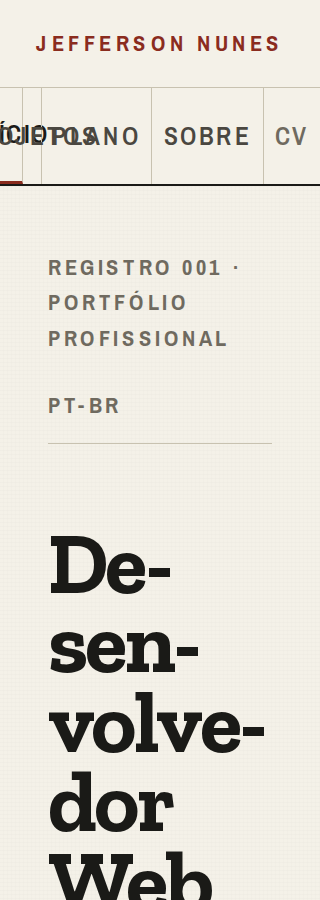
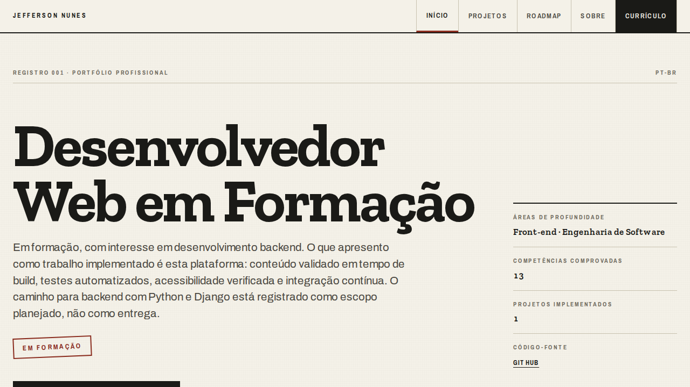

# Auditoria técnica Impeccable — 2026-10-23

## Veredito de integridade

**PASS — o sistema é coerente e específico ao produto.** A interface implementa o fichário de
`DESIGN.md`: tokens de tinta e cartão, hierarquia por filetes, tipografia consistente e a mesma
estrutura entre rotas. A separação entre implementação e intenção está presente no domínio, nos
componentes e nas rotas; o roadmap não se apresenta como software entregue. O detector Impeccable
retornou `[]` para `app/`, `components/` e `lib/og-image.tsx`.

Esse veredito reconhece a coerência do sistema; não libera publicação. Há uma falha de navegação
com texto ampliado e lacunas entre garantias documentadas e testes. A inspeção de publicação T055
permanece aberta.

## Resumo executivo

**Audit Health Score: 15/20 — Bom; corrigir as dimensões mais fracas.**

| Dimensão                     | Nota      | Evidência principal                                                                                                 |
| ---------------------------- | --------- | ------------------------------------------------------------------------------------------------------------------- |
| Acessibilidade               | 2/4       | Texto a 200% em 320 px compromete leitura e acionamento da navegação.                                               |
| Desempenho                   | 4/4       | Rotas pré-renderizadas, payload contido e nenhuma falha de execução observada no ensaio local.                      |
| Responsividade               | 2/4       | Larguras padrão passam; a navegação falha ao combinar celular e texto ampliado.                                     |
| Temas                        | 4/4       | Tokens consistentes, tema escuro e cores forçadas; nenhum problema automático de contraste nos cenários examinados. |
| Integridade da implementação | 3/4       | Identidade consistente; SC-001 e cobertura anunciada de WCAG 2.1 não estão integralmente verificados pelos testes.  |
| **Total**                    | **15/20** | **Bom**                                                                                                             |

Foram confirmados **4 achados: 0 P0, 1 P1, 3 P2 e 0 P3**. A ordem recomendada é corrigir a
navegação ampliada, completar os testes axe, ampliar o alvo do currículo e atender ao critério de
primeira dobra. Nenhuma correção foi aplicada durante a auditoria.

As notas são um diagnóstico da implementação examinada, não uma certificação WCAG nem uma
medição de experiência em produção.

## Achados por severidade

### 1. [P1] Texto ampliado sobrepõe links e altera o destino acionado

- **Localização:** `app/globals.css:370` (`white-space: nowrap`),
  `app/globals.css:1966` (grade compacta) e `tests/e2e/responsive.spec.ts:313`.
- **Categoria:** Acessibilidade / Responsividade.
- **Reprodução:** abrir qualquer rota em 320 px; aplicar
  `document.documentElement.style.fontSize = "200%"`. É o mesmo mecanismo usado pela regressão
  existente, que atualmente o exercita somente em 1280 px.
- **Evidência:** as colunas de “Início” e “Projetos” encolhem para aproximadamente 23,4 px,
  enquanto os rótulos ocupam 77,4 px e 137,5 px. Ambos se sobrepõem e começam fora da viewport.
  A inspeção de `elementFromPoint` confirmou que o centro do rótulo “Início” pertence ao link
  `/projetos`, e a extremidade direita pertence a `/roadmap`. A ausência de scroll horizontal no
  documento não detecta essa sobreposição interna.
- **Impacto:** quem amplia o texto perde legibilidade e pode abrir uma página diferente da
  indicada pelo rótulo tocado. O defeito aparece nas oito rotas auditadas porque o cabeçalho é
  compartilhado.
- **Padrão:** WCAG 2.1 AA, 1.4.4 — Resize Text; FR-020/FR-022 e SC-006.
- **Recomendação:** permitir que a navegação reflua ou empilhe quando o texto não couber, sem
  comprimir os dois primeiros links nem fixar uma altura que impeça a quebra. Acrescentar à
  regressão as combinações de 320/768 px com texto a 200%, verificando os retângulos dos rótulos e
  os destinos acionados, além da largura total do documento.
- **Comando sugerido:** `$impeccable adapt`.

Em 768 px com texto a 200%, também foi medido extravasamento local de “Projetos” e “Currículo”.
O caso de 320 px é o que confirmou perda clara de leitura e de correspondência entre texto e alvo.

### 2. [P2] A cobertura axe anunciada como WCAG 2.1 exclui regras dessa versão

- **Localização:** `tests/e2e/accessibility.a11y.spec.ts:19`,
  `tests/e2e/home.a11y.spec.ts:7` e `tests/e2e/project-detail.a11y.spec.ts:7` e `:15`.
- **Categoria:** Integridade da implementação / Acessibilidade.
- **Evidência:** os testes filtram somente `wcag2a` e `wcag2aa`. A API da versão instalada do
  axe confirmou regras com tags específicas `wcag21a`/`wcag21aa`, incluindo
  `label-content-name-mismatch`, `autocomplete-valid`, `avoid-inline-spacing` e
  `css-orientation-lock`.
- **Impacto:** o gate pode ficar verde após uma regressão em critérios que seu nome e a
  documentação afirmam cobrir. A regressão dedicada dos nomes da navegação cobre um caso, sem
  equivaler ao conjunto de regras ausentes.
- **Padrão:** lacuna de verificação de FR-022; não constitui, por si só, uma violação da interface.
- **Recomendação:** acrescentar `wcag21a` e `wcag21aa` a todas as chamadas e manter cobertura
  representativa de mobile/desktop e temas claro/escuro.
- **Comando sugerido:** `$impeccable harden`.

A varredura adicional desta auditoria já incluiu as quatro tags em 32 cenários e não encontrou
violações. O problema é a permanência dessa garantia no CI.

### 3. [P2] O acesso ao currículo tem alvo estreito no celular

- **Localização:** `app/globals.css:1966` e `app/globals.css:1972`.
- **Categoria:** Responsividade.
- **Evidência:** em 320 px, o link “CV” mede **28,75 × 48 px** em todas as rotas, nos dois
  temas. A grade reserva uma coluna `auto`, e a regra define altura mínima sem largura mínima.
- **Impacto:** a saída principal para recrutamento exige precisão maior de toque e fica junto
  ao alvo “Sobre”.
- **Padrão:** abaixo da referência de 44 × 44 px do audit e do critério AAA 2.5.5. Não foi
  classificado como violação WCAG 2.1 AA.
- **Recomendação:** garantir pelo menos 44 px nos dois eixos e ajustar a distribuição das cinco
  colunas. Validar em conjunto com o refluxo do achado 1; aumentar somente a largura do CV pode
  comprimir ainda mais os primeiros links.
- **Comando sugerido:** `$impeccable adapt`.

### 4. [P2] Competências ficam fora da primeira dobra exigida por SC-001

- **Localização:** `app/globals.css:426`, `app/page.tsx:106` e
  `tests/e2e/home.spec.ts:60`; requisito em
  `specs/001-experiencia-publica-inicial/spec.md:207`.
- **Categoria:** Integridade da implementação / Layout responsivo.
- **Evidência:** em 1280 × 720 px, o hero termina em aproximadamente **y = 971 px** e os quatro
  cabeçalhos de competências começam em **y = 1170–1172 px**. Também ficam abaixo da primeira
  dobra no cenário de 1280 × 900 px. O registro do hero mostra duas áreas e uma contagem; não
  substitui as competências agrupadas de profundidade e complementares exigidas por SC-001.
- **Impacto:** o recrutador precisa rolar para avaliar as competências, embora esse conteúdo
  devesse estar disponível imediatamente segundo o critério aprovado.
- **Padrão:** SC-001; não é uma violação WCAG por si só.
- **Recomendação:** compactar a composição inicial ou reposicionar as competências para atender
  à primeira dobra, preservando texto, legibilidade e conteúdo factual. Acrescentar asserções de
  viewport para as competências: `toBeVisible()` sozinho não garante presença na primeira dobra.
  Não alterar o requisito aprovado como parte de uma correção de layout.
- **Comando sugerido:** `$impeccable layout`.

## Padrões sistêmicos

1. **As asserções são mais estreitas que as garantias documentadas.** O zoom é testado somente em
   desktop; as competências recebem `toBeVisible()` sem limite de viewport; o axe omite tags da
   versão anunciada. Os 64 E2E verdes coexistem com os achados porque essas condições escapam à
   cobertura atual.
2. **Compacidade da navegação depende de uma única escala de texto.** A grade dá precedência às
   três colunas `auto`, comprimindo as duas primeiras quando a fonte cresce. A ausência de largura
   mínima no CV produz o problema oposto em escala normal.

## Pontos positivos e falsos positivos descartados

- Headings, landmarks, listas, nomes das navegações, skip link e ordem DOM/visual estão coerentes
  na revisão semântica. A suíte confirma tabulação e foco nas oito rotas.
- Imagens de índice são decorativas e usam `alt=""` intencionalmente; o conteúdo relevante está
  no texto adjacente. Não foram reportadas como alternativas ausentes.
- O tema escuro usa os mesmos tokens e mantém contraste nos cenários examinados. Os testes de
  cores forçadas preservam estados e foco.
- A preferência por movimento reduzido remove a rolagem suave e preserva feedback cromático. Não
  há animação espacial ativa cuja informação seja perdida pelo override global de animações.
- Cores literais em imagens OG, ícone e impressão pertencem a saídas específicas; não foram
  tratadas como vazamentos do tema da interface.
- As rotas continuam pré-renderizadas. Não há dependência de runtime adicional além de
  Next/React, varredura de layout em loops, animação de layout ou uso amplo de `will-change`.
- Na primeira visita mobile observada: quatro fontes somaram **87.600 bytes**, nove recursos JS
  somaram **140.816 bytes** e o CSS **6.831 bytes** de corpo codificado transferido. O orçamento
  tipográfico de 100 KiB e a navegação cliente passaram nos E2E existentes.
- A varredura local registrou LCP entre 44 e 220 ms, CLS máximo de 0,0081 e nenhum erro de
  JavaScript. Esses números vêm de Chromium local, sem limitação de CPU/rede; não representam
  Core Web Vitals de usuários reais e não justificam garantia de desempenho em produção.

## Validações executadas

| Verificação                                              | Resultado                                                                                              |
| -------------------------------------------------------- | ------------------------------------------------------------------------------------------------------ |
| Detector Impeccable em `app components lib/og-image.tsx` | Nenhum achado mecânico (`[]`).                                                                         |
| `npm run build`                                          | Passou com Next.js 16.4.2/Turbopack; rotas estáticas/SSG preservadas.                                  |
| `npm run lint`                                           | Passou.                                                                                                |
| `npm run typecheck`                                      | Passou.                                                                                                |
| `npm run test -- --run`                                  | 7 arquivos, 43 testes passaram.                                                                        |
| `npm run test:e2e -- --workers=2 --reporter=line`        | 64 testes passaram, incluindo 21 de acessibilidade.                                                    |
| Axe com tags WCAG 2.0 e 2.1 A/AA                         | 8 rotas × 2 larguras (320/1280 px) × 2 temas; zero violações automáticas.                              |
| Geometria em escala normal                               | Sem overflow horizontal do documento nos 32 cenários adicionais.                                       |
| Texto a 200% em 320/768 px                               | Detectou overflow interno da navegação nas 8 rotas; confirmado por screenshot e hit testing em 320 px. |
| Revisão visual                                           | Capturas desktop/mobile das 8 rotas, tema escuro e confirmação do caso ampliado.                       |
| Revisão semântica especializada                          | Sem outro defeito confirmado; apontou a lacuna de tags axe descrita no achado 2.                       |
| `git diff --check`                                       | Passou antes e após a criação deste relatório.                                                         |

As primeiras tentativas de E2E foram impedidas pelo isolamento de rede (`EPERM` no acesso ao
servidor local). A execução concluída usou a permissão do ambiente para comunicação local entre
Playwright e Next.js. O aviso do Vite sobre uma mudança futura de carregamento de configuração
não impediu os 43 testes unitários.

Não foram executados leitor de tela real, validação em Safari/Firefox, teste em aparelho físico,
medição de INP de campo ou verificação de preview/canário. T055 permanece pendente; esta auditoria
não foi registrada como inspeção humana nem como aprovação de publicação.

## Ações recomendadas

1. **[P1/P2] `$impeccable adapt`** — corrigir a navegação com texto ampliado e garantir o alvo do
   currículo, com regressão combinando escala e largura.
2. **[P2] `$impeccable harden`** — incluir as tags WCAG 2.1 e consolidar os cenários adicionais
   relevantes no CI.
3. **[P2] `$impeccable layout`** — atender a SC-001 e verificar a geometria das competências na
   primeira dobra.
4. **`$impeccable polish`** — confirmar o acabamento após as correções.

Os comandos podem ser executados individualmente, todos juntos ou na ordem escolhida pelo
proprietário. Reexecutar `$impeccable audit` após as correções para atualizar a pontuação.

Somente este relatório e suas duas imagens de evidência foram adicionados. Alterações
preexistentes de implementação, conteúdo, especificações e testes foram preservadas; nenhuma
tarefa foi marcada como concluída.
