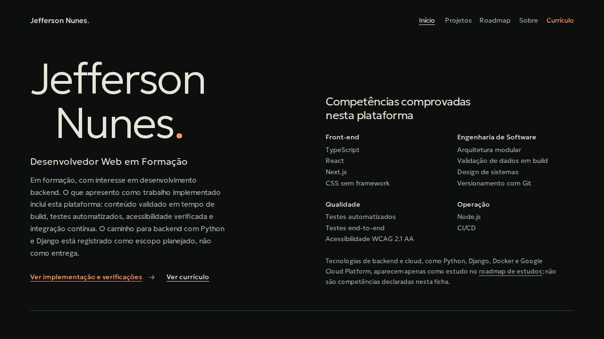
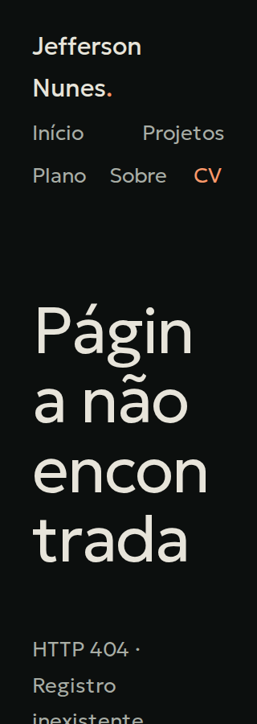

# Correções integradas Impeccable — 2026-10-24

Executados em conjunto **adapt, harden, layout, optimize e polish**, conforme autorização do
proprietário após a [auditoria técnica](impeccable-2026-10-24.md). A implementação usa a direção
**Minimalismo escuro**, já aprovada, e conclui a migração local de T102–T105. Não houve alteração
de requisitos, dados de `content/`, schema, dependências, PDF ou destinos públicos. Não houve
commit, push ou deploy.

## Achados tratados

| Achado original                          | Correção                                                                                                                                           | Evidência de validação                                                                                             |
| ---------------------------------------- | -------------------------------------------------------------------------------------------------------------------------------------------------- | ------------------------------------------------------------------------------------------------------------------ |
| P1 — corte e overflow com texto ampliado | Quebra segura de texto, colunas `minmax(0, 1fr)`, mínimos de grade corrigidos e retirada do recorte do conteúdo.                                   | Todas as nove rotas passam com texto a 200% em 320/768/1280 px, inclusive disclosures abertos.                     |
| P2 — alvos estreitos                     | Os cinco destinos do menu reservam largura e altura mínimas de 44px, com quebra em linhas quando necessário.                                       | Dimensões e hit testing dos centros verificados em 320/390/768/1280 px.                                            |
| P2 — competências fora da primeira dobra | Autoria, posicionamento/descrição integrais e quatro grupos de competências compartilham a abertura.                                               | Em 1280 × 720, a descrição termina em y = 550,6 px e todos os itens de competências até y = 520,3 px, sem rolagem. |
| P2 — cobertura WCAG 2.1 incompleta       | Todos os quatro pontos axe incluem `wcag21a`/`wcag21aa`; regressões rejeitam contraste inconclusivo nos cenários de rota e detalhes abertos.       | Suíte final de acessibilidade passou, com fundos sólidos no lugar de terreno e degradês.                           |
| P2 — CPU do terreno decorativo           | SurveyOpening, cálculo de isolinhas, eventos de ponteiro e animações foram removidos; BuildEvidence entrega HTML/SVG estático e disclosure nativo. | Comprovação funciona sem JavaScript; medição de primeira visita e orçamento de recursos registrados abaixo.        |

O acabamento preserva a assinatura em duas linhas e seu ponto, o estado da rota atual,
foco âmbar, cores forçadas, movimento reduzido, fontes locais e a composição aberta.
Um ajuste de confirmação manteve a seta do diagrama dentro da caixa da etapa; os testes de
refluxo não foram afrouxados. O ponto da assinatura também acompanha o sobrenome quando o
texto do cabeçalho quebra linha.

## Conteúdo e funcionalidades preservados

- Home, catálogo, estudos completos, roadmap, Sobre, currículo HTML/PDF e os estados 404/erro
  continuam disponíveis, com navegação cliente e metadados próprios.
- Nana Silva fica textual na home, catálogo e detalhe, conforme FR-006a. Campo de imagem,
  arquivo e metadados permanecem; estado em andamento/em validação, demonstração, limitações
  e contato para solicitação de código privado continuam acessíveis.
- A imagem ilustrativa da plataforma foi adaptada ao sistema e conserva proporção 5:3 e
  fallback. Os dados e arquivos dos demais projetos não foram removidos.
- As decisões resumidas dos cartões são derivadas do JSON, com link ao estudo completo.
  Nenhuma afirmação ou competência foi criada a partir dos exemplos fictícios do protótipo.
- Comprovação usa `details`/`summary` nativos, operáveis por Enter/Espaço mesmo sem JavaScript.
  A substituição do Escape customizado anterior foi registrada no plano antes de implementar.
- A separação entre trabalho implementado e intenção de estudo permanece verificável no
  build e nos fluxos. Acervo e Intervalo não entraram na aplicação.

## Desempenho antes/depois

Mesmo Chromium local, primeira visita, mobile de 390 × 844 px, CPU com redução de velocidade
4×, latência de 150 ms e download de 1,6 Mbps. As amostras são de laboratório, não percentis,
INP ou Core Web Vitals de usuários reais.

| Medida                                      | Antes                       | Após retirar o terreno     |
| ------------------------------------------- | --------------------------- | -------------------------- |
| LCP mobile                                  | 1.024 ms                    | 680 ms                     |
| CLS mobile                                  | 0                           | 0                          |
| Tarefas longas observadas durante a entrada | 284, 104, 332 e 51 ms       | 65 e 247 ms                |
| Fontes, corpo codificado                    | 35.340 bytes / 2 fontes     | 24.964 bytes / 1 fonte     |
| JavaScript, corpo codificado                | 143.425 bytes / 10 recursos | 140.803 bytes / 9 recursos |
| CSS, corpo codificado                       | 7.817 bytes                 | 5.387 bytes                |
| LCP desktop local sem limitação             | 232 ms                      | 80 ms                      |

O custo específico da geração de terreno deixou de existir. Há trabalho de inicialização e
hidratação restante; a entrega não afirma ausência de bloqueio da thread principal. O teto
tipográfico de 100 KiB foi mantido, e o teste agora exige somente Geologica.

## Validações

- `npm run typecheck` e `npm run lint`: passaram, incluindo nova execução após o ajuste final.
- `npm run test -- --run`: **45 testes em 8 arquivos passaram**. O aviso preexistente do Vite
  sobre uma futura mudança do carregador de configuração não impediu a execução.
- `npm run build`: passou com Next.js 16.4.2/Turbopack; geração estática/SSG preservada.
- `npm run test:e2e -- --workers=2 --reporter=line`: **75 testes passaram** no lote final,
  incluindo 25 marcados como acessibilidade, sem desativar regras.
- A primeira execução E2E teve 70/75 aprovados; as cinco falhas tinham a mesma causa no
  conector externo do diagrama. A correção foi feita no CSS, mantendo as asserções.
- Detector do lote de implementação: `[]`. Os 13 avisos tipográficos da direção anterior
  foram eliminados pela migração, sem nova supressão de regras ou valores.
- Inspeção inicial em lote: desktop e celular, páginas completas e detalhes abertos.
  A confirmação cobre as nove rotas em 320/390/768/1280 px, com análise axe mobile adicional.
- Revisões independentes: conteúdo, constituição, semântica de acessibilidade e código, sem
  bloqueadores confirmados; a consolidação final segue o papel `pr-reviewer` do projeto.
- A confirmação final registrou **36 cenários sem overflow**, nenhum erro de página e nove
  análises axe mobile sem violações nem contraste inconclusivo. A revisão consolidada retornou
  **Green**, após inspecionar as capturas e os resultados.
- Formatação, diff e links locais do relatório foram conferidos antes da entrega.

O probe adicional de confirmação exigiu corrigir seu contexto de navegador explícito para
o axe; essa falha era do script temporário de inspeção, sem alteração da aplicação ou dos
75 testes aprovados.

## Limites preservados

T055 continua aberta: não foram realizados leitor de tela real, teste em aparelho físico,
Safari/Firefox ou inspeção de preview/canário. A confirmação automatizada e visual do agente
não foi registrada como aprovação humana de publicação.

O hook informou que `DESIGN.md` é mais recente que o sidecar local
`.impeccable/design.json`. O aviso foi registrado; não foi executado `document` nem reparado
estado local como efeito colateral. Os valores canônicos do frontmatter permanecem os sete
tokens e os papéis aprovados, usados na aplicação e na validação.

A auditoria original e suas duas imagens, já presentes no workspace no início deste pedido,
foram preservadas como evidência anterior às correções.
