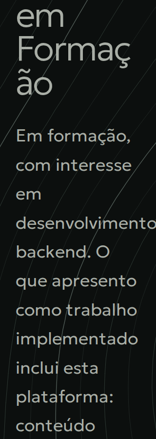
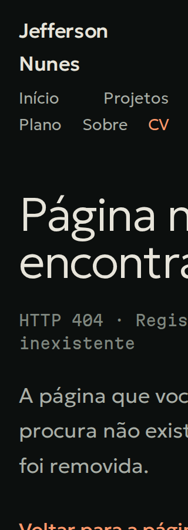

# Auditoria técnica Impeccable — 2026-10-24

## Veredito de integridade

**PASS — a implementação expressa um sistema coerente e específico ao portfólio.** A linguagem
topográfica, os tokens noturnos, a distinção entre software implementado e planejamento e os
estudos de caso permanecem consistentes entre rotas. Isso não significa aprovação de publicação:
os achados abaixo ainda precisam de tratamento.

Esta auditoria examina o código em `8545032`, com árvore Git inicialmente limpa. A referência
aplicável ao visual implementado é
[`Levantamento e sondagem`](../referencias-visuais/design-levantamento-sondagem.md).
O `DESIGN.md` atual registra **Minimalismo escuro**, aprovado e ainda não migrado, conforme
T102–T105. A diferença entre esses dois visuais é uma transição documentada, não um novo defeito.
Nenhum requisito ou artefato de direção foi alterado.

O detector foi executado sobre `app/`, `components/`, `lib/` e `content/`. Retornou **13 avisos
consultivos**, todos de tamanho tipográfico fora da escala do novo `DESIGN.md`, e nenhum achado
de outra regra. Os avisos foram conferidos no CSS: linhas 533, 547, 694, 830, 874, 936, 1065,
1102, 1170, 1419, 1465, 1526 e 1643. São divergências esperadas na migração pendente e foram
descartados como defeitos desta auditoria; não se criaram exceções para escondê-los. O comando
encerrou com código 2 apesar de listar somente avisos consultivos; o resultado foi julgado pelo
conteúdo, sem declarar que o detector retornou uma lista vazia.

## Resumo executivo

**Audit Health Score: 14/20 — Bom; corrigir as dimensões mais fracas.**

| #   | Dimensão                     | Nota      | Evidência principal                                                                 |
| --- | ---------------------------- | --------- | ----------------------------------------------------------------------------------- |
| 1   | Acessibilidade               | 2/4       | Texto a 200% em 320 px sofre corte; os cenários axe não comprovam todo o contraste. |
| 2   | Desempenho                   | 3/4       | Carga contida e LCP local rápido; geração decorativa ocupa CPU no carregamento.     |
| 3   | Responsividade               | 2/4       | Escala normal funciona; texto ampliado provoca overflow em quatro rotas.            |
| 4   | Temas                        | 4/4       | Tema escuro intencional, tokens compartilhados e suporte a cores forçadas.          |
| 5   | Integridade da implementação | 3/4       | Sistema coerente; SC-001 e cobertura declarada do gate ainda têm lacunas.           |
|     | **Total**                    | **14/20** | **Bom**                                                                             |

**5 achados confirmados: 0 P0, 1 P1, 4 P2 e 0 P3.** Os principais são o refluxo com texto
ampliado, o acesso estreito ao currículo no celular, a ausência de competências na primeira
dobra e a cobertura incompleta do gate WCAG 2.1. O quinto achado trata do trabalho decorativo na
thread principal da home.

Prioridade: corrigir o refluxo, melhorar os alvos de toque e consolidar as verificações; atender
SC-001 e eliminar o custo do terreno na migração já aprovada. Nenhuma correção foi aplicada.
As notas são diagnósticas, não certificação WCAG nem resultados de usuários em produção.

## Achados por severidade

### 1. [P1] Texto a 200% causa corte e rolagem horizontal em telas estreitas

- **Localização:** `app/globals.css:454` (`overflow: clip` da abertura), `:543`
  (`.hero__description`), `:612` (grade da legenda), `:1061` (`.page-intro__lead`), `:1294`
  (listas do currículo), `:1448` (`.message-page__body`), `:1570` e `:1651`
  (grades do currículo). Cobertura insuficiente em `tests/e2e/responsive.spec.ts:318`.
- **Categoria:** Acessibilidade / Responsividade.
- **Reprodução:** viewport de 320 × 900 px; executar
  `document.documentElement.style.fontSize = "200%"`. É o mesmo mecanismo do teste existente,
  que o exercita apenas em 1280 px.
- **Evidência:** em `/projetos`, o documento cresce para **340 px**; em `/curriculo`, **325 px**;
  na 404 global, **434 px**; na 404 de projeto, **438 px**. Nas duas 404, uma coluna implícita
  da grade cresce para 402/406 px dentro de um contêiner de 256 px, levando títulos, texto e
  ação de retorno para fora da viewport. Na home, a descrição tem `scrollWidth = 290 px` dentro
  de `clientWidth = 256 px`; o corte da seção esconde parte de palavras como
  “desenvolvimento”, mesmo com `document.scrollWidth = 320 px`. A legenda também extravasa.
- **Causa:** parágrafos sem quebra de palavras longas e grades com dimensionamento mínimo
  intrínseco maior que a coluna disponível. O corte usado na camada decorativa também atinge
  conteúdo textual da abertura. Medir somente o documento não detecta esse último caso.
- **Impacto:** visitantes que precisam ampliar texto perdem trechos do posicionamento ou
  precisam deslocar a página lateralmente para ler e encontrar a ação de recuperação.
- **Padrão:** FR-020/FR-022 e SC-006. O corte de texto ampliado contraria o objetivo de
  preservar conteúdo e funcionalidade de
  [WCAG 2.1 AA, 1.4.4 — Resize Text](https://www.w3.org/WAI/WCAG21/Understanding/resize-text.html).
  A combinação usada aqui testa ampliação de texto; não foi confundida com um ensaio separado
  de zoom integral do navegador a 400%.
- **Recomendação:** permitir quebra segura dos textos, restringir as colunas de conteúdo com
  `minmax(0, 1fr)` e os mínimos dos seus itens, e limitar o recorte à decoração. Preservar todo
  o texto. Incluir 320 e 768 px com fonte a 200% nos testes, verificando contêineres internos
  e retângulos dos textos, além da largura do documento.
- **Comando sugerido:** `$impeccable adapt`.

A antiga sobreposição entre os links do menu, descrita na auditoria de 2026-10-23, **não foi
reproduzida no código atual**: o menu quebra em linhas, e os centros dos cinco alvos continuam
correspondendo aos destinos em 320 px/200%. O problema atual é o conteúdo abaixo dele.

### 2. [P2] Alvos de navegação ficam estreitos, sobretudo o currículo

- **Localização:** `app/globals.css:345` e `:1742`; rótulos em
  `components/layout/Header.tsx:9`.
- **Categoria:** Responsividade.
- **Evidência:** em 320 px e texto normal, os links do cabeçalho medem **33 × 44 px**
  (“Início”), **36 × 44 px** (“Plano”), **39 × 44 px** (“Sobre”) e **19 × 44 px** (“CV”).
  As mesmas medidas se repetem nas nove rotas, pois o cabeçalho é compartilhado.
- **Impacto:** o currículo, uma saída importante para recrutamento, exige precisão de toque
  maior que os demais destinos; o espaço visual ao redor do texto não integra o link.
- **Padrão:** abaixo da referência de 44 × 44 px deste audit. Esse tamanho pertence ao
  [critério WCAG 2.1 AAA, 2.5.5 — Target Size](https://www.w3.org/WAI/WCAG21/Understanding/target-size.html),
  com exceções, inclusive para destinos equivalentes. Não foi classificado como violação AA.
  Links dentro de frases não foram automaticamente considerados defeitos de tamanho.
- **Recomendação:** reservar área clicável de pelo menos 44 px nos dois eixos e redistribuir
  os cinco destinos sem perder o refluxo atual. Incluir as dimensões reais dos links na
  regressão mobile; altura mínima sozinha não basta.
- **Comando sugerido:** `$impeccable adapt`.

### 3. [P2] Competências continuam fora da primeira dobra exigida por SC-001

- **Localização:** `app/page.tsx:192` e `:201`; `tests/e2e/home.spec.ts:60` e `:75`;
  requisito em `specs/001-experiencia-publica-inicial/spec.md:222`.
- **Categoria:** Integridade da implementação / Responsividade.
- **Evidência:** em **1280 × 720 px**, os quatro grupos de competências começam em
  **y = 2599,7 px**. Estão depois dos dois projetos e do registro de CI. O resumo da abertura
  informa duas áreas e uma contagem de 13 competências, sem apresentar as competências
  agrupadas exigidas. A seção também ficaria fora de uma dobra de 900 px.
- **Impacto:** o recrutador precisa percorrer vários blocos para avaliar a base técnica,
  apesar de o critério aprovado exigir esse conteúdo imediatamente acessível.
- **Padrão:** SC-001 e preservação expressa em T102. Não é uma violação WCAG por si só.
- **Recomendação:** incorporar as competências por área à composição inicial durante T102,
  preservando legibilidade e conteúdo factual. Verificar a presença na viewport: o teste
  atual usa `toBeVisible()` para as competências, mas limita a posição somente de título e
  descrição; elementos abaixo da dobra também satisfazem `toBeVisible()`.
- **Comando sugerido:** `$impeccable layout`.

### 4. [P2] O gate anunciado como WCAG 2.1 omite regras específicas dessa versão

- **Localização:** `tests/e2e/accessibility.a11y.spec.ts:20`,
  `tests/e2e/home.a11y.spec.ts:7` e `tests/e2e/project-detail.a11y.spec.ts:8` e `:16`.
- **Categoria:** Integridade da implementação / Acessibilidade.
- **Evidência:** os quatro pontos usam apenas `wcag2a` e `wcag2aa`. A API do axe instalado
  confirmou quatro regras nas tags `wcag21a`/`wcag21aa`: `autocomplete-valid`,
  `avoid-inline-spacing`, `css-orientation-lock` e `label-content-name-mismatch`.
  A varredura adicional deste audit incluiu as quatro tags em **18 cenários** e encontrou
  **zero violações automáticas**.
- **Impacto:** regressões em regras omitidas podem passar pelo CI, embora o gate declare
  cobertura dessa versão. A verificação própria dos nomes da navegação cobre um caso,
  sem substituir o conjunto de regras ausente.
- **Padrão:** lacuna de verificação de FR-022 e da garantia anunciada. Não prova uma violação
  atual desses critérios na interface.
- **Recomendação:** incluir `wcag21a` e `wcag21aa` em todas as chamadas. Manter os cenários
  mobile e o julgamento dos resultados inconclusivos. O axe retornou `color-contrast` como
  **inconclusivo**, devido a fundos em gradiente, em todos os 18 cenários: por exemplo,
  **39 nós na home desktop** e **72 no roadmap desktop**. Revisar esses fundos e a
  composição atrás do texto; zero violações não significa que todo contraste foi validado.
- **Comando sugerido:** `$impeccable harden`.

### 5. [P2] O terreno decorativo consome CPU na thread principal durante a entrada

- **Localização:** `components/home/SurveyOpening.tsx:55`, `:67`, `:117` e `:178`.
- **Categoria:** Desempenho.
- **Evidência:** no ensaio de primeira visita mobile com CPU 4× mais lenta e rede de
  1,6 Mbps/150 ms, foram observadas tarefas longas de **284, 104, 332 e 51 ms** durante a
  entrada. Uma captura adicional do perfil de CPU, com a mesma redução de CPU e rede local,
  registrou aproximadamente **202 ms de amostras nas funções do chunk de `SurveyOpening`**,
  incluindo o cálculo de cotas e o passo da geração. Esses dois ensaios não permitem atribuir
  cada tarefa longa individualmente ao componente.
- **Causa verificável:** o limite de 8 ms é consultado entre níveis completos; a amostragem
  inicial de 20.691 pontos, cada isolinha sobre 20.400 células e a montagem final dos caminhos
  continuam síncronas. O desenho é gerado também em aparelhos de toque, onde não há paralaxe.
- **Impacto:** trabalho sem informação essencial compete com hidratação e interação inicial
  em aparelhos modestos. É uma oportunidade de reduzir bloqueio, apesar dos bons números de
  carregamento visual. Não foi medida latência real de interação nem INP de campo.
- **Padrão:** qualidade de desempenho, sem violação WCAG atribuída.
- **Recomendação:** aproveitar T102, que já prevê retirar terreno e efeitos, para eliminar
  esse trabalho. Se for necessário manter a versão atual por mais tempo, particionar a
  amostragem e os laços internos ou pré-calcular um recurso decorativo separado, sem devolver
  centenas de KB de coordenadas ao HTML/RSC. Evitar otimizar uma direção que será removida sem
  necessidade de sustentá-la nesse intervalo.
- **Comando sugerido:** `$impeccable optimize`.

## Padrões sistêmicos

1. **Os gates verificam menos que as garantias declaradas.** O zoom é testado apenas em desktop,
   as competências recebem uma asserção de visibilidade sem limite de viewport, e o axe omite
   tags WCAG 2.1. Isso explica os 73 E2E verdes coexistindo com os achados.
2. **A largura do documento não basta para validar refluxo.** A home corta conteúdo sem ampliar
   o documento, enquanto as grades do currículo e das 404 expandem suas colunas internamente.
3. **A migração pendente concentra correções úteis.** T102 pode resolver primeira dobra e CPU
   decorativa; T104 pode incorporar o refluxo das rotas secundárias e dos estados de erro.
   Não é necessário trocar requisitos nem iniciar outro redesenho para tratar esses pontos.

## Pontos positivos e falsos positivos descartados

- Um `h1` por rota, hierarquia coerente, landmarks, navegações nomeadas, listas semânticas,
  skip link funcional e foco visível. A revisão semântica especializada não confirmou outro
  defeito de markup além das lacunas de verificação descritas.
- O disclosure usa botão nativo, `aria-expanded`, `aria-controls`, conteúdo oculto e Escape
  devolvendo foco. Nos seis cenários adicionais de abertura, o botão focado manteve seu
  retângulo dentro da viewport; não foi reportado como foco perdido sem evidência suficiente.
- As fichas ilustrativas têm `alt=""` intencional: são decoração, e o conteúdo relevante está
  no texto. Status são textuais, e planejamento não se apresenta como software entregue.
- Em escala normal, as nove rotas funcionam sem overflow em 320, 390, 768 e 1280 px.
  As duas 404 oferecem ações de recuperação. Nenhum erro de JavaScript foi observado no probe.
- Tema escuro único é uma decisão explícita, não falta de modo claro. Preferências de sistema
  claras/escuras mantiveram fundo `#0c0f0e` e texto `#e7e4da` nas três rotas verificadas.
  Cores forçadas e movimento reduzido possuem alternativas específicas; os testes passaram.
- Os pares de tokens sobre fundos sólidos apresentam bom contraste: texto principal sobre
  terreno **15,14:1**, texto secundário **8,52:1**, texto discreto sobre superfície **4,93:1**
  e foco sobre terreno **11,82:1**. Esses cálculos não substituem a revisão dos fundos
  compostos que o axe deixou inconclusivos.
- Duas fontes servidas localmente pelo build somaram **35.340 bytes** de corpo codificado;
  dez recursos JS, **143.425 bytes**; CSS, **7.817 bytes** na primeira visita medida.
  O orçamento de fontes e a navegação cliente passaram. As rotas continuam estáticas/SSG,
  e as imagens de projeto usam carregamento adiado e proporção reservada no CSS.
- A paralaxe agrupa eventos com `requestAnimationFrame`, lê medidas antes de escrever estilos
  e limita `will-change` às três camadas em condições compatíveis. Não há evidência de
  layout thrashing nem motivo para exigir memoização indiscriminada.
- As cores literais de máscaras, transparências, SVGs, imagens OG e impressão têm contexto
  próprio. Não foram convertidas em um achado genérico de “cores fora de tokens”.

## Validações executadas

| Verificação                                       | Resultado                                                                                                                                                                |
| ------------------------------------------------- | ------------------------------------------------------------------------------------------------------------------------------------------------------------------------ |
| `npm run build`                                   | Passou com Next.js 16.4.2/Turbopack; 18 páginas geradas, rotas estáticas/SSG.                                                                                            |
| `npm run lint`                                    | Passou, sem alterações automáticas.                                                                                                                                      |
| `npm run typecheck`                               | Passou.                                                                                                                                                                  |
| `npm run test:e2e -- --workers=2 --reporter=line` | **73 testes passaram**, incluindo funcional, responsividade, fontes, metadados e a11y.                                                                                   |
| Detector Impeccable                               | 13 avisos tipográficos consultivos, contextualizados acima; nenhum defeito adicional confirmado pelo detector.                                                           |
| Probe de geometria                                | 9 rotas × 6 combinações = **54 cenários**: 320/390/768/1280 px a 100%, 320/768 px a 200%.                                                                                |
| Axe adicional, WCAG 2.0 e 2.1 A/AA                | 9 rotas × 2 larguras (320/1280 px) = **18 análises**, zero violações; contraste inconclusivo registrado.                                                                 |
| Inspeção visual                                   | Capturas desktop/mobile das nove rotas; revisão da home, catálogo, dois estudos de caso, roadmap, Sobre, currículo e 404, mais confirmação dos cortes em texto ampliado. |
| Primeira visita desktop local                     | LCP **232 ms**, CLS **0**; uma tarefa longa de **122 ms**.                                                                                                               |
| Primeira visita mobile simulada                   | 390 × 844 px, CPU 4×, latência 150 ms, 1,6 Mbps: LCP **1.024 ms**, CLS **0**, tarefas longas registradas no achado 5.                                                    |
| Perfil de CPU de confirmação                      | CPU 4×, rede local; confirmou tempo relevante no chunk da abertura.                                                                                                      |
| Revisão semântica                                 | Executada conforme `.claude/agents/a11y-auditor.md`; sem edição de código.                                                                                               |

`npm run format:check`, `git diff --check` e a conferência dos links locais do relatório passaram.
O estado final do Git contém apenas este relatório e suas duas imagens novas.

Os primeiros comandos de navegador no isolamento encontraram `EPERM` na conexão local. Uma
tentativa inicial de E2E também reconstruiu `.next` com o servidor aberto, produzindo erros
temporários de manifesto ausente no log desse servidor. A execução final e os probes posteriores
usaram o build completo: todas as respostas tiveram os status esperados, 200 ou 404. A
execução concluída usou a permissão do ambiente para Playwright acessar o servidor de produção
em `localhost:3001`; os resultados acima pertencem às execuções efetivamente concluídas.

Os números de desempenho são amostras locais de laboratório, não percentis nem Core Web Vitals
de produção. Não houve leitor de tela real, Safari/Firefox, aparelho físico ou verificação de
preview/canário. A suíte unitária não foi reexecutada: não houve mudança de implementação, e o
escopo de execução foi build, análise estática e interface. T055 permanece pendente.

## Ações recomendadas

1. **[P1/P2] `$impeccable adapt`** — resolver corte e overflow com texto ampliado e reservar
   área de toque para o menu, principalmente “CV”, preservando sua quebra em linhas.
2. **[P2] `$impeccable harden`** — completar as tags WCAG 2.1 e tratar a revisão de contraste
   inconclusivo, com regressões proporcionais aos cenários confirmados.
3. **[P2] `$impeccable layout`** — atender SC-001 durante T102, verificando competências na
   primeira dobra com geometria real.
4. **[P2] `$impeccable optimize`** — eliminar o custo decorativo junto de T102; otimizar o
   gerador atual somente se for necessário mantê-lo antes da migração.
5. **`$impeccable polish`** — revisar o acabamento depois das correções.

Você pode pedir a execução desses comandos individualmente, todos juntos ou na ordem que
preferir. Reexecute `$impeccable audit` após as correções para atualizar a pontuação.

Somente este relatório e duas imagens de evidência foram adicionados. Não houve alteração da
interface, de conteúdo publicado, de dependências ou de especificações; nenhuma tarefa foi
marcada como concluída, e não houve commit ou deploy.
